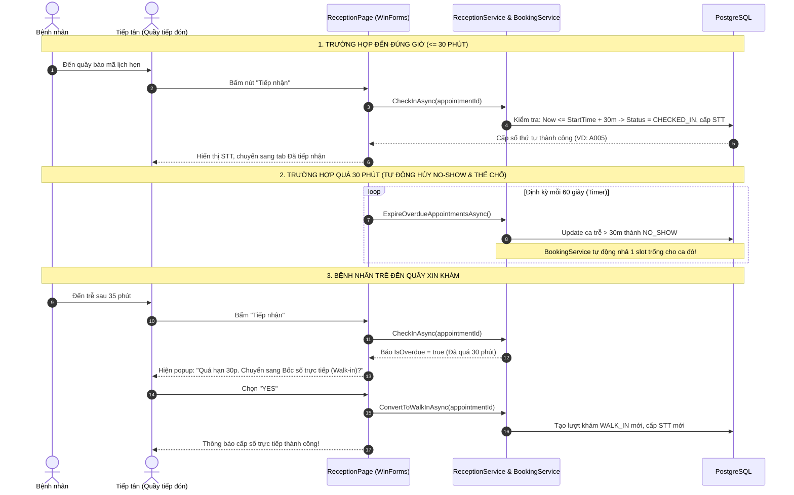

# BÁO CÁO THAY ĐỔI & TINH CHỈNH HỆ THỐNG (CHANGED.MD)

**Tính năng:** Cơ chế Check-in tại quầy, Tự động hủy quá hạn 30 phút (No-Show), Chuyển sang khám trực tiếp (Walk-in) & Tự động hồi phục Slot đặt lịch.  
**Ngày thực hiện:** 01/11/2026  
**Phạm vi:** `HIS.Domain`, `HIS.BLL`, `HIS.WinForms`

---

## 1. TỔNG QUAN YÊU CẦU NGHIỆP VỤ ĐÃ HIỆN THỰC

1. **Xác nhận có mặt (Check-in):** Nhân viên quầy tiếp nhận xác nhận bệnh nhân đã đến viện để chuyển trạng thái từ `CONFIRMED` / `PENDING` sang `CHECKED_IN` và cấp số thứ tự vào phòng khám.
2. **Tự động hủy sau 30 phút (Auto No-Show):** Nếu sau 30 phút so với giờ hẹn mà bệnh nhân chưa đến check-in, hệ thống tự động đánh dấu lượt khám là `NO_SHOW` (Không đến) và ghi lịch sử trạng thái.
3. **Chuyển sang bốc số trực tiếp (Walk-in) khi đến trễ:** Khi bệnh nhân đến trễ sau 30 phút, tiếp tân bấm tiếp nhận sẽ nhận được cảnh báo quá hạn kèm gợi ý: **"Chuyển sang bốc số khám trực tiếp"**. Nếu đồng ý, hệ thống tái sử dụng hồ sơ bệnh nhân cũ và cấp số thứ tự trực tiếp mới (`WALK_IN`).
4. **Giải phóng Slot trong cơ chế Đặt lịch (`BookingService`):** Khi một lịch hẹn bị hủy hoặc đánh dấu `NO_SHOW`, ca khám đó lập tức được nhả chỗ trống (Available) để bệnh nhân khác hoặc bệnh nhân khám trực tiếp có thể thế vào chỗ đó.
5. **Tiến trình quét ngầm định kỳ (Background Timer):** Tích hợp Timer chạy ngầm mỗi 1 phút trên màn hình tiếp nhận WinForms để tự động quét dọn các ca quá hạn và tự động làm mới giao diện.

---

## 2. CHI TIẾT CÁC FILE ĐÃ CHỈNH SỬA

### ① `HIS.Domain/Entities/Appointments/AppointmentStatus.cs`
* **Mục đích:** Bổ sung hằng số mã trạng thái `NoShow` và `Expired` vào lớp `AppointmentStatus.Codes` (khớp với seed data Id = 8, 9 trong CSDL).
* **Nội dung thay đổi:**
  ```csharp
  public static class Codes
  {
      public const string Pending = "PENDING";
      public const string Confirmed = "CONFIRMED";
      public const string CheckedIn = "CHECKED_IN";
      public const string InProgress = "IN_PROGRESS";
      public const string Completed = "COMPLETED";
      public const string Cancelled = "CANCELLED";
      public const string NoShow = "NO_SHOW";       // << MỚI THÊM
      public const string Expired = "EXPIRED";     // << MỚI THÊM
  }
  ```

---

### ② `HIS.BLL/Services/BookingService.cs`
* **Mục đích:** Hồi phục slot khám của Bác sĩ / Ca khám khi có bệnh nhân bị No-Show hoặc Expired.
* **Chi tiết:** 
  * Cập nhật 2 vị trí tính toán số lượng lịch đã đặt: hàm `GetActiveDepartmentsAsync()` (dòng 48) và `GetShiftsAsync()` (dòng 155).
  * **Trước:** Chỉ lọc `a.Status.Code != "CANCELLED"`.
  * **Sau:** Lọc loại trừ cả `CANCELLED`, `NO_SHOW` và `EXPIRED`:
  ```csharp
  && a.Status.Code != AppointmentStatus.Codes.Cancelled
  && a.Status.Code != AppointmentStatus.Codes.NoShow
  && a.Status.Code != AppointmentStatus.Codes.Expired
  ```
  *(Khi ca khám có người bị No-Show quá 30p, số chỗ trống `SlotsLeft` tự động tăng thêm 1).*

---

### ③ `HIS.BLL/Interfaces/IReceptionService.cs`
* **Mục đích:** Bổ sung chữ ký hàm và cờ nhận diện quá hạn cho tầng giao diện.
* **Chi tiết:**
  1. Mở rộng `ReceptionActionResult`:
     ```csharp
     public sealed record ReceptionActionResult(
         bool Success, 
         string Message, 
         string QueueNumber = "", 
         bool IsOverdue = false,          // << Cờ báo hiệu quá hạn 30 phút
         int? AppointmentId = null);      // << Mã lịch hẹn liên quan
     ```
  2. Bổ sung 2 phương thức nghiệp vụ mới:
     ```csharp
     Task<int> ExpireOverdueAppointmentsAsync(CancellationToken cancellationToken = default);
     Task<ReceptionActionResult> ConvertToWalkInAsync(int appointmentId, CancellationToken cancellationToken = default);
     ```

---

### ④ `HIS.BLL/Services/ReceptionService.cs`
* **Mục đích:** Xử lý toàn bộ logic nghiệp vụ quét hủy 30 phút, chặn check-in trễ và chuyển đổi sang Walk-in.
* **Chi tiết:**
  1. **Hiển thị No-Show ở Tab Đã hủy:**
     ```csharp
     private static readonly string[] CancelledCodes = { 
         AppointmentStatus.Codes.Cancelled, 
         AppointmentStatus.Codes.NoShow 
     };
     ```
  2. **Tự động quét dọn thời gian thực:**
     Gọi `await ExpireOverdueAppointmentsAsync(cancellationToken);` ngay đầu các hàm `GetCountsAsync()` và `GetReceptionListAsync()`.
  3. **Nâng cấp `CheckInAsync(appointmentId)`:**
     * Kiểm tra thời gian: nếu `DateTime.Now > appointmentTime.AddMinutes(30)`:
       * Tự động cập nhật `StatusId = NO_SHOW`.
       * Ghi log vào `AppointmentStatusHistory`.
       * Trả về kết quả: `Success = false`, `IsOverdue = true`, kèm thông báo quá giờ.
  4. **Thêm phương thức `ExpireOverdueAppointmentsAsync(...)`:**
     * Truy vấn tất cả lịch hẹn trong ngày hôm nay ở trạng thái `PENDING` hoặc `CONFIRMED`.
     * Điều kiện: `Slot.StartTime` (hoặc `CreatedAt`) + 30 phút < `DateTime.Now`.
     * Cập nhật đồng loạt sang trạng thái `NO_SHOW` và ghi lịch sử thay đổi.
  5. **Thêm phương thức `ConvertToWalkInAsync(appointmentId)`:**
     * Lấy lại thông tin bệnh nhân từ lịch hẹn trễ.
     * Tạo một lượt khám trực tiếp mới (`VisitType = "WALK_IN"`, `BookingChannel = "ON_SITE"`).
     * Cấp số thứ tự khám trong ngày (`QueueNumber`) mới.
     * Liên kết `ParentAppointmentId` để dễ dàng tra cứu nguồn gốc.

---

### ⑤ `HIS.WinForms/Pages/ReceptionPage.cs`
* **Mục đích:** Tương tác người dùng tại quầy tiếp nhận.
* **Chi tiết:**
  1. **Thêm Timer ngầm 60 giây (`_autoRefreshTimer`):**
     * Định kỳ mỗi 1 phút tự động gọi `ExpireOverdueAppointmentsAsync()`.
     * Nếu có ca bị quá hạn chuyển sang No-Show, tự động nạp lại danh sách (`ReloadAsync()`) và số đếm trên các Tab.
     * Hủy Timer khi đóng UserControl (`Disposed`).
  2. **Xử lý sự kiện bấm Tiếp nhận:**
     * Nếu đúng hạn: Tiếp nhận thành công $\rightarrow$ Hiển thị số thứ tự và chuyển sang tab "Đã tiếp nhận".
     * Nếu quá 30 phút: Hiện hộp thoại hỏi tiếp tân:
       > *"Lịch hẹn đã quá giờ hẹn hơn 30 phút. Hệ thống đã đánh dấu Vắng mặt (No-Show).*  
       > *Bạn có muốn chuyển bệnh nhân sang diện BỐC SỐ KHÁM TRỰC TIẾP (Walk-in) ngay bây giờ không?"*
     * Nếu bấm **Yes**: Gọi `ConvertToWalkInAsync` $\rightarrow$ Tự động cấp số Walk-in mới và chuyển ngay sang danh sách đã tiếp nhận.
  3. **Định dạng màu sắc trạng thái (`GridReceptions_CellFormatting`):**
     * Trạng thái `"Không đến"` (No-Show) và `"Đã hủy"` được hiển thị bằng màu đỏ cảnh báo (`Theme.Red`).
     * Trạng thái `"Đã check-in"` / `"Đã tiếp nhận"` hiển thị màu xanh lá (`Theme.Green`).

---

## 3. SƠ ĐỒ LUỒNG HOẠT ĐỘNG (WORKFLOW)



---

## 4. HƯỚNG DẪN KIỂM THỬ (TESTING GUIDE)

1. **Kiểm tra biên dịch và test:**
   * Chạy lệnh `dotnet build` $\rightarrow$ Đạt 0 Warning, 0 Error.
   * Chạy lệnh `dotnet test` $\rightarrow$ Toàn bộ Unit Test vượt qua thành công.
2. **Kiểm tra kịch bản Check-in đúng giờ:**
   * Đặt 1 lịch khám trên Web hoặc tạo sẵn lịch hẹn trong ngày hôm nay.
   * Mở WinForms $\rightarrow$ Tab **"Chờ tiếp nhận"** $\rightarrow$ Bấm nút "Tiếp nhận".
   * Kiểm tra số thứ tự được cấp và ca khám chuyển sang Tab **"Đã tiếp nhận"**.
3. **Kiểm tra kịch bản Quá hạn 30 phút:**
   * Tạo 1 lịch hẹn có `Slot.StartTime` lùi lại hơn 30 phút so với giờ hiện tại.
   * Sau 1 phút (hoặc bấm Làm mới), ca khám sẽ tự động biến mất khỏi Tab "Chờ tiếp nhận" và xuất hiện tại Tab **"Đã hủy"** với trạng thái **"Không đến"** (màu đỏ).
   * Kiểm tra trên Web đặt lịch: Ca khám đó đã được hồi phục lại thêm 1 chỗ trống.
4. **Kiểm tra bốc số trực tiếp lại (Walk-in):**
   * Tại quầy, bấm tiếp nhận ca trễ $\rightarrow$ Chọn Đồng ý chuyển sang khám trực tiếp $\rightarrow$ Kiểm tra lượt khám mới được sinh ra với thông tin cũ và STT mới.

---

## 5. ĐỢT SỬA LỖI SAU REVIEW (02/11/2026)

Phạm vi: chỉ sửa code, **không đổi cấu trúc database**.

### 5.1 Lỗi chặn — hẹn Web bị hủy oan sau 30 phút

* **Nguyên nhân:** `BookingService.CreateAppointmentAsync` chưa lưu `SlotId`, nên lượt đặt Web có `slot_id = NULL`. Mã cũ lấy `created_at` thay cho giờ hẹn (`ReceptionService.CheckInAsync` và `ExpireOverdueAppointmentsAsync`), khiến lượt vừa đặt lúc 14:00 cho ngày 04/11 bị coi là "quá hạn" từ 14:31.
* **Sửa:** bộ quét quá hạn và `CheckInAsync` **chỉ xét lượt có slot**; lượt chưa có giờ hẹn giữ nguyên trạng thái.

### 5.2 Luồng hồi phục bị khóa ở tab "Đã hủy"

* **Nguyên nhân:** nút thao tác chỉ hiện ở tab Chờ tiếp nhận, còn `ConvertToWalkInAsync` chỉ được gọi khi bấm đúng lúc. Sau khi timer kịp chuyển `NO_SHOW`, tiếp tân không còn cách nào cấp lại số.
* **Sửa:** tab "Đã hủy" nay hiển thị nút **"Bốc số lại"** cho các lượt `CANCELLED` / `NO_SHOW` / `EXPIRED` và gọi thẳng luồng cấp số trực tiếp.

### 5.3 `ConvertToWalkInAsync` siết lại nghiệp vụ

* Chống cấp trùng: nếu lượt gốc đã có lượt con `ParentAppointmentId` thì trả về số đã cấp, không sinh lượt mới.
* Chặn khi bệnh nhân **đã có ca khám hoàn thành trong ngày hôm nay** (đúng nghiệp vụ đã chốt).
* Bỏ việc chọn bừa phòng đầu tiên trong danh mục: không suy ra được phòng từ lượt gốc/slot thì báo rõ và hướng dẫn dùng "Tiếp nhận mới".
* Nếu lượt gốc vẫn còn ở trạng thái chờ (trường hợp CSDL chưa có `NO_SHOW`) thì đóng lượt gốc trong cùng transaction.

### 5.4 Chống trùng số thứ tự và giao dịch

* Thêm `LockQueueNumberAsync` dùng `pg_advisory_xact_lock` theo ngày, gọi trong cả ba đường cấp số: `CreateReceptionAsync`, `CheckInAsync`, `ConvertToWalkInAsync`.
* `CheckInAsync` và `ConvertToWalkInAsync` giờ chạy trong transaction tường minh (trước đây `SaveChangesAsync` đơn lẻ).
* Chuông `Timer` 60 giây thêm cờ chống chạy chồng (`_isSweepingOverdue`).

### 5.5 Sửa thông báo và dữ liệu tạm

* `CheckInAsync` chỉ báo "đã đánh dấu Vắng mặt" khi thực sự ghi được `NO_SHOW`; nếu CSDL thiếu trạng thái thì nói đúng thực tế.
* `ReloadAsync` khi lỗi sẽ **xóa danh sách cũ** thay vì để lại các dòng của lần tải trước; các `await` đều kiểm tra `IsDisposed/Disposing`.
* `BookingService.GetActiveDepartmentsAsync`: khôi phục cận trên `Slot.StartTime <= toDateTime` (trước đó chỉ còn cận dưới, tải toàn bộ tương lai).

### 5.6 Khôi phục các sửa giao diện bị mất khi chuyển sang bản Git

* `ReceptionPage.Designer.cs`: bảng dùng `AutoSizeColumnsMode = Fill` với trọng số cột đã tinh chỉnh, để cột THAO TÁC không bị che ở cửa sổ nhỏ.
* `NewReceptionDialog.Designer.cs` / `NewReceptionDialog.cs`: bỏ checkbox trong ô chọn ngày sinh, nút "Xóa nhập", giá trị ngày sinh mặc định dùng hằng `DefaultDateOfBirth`.

### 5.7 Repository

* `.gitignore` bổ sung `appsettings.json` (file chưa từng được track và đang chứa mật khẩu CSDL). `appsettings.Development.json` vẫn ignore; `HIS.Web`/`HIS.WebApi` appsettings đã track trước đó nên không bị ảnh hưởng.

### 5.8 Kiểm chứng đã chạy (không phải mô tả trong tưởng tượng)

* `dotnet build HIS.sln` → 0 Warning, 0 Error. `dotnet test` → 3/3 pass (chưa có unit test cho luồng mới).
* Kiểm chứng trên PostgreSQL `hospital_his` bằng dữ liệu tạm thật (đã xóa sạch sau khi đo: còn đúng 5 appointments, 18 slots, 0 history mồ côi):

| Kịch bản | Kết quả |
| --- | --- |
| Quét quá hạn: 1 lượt có slot bắt đầu 45 phút trước + 1 lượt Web không slot tạo 40 phút trước | Chỉ lượt có slot thành `NO_SHOW` (count = 1); lượt Web vẫn `CONFIRMED` |
| `CheckInAsync` lượt Web không slot | `Success = True`, cấp số `A001`, `IsOverdue = False` |
| `ConvertToWalkInAsync` lượt `NO_SHOW` | `Success = True`, cấp số `A002` |
| Gọi lần hai trên cùng lượt | `Success = False`, "đã được cấp số trực tiếp trước đó", không sinh lượt thứ hai |
| Bệnh nhân đã có ca `COMPLETED` trong ngày | `Success = False`, từ chối mở lượt thường mới |
| Lượt không suy ra được phòng khám | `Success = False`, không gán phòng bừa, 0 lượt Walk-in phát sinh sai |

* **Chưa kiểm chứng bằng giao diện thật:** các thay đổi ở tab "Đã hủy" (nút "Bốc số lại") và layout grid mới chỉ được xác nhận qua build, chưa chạy lại chụp màn hình WinForms.

### 5.9 Còn treo, cần quyết định trước khi làm tiếp

* Mốc 30 phút hiện vẫn tính từ **giờ slot tại quầy**, trong khi kế hoạch đã chốt là tính từ **lần bác sĩ gọi số đầu tiên không ai trả lời**; đồng thời đã chốt là **không có bước check-in riêng**. Phần này chỉ sửa được tận gốc khi lượt khám lưu được ngày/giờ và có bảng theo dõi gọi số.
* `appointment_slots.booked_count` **không** có code nào cập nhật (chỉ seed SQL), nên mục 4 ở phần cũ ("Slot được hồi phục") chỉ đúng với `SlotsLeft` do `BookingService` tự đếm từ bảng `appointments`; cột "Đã đặt" và bộ lọc còn trống của `SchedulingService.GetAvailableSlotsAsync` vẫn đọc `booked_count` nên chưa phản ánh đúng. Cần làm cùng đợt với việc gắn lịch Web vào slot.

---

## 6. ĐỢT CÂN CHỈNH THEO SPEC NHÓM — schema 33 bảng (03/11/2026)

Phạm vi: `HIS.Domain`, `HIS.DAL`, `HIS.BLL`, `HIS.Web`, `HIS.WebApi`, `HIS.WinForms` và **CSDL thật** `hospital_his`.
Khuôn chuẩn: `init.md` (bản 02/11) mục 5 — 33 bảng, id `appointment_statuses` theo spec, ràng buộc `ck_*`/`uq_*`/`fk_*`/`pk_*`.

### 6.1 Vì sao không dùng diff tự động của EF Core

`hospital_his` được dựng tay từ `init.md`, **không** do migration `20261015010838_InitialCreate` tạo ra, và không có bảng `__EFMigrationsHistory`. Vì vậy diff của EF so với `InitialCreate` sinh ra hàng trăm câu lệnh sai (thiếu `payments`, `insurance_cards`, `duty_shifts`; ép `timestamp with time zone`). Toàn bộ SQL align được **sinh từ `AppDbContextModelSnapshot.cs` đối chiếu trực tiếp với hiện trạng DB** bằng script `backup/align_plan.js`, rồi viết tay vào migration.

Kết quả đối chiếu máy móc: 30 PK rename, 50 FK rename, 14 unique index, 15 CHECK rename, 3 bảng mới, 12 cột thêm, 2 cột sửa kiểu, 2 cột bỏ, 8 đối tượng thừa cần xóa.

### 6.2 Cấu trúc DB sau align (`hospital_his` == `his_rehearsal`, khác nhau đúng 2 dòng dump-id ngẫu nhiên)

| Nhóm | Thay đổi |
| --- | --- |
| Bảng mới | `account_patient_profiles` (liên kết tài khoản ↔ hồ sơ, PK ghép), `queue_counters` (PK ghép 4 cột ngày/phòng/ca/kênh), `notifications` |
| `patients` | **bỏ** `account_id` (đã dồn sang `account_patient_profiles`) và `insurance_card_number` (nguồn chuẩn là `insurance_cards`) |
| `appointments` | thêm `booked_by`, `doctor_id`, `department_id`, `checked_in_at`, `called_at` |
| `doctor_schedules` | `day_of_week` 0–6 NOT NULL theo `System.DayOfWeek`, thêm `max_patients` (40), `online_slots` (28) + `ck_online_slots`; `shift` bỏ `EVENING` |
| `schedule_exceptions` | thêm `status` (PENDING/APPROVED/REJECTED), backfill `APPROVED` cho dòng đã có `approved_by` |
| Khác | `accounts.email`, `invoices.coverage_pct_applied`, `payments.receipt_email`, `access_logs.patient_id` |
| Tên ràng buộc | toàn bộ theo `init.md`: `ck_appointment_slots_capacity`, `uq_slot`, `uq_patient_slot_active`, `uq_link_self_account`, `uq_link_self_patient`, `idx_appointments_hold`… |
| FK | 61 FK đều `NO ACTION` (Restrict) — vòng lặp trong `AppDbContext.OnModelCreating` áp cho mọi quan hệ, kể cả 2 cấu hình từng khai báo `Cascade` |

### 6.3 Di trú dữ liệu (một chiều, đã chạy trên `hospital_his`)

* **Hoán vị id `appointment_statuses`**: DB cũ có 8 trạng thái với id lệch spec (3↔5 `IN_PROGRESS`, 4↔6 `COMPLETED`↔`CHECKED_IN`). Migration drop 3 FK trạng thái → cộng 1000 vào mọi id (cha và con) → xóa và chèn 10 dòng theo spec → re-point qua bảng tạm `_status_remap` → tạo lại FK → tạo index một phần. Cả 5 lượt khám và 6 dòng lịch sử vẫn giữ **đúng ý nghĩa** (bảng 6.5).
* `patients.account_id` → link `SELF` ACTIVE, `can_view_records = true`; hồ sơ `k` (bệnh nhân 4, tạo bởi tài khoản admin) thành link `OTHER` ACTIVE với `can_view_records = false`.
* 3 tài khoản tự sinh cho bệnh nhân (`bn26…`) không xóa mà chuyển thành link `SELF` + `accounts.is_active = false`, vì `appointments.booked_by` đang tham chiếu chúng.
* `booked_by` backfill từ `patients.account_id` của từng hồ sơ → không lượt nào NULL (gate số 5).

### 6.4 Kiểm chứng đã chạy (số liệu thật, không mô tả)

* `dotnet build HIS.sln` → **0 Warning, 0 Error**.
* `dotnet test` → **4/4 pass** trên `his_rehearsal` (có dòng hôm nay) và **4/4 pass** trên `hospital_his`.
* `backup/gate_align.sql` trên `hospital_his`: 10/10 `ok = true` — 33 bảng, 10 status đúng id spec, `patients` không còn 2 cột, 5 link hồ sơ, 0 lượt thiếu `booked_by`, 0 cột `timestamp with time zone`, `day_of_week` NOT NULL 0–6, 4 index một phần tồn tại, 0 FK Cascade.
* `pg_restore` bản dump `backup/hospital_his_20261103_225211.dump` vào DB tạm `his_restore_check` → 30 bảng / 5 appointments / 8 status → xác nhận đường lùi còn dùng được (DB tạm đã xóa).
* Migration rỗng `20261103173448_SanityCheck` + snapshot không đổi = bằng chứng cơ học "model == DB".
* HTTP `GET /api/appointments` trên `hospital_his` → 200, enum serialize dạng chuỗi UPPER_SNAKE, `bookedBy` đầy đủ.

### 6.5 Ý nghĩa trạng thái trước / sau khi remap

| id lượt | trước align | sau align |
| --- | --- | --- |
| 1 | `status_id=4` COMPLETED | `status_id=6` COMPLETED (Hoàn thành) |
| 2 | `status_id=2` CONFIRMED | `status_id=2` CONFIRMED |
| 4 | `status_id=2` CONFIRMED | `status_id=2` CONFIRMED |
| 5 | `status_id=6` CHECKED_IN | `status_id=3` CHECKED_IN (Đã check-in) |
| 6 | `status_id=6` CHECKED_IN | `status_id=3` CHECKED_IN |

### 6.6 Lệch có chủ đích so với spec (ghi để nhóm không hiểu nhầm)

1. Giữ `HIS.WebApi` + `HIS.WinForms` và DB `hospital_his`; BLL trả tuple/DTO thay vì `Result<T>`.
2. `roles` giữ **7** vai trò đang có (lễ tân ≠ y tá, thêm `DEPT_HEAD`) chứ không theo danh mục ít hơn trong spec.
3. Seed `HasData` cho `roles`/`service_types` khớp **DB đích**, không chép nguyên số lượng trong spec.
4. Chưa bật `TreatWarningsAsErrors`, chưa dùng `Directory.Packages.props` (Central Package Management).
5. Chưa làm: job hủy 14 ngày, màn bác sĩ gọi số + no-show 30 phút từ lần gọi, `hold_until` + worker, trang Thu ngân, `Notification` UI.
6. `capacity` của 18 slot cũ **không** backfill theo `online_slots` (giữ 1) vì các slot này đã sinh cố định; chỉ slot mới sinh theo `online_slots` ở mẻ chọn giờ.

### 6.7 Công cụ hỗ trợ trong `backup/` (đã ignore, không vào git)

* `align_plan.js` — sinh `backup/sql/{A..G}.sql` + `diff_report.txt` từ snapshot vs DB.
* `build_migration.js` — ghép `backup/sql/*` + các đoạn SQL viết tay thành `20261103165420_AlignToGroupSpec.cs`.
* `baseline_history.sql` — tạo `__EFMigrationsHistory` và ghi dòng `InitialCreate` trước khi `dotnet ef database update`.
* `seed_rehearsal_day.sql` — nạp 4 lượt khám hôm nay vào `his_rehearsal` để test chạy thật đường đọc của quầy.
* `db.sh` — gọi psql/pg_dump theo connection string trong appsettings mà không lộ mật khẩu.
* `gate_align.sql` — 10 kiểm tra gate.
* `winforms-smoke/` — app console tham chiếu `HIS.WinForms`, dựng `ReceptionPage` thật để đếm cột grid và tìm nút mới (không mở cửa sổ), dùng khi sửa `.Designer.cs`.

### 6.8 Mẻ 3 — hồ sơ N–N, quầy tiếp nhận và cấp số `queue_counters` (04/11/2026)

**BLL mới** (`src/HIS.BLL`)
* `Interfaces/IPatientProfileService.cs` + `Services/PatientProfileService.cs`: `CreateProfileAsync`, `RequestLinkAsync`, `VerifyLinkAsync`, `RevokeLinkAsync`, `GetLinksForAccountAsync`, `GetPendingLinksAsync` theo "cách A" — hồ sơ mới ⇒ link `ACTIVE` + `can_view_records = true`; xin liên kết hồ sơ đã có ⇒ `PENDING` + `false`, quầy duyệt. Một hồ sơ thuộc được nhiều tài khoản. Mọi ghi đều kèm `access_logs`.
* `Interfaces/IPatientAccessService.cs` + `Services/PatientAccessService.cs`: `CanBookAsync` (link `ACTIVE`/`PENDING`), `CanViewRecordsAsync` (`ACTIVE` ∧ `can_view_records`), `LogRecordAccessAsync` ghi `DENIED_<ACTION>` khi từ chối.
* Đăng ký DI: `HIS.WinForms/Program.cs`, `HIS.Web/Program.cs`.

**Quầy tiếp nhận** (`Services/ReceptionService.cs`)
* `CreateReceptionAsync` **không còn tự tạo tài khoản đăng nhập** cho bệnh nhân vãng lai; hồ sơ liên kết tài khoản phải đi qua `account_patient_profiles`. Ghi thêm `booked_by` = tài khoản quầy (`CreateReceptionRequest.OperatorAccountId`), `department_id`, `doctor_id`, `checked_in_at`.
* `CheckInAsync` / `ConvertToWalkInAsync` nhận `operatorAccountId`; `CheckInAsync` suy `room_id`/`department_id` từ slot, chỉ điền `booked_by` khi lượt chưa có ai đặt.
* `ExpireOverdueAppointmentsAsync` **chỉ quét lượt đã có `called_at`** — bỏ nhánh quét theo `slot.start_time` để không hủy oan lịch Web (màn gọi số là mẻ sau).
* Tab "Đã hủy" gồm `CANCELLED`, `NO_SHOW`, `EXPIRED` để dòng không biến mất khỏi mọi tab.
* Danh sách chiếu thêm `BookedByLabel` ("patient.nguyena (bệnh nhân)" / "td.tranthivan · Lễ tân" / "Chưa ghi nhận") và cờ `HasPendingLink`.

**Cấp số thứ tự** — `queue_counters` thay cho `pg_advisory_xact_lock` + đếm `COUNT(appointments)` (đã xóa `LockQueueNumberAsync`, `GenerateQueueNumberAsync`):
```sql
INSERT INTO queue_counters (queue_date, room_id, shift, channel, last_number)
VALUES (@queue_date, @room_id, @shift, @channel, 1)
ON CONFLICT (queue_date, room_id, shift, channel)
DO UPDATE SET last_number = queue_counters.last_number + 1
RETURNING last_number
```
Chạy bằng ADO.NET trên chính connection + transaction của `AppDbContext` (đảm bảo số chỉ có hiệu lực khi lượt khám commit; hai quầy cùng bấm thì PostgreSQL tự khóa dòng).

**Hai lỗi chỉ lộ ra khi chạy DB thật (đã sửa)**
1. `Database.SqlQueryRaw<QueueCounter>` báo *"The property 'QueueCounter.Room' … Navigations are not supported when using 'SqlQuery'"* ⇒ chuyển sang `DbCommand` + `ExecuteScalarAsync`, đồng thời đọc `Enum.IsDefined` qua `DbSet` để chắc chắn enum vẫn dịch đúng khi LINQ đọc bảng.
2. `LogAccess` gán `AccessLog.Patient = patient` cho hồ sơ **đã tồn tại** (tra về `AsNoTracking`) ⇒ EF coi bệnh nhân là bản ghi mới và `INSERT` vào `patients.id` là cột `GENERATED ALWAYS AS IDENTITY` ⇒ `428C9: cannot insert a non-DEFAULT value into column "id"`. Nay ghi `PatientId` cho hồ sơ cũ, chỉ dùng navigation khi hồ sơ vừa tạo trong cùng `SaveChanges`.

**WinForms**
* `ReceptionPage` thêm cột **ĐẶT BỞI** (grid Now 13 cột) và nút **Xác nhận liên kết hồ sơ** kèm badge số liên kết `PENDING`; nút ẩn khi trang chạy không có DB.
* `Dialogs/LinkApprovalDialog.cs`: danh sách chờ duyệt (tài khoản, hồ sơ, mã BN, ngày sinh, quan hệ, gửi từ, lượt hôm nay) ⇒ `VerifyLinkAsync` với `verified_by` = tài khoản đăng nhập.
* `MainForm` truyền `_session?.User?.AccountId` + `IPatientProfileService` xuống trang; `NewReceptionDialog` gửi `OperatorAccountId`.

**Kiểm chứng đã chạy (số liệu thật)**
* `dotnet build HIS.sln` ⇒ 0 Warning, 0 Error.
* `dotnet test` ⇒ **9/9 Passed trên `his_rehearsal`** và **9/9 Passed trên `hospital_his`**.
  * `QueueCounterNumberingTests`: 2 quầy bấm cùng lúc ⇒ `W01`, `W02`; 3 lượt liên tiếp ⇒ `W03, W04, W05`; counter đọc qua model = `room=1 Morning/OnSite last=5`.
  * `ReceptionCheckInPathTests`: lịch Web mồi chưa có số ⇒ check-in ra `O01` (đúng dãy của kênh WEB), `booked_by=10`, `checked_in_at` có, 1 dòng `appointment_status_history`, sweep trả 0 vì chưa gọi số.
  * `PatientProfileFlowTests`: tạo hồ sơ ⇒ `ACTIVE` + view=true; người thân xin liên kết ⇒ `PENDING` + view=false; quầy duyệt ⇒ `ACTIVE`, `verified_by=10`; xin SELF lần hai ⇒ bị chặn `uq_link_self_account`; `access_logs` = `CREATE_PROFILE, LINK_REQUEST, LINK_VERIFY`.
* `backup/gate_align.sql` chạy lại trên `hospital_his` sau Mẻ 3 ⇒ **10/10** (33 bảng, 10 status đúng id spec, 5 link, 0 `booked_by` thiếu, 4 partial index, 0 FK cascade).
* Dọn dữ liệu test: `hospital_his` vẫn `patients=5, appointments=5, links=5, history=6`, không còn dòng `HIS-TEST%`; chỉ `queue_counters` tăng (`MORNING/ON_SITE=15`) vì bộ đếm không hoàn tác.

**Chưa kiểm chứng bằng chuột thật**: toàn bộ thay đổi WinForms mới được xác minh qua build + smoke dựng control (`backup/winforms-smoke`), chưa bấm thử trên GUI.


### 6.9 Nạp dữ liệu demo vào `hospital_his` để bấm thử WinForms (04/11/2026)

`hospital_his` trước đó có 16 slot hôm nay nhưng **0 lượt hẹn** và **0 liên kết chờ duyệt**, nên mở quầy sẽ thấy trống. Đã nạp mồi (không đổi cấu trúc bảng):

| Script | Nội dung |
| --- | --- |
| `backup/seed_rehearsal_day.sql` | 4 lượt `HIS-SEED-*` (CONFIRMED / CHECKED_IN / CANCELLED hôm nay, FUTURE ngày mai) + 2 slot `2026-11-05`, rồi tính lại `booked_count`/`status` cho slot từ hôm nay |
| `backup/seed_demo_pending_link.sql` | 1 liên kết `PENDING` (tài khoản 8 `patient.tranb` → bệnh nhân 1, `OTHER`, `can_view_records=false`) + log `LINK_REQUEST` |
| `backup/seed_demo_shift_slot.sql` | Dời `HIS-SEED-CONFIRMED` sang slot còn trống **muộn hơn now()+30′** để bấm check-in ra số `O##` thay vì bị quét `NO_SHOW` |
| `backup/unseed_demo.sql` | Dọn sạch 4 lượt mồi + lịch sử trạng thái + link demo + log, xóa 2 slot seed (chỉ khi trống) và tính lại `booked_count` |

**Bẫy gặp phải khi dời slot:** sub-`SELECT` của câu `UPDATE` **không nhìn thấy** thay đổi do CTE data-modifying gây ra trong cùng một lệnh (cùng snapshot) ⇒ lần chạy đầu cho `07:30 booked_count=1` (stale) và `09:45 booked_count=0`. Đã tách thành 2 câu lệnh riêng; chạy lại cho kết quả đúng.

**Kiểm chứng bằng query thật trên `hospital_his`**
* 4 lượt mồi: `HIS-SEED-CONFIRMED` BN1 *Nguyễn Văn An* — Đã xác nhận — `O01` — WEB — slot `11-04 09:45` — `booked_by=7`; `HIS-SEED-CHECKEDIN` BN2 — Đã check-in — `O02` — ON_SITE — `07:45` — `booked_by=8` — `checked_in_at` có; `HIS-SEED-FUTURE` BN4 — `11-05 07:30`; `HIS-SEED-CANCELLED` BN6 — Đã hủy — không slot.
* Slot hôm nay: chỉ `07:45` và `09:45` là `FULL booked_count=1`, 14 slot còn lại `AVAILABLE booked_count=0` — khớp số lượt đang giữ chỗ.
* Link demo: `account 8 → patient 1, OTHER, PENDING, can_view_records=f, created_by=8`; `access_logs` có đúng 1 dòng `LINK_REQUEST`.
* `backup/gate_align.sql` chạy lại sau khi nạp ⇒ **10/10** (33 bảng, 10 status đúng id, 6 link, 0 `booked_by` thiếu, 4 partial index, 0 FK cascade) — seed không làm lệch schema.
* Số dư sau seed: `patients=5, appointments=9, links=6, history=6, slots=20`; `queue_counters` = `MORNING/ON_SITE=25`, `MORNING/WEB=2` ⇒ số kế tiếp là `W26`/`O03`, không đụng `O01`/`O02` đã mồi.

**Chưa kiểm chứng:** lần này chỉ xác minh ở tầng dữ liệu. Phần harness gọi thẳng `ReceptionService` để in ra đúng những gì lưới hiển thị đã bị dừng giữa chừng (build chưa chạy xong), nên **chưa có bằng chứng GUI** — cần bấm thật trên WinForms.

---

### 6.10 Mẻ 3b — bỏ `queue_counters`, đánh số theo vị trí khung giờ A/T (04–05/11/2026)

**Lý do đổi:** cách cũ cấp số từ bộ đếm tăng dần theo kênh (`O01`, `W26`) nên số không nói gì về giờ khám, hai kênh chạy song song thành hai dãy vô nghĩa, và `CancelCutoffMinutes = 120` cứng khiến mọi lượt hủy trong 2 giờ cuối bị chặn hẳn thay vì tính là hủy trễ. Cơ chế mới binding theo đúng nghiệp vụ đã chốt: khung 60 phút, chỉ tiêu suất của khung chia theo tỷ lệ online, số là **vị trí** chứ không phải bộ đếm.

**Cơ chế số (nguồn sự thật: `init.md` mục 7 + `DomainExtensions.cs`)**

| Đại lượng | Công thức |
| --- | --- |
| `capacity` của khung | `max(1, slot_duration_minutes / doctors.avg_consultation_minutes)` — khung 60′, khám 12′ ⇒ 5 suất; khám 15′ ⇒ 4 suất |
| `online_quota` | `round(capacity × online_ratio_pct / 100)` (AwayFromZero) — 5 suất @60% ⇒ 3A + 2T; 4 suất ⇒ 2A + 2T |
| `slot_position` | `1..online_quota` = suất A (web), `online_quota+1..capacity` = suất T (tại quầy) |
| `queue_number` | `tiền tố + (tổng capacity các khung **cùng phòng, cùng ngày, cùng ca** bắt đầu sớm hơn + slot_position)`, pad 2 chữ số ⇒ `A06`, `T09`. Một dãy liên tục trong ca nên không bao giờ trùng số |
| Mốc cắt | `start_time − ReleaseCutoffMinutes (10′)`; qua mốc mà lượt WEB chưa check-in thì suất A bị giải phóng thành suất T |

**Schema / DAL**
* Bỏ entity `QueueCounter` + bảng `queue_counters` ⇒ **32 entity / 32 bảng** (`33 → 32`).
* Migration `20261104144910_QueuePositionNumbering` (tập dượt trên `his_rehearsal` trước, sau đó mới chạy lên `hospital_his`):
  * `doctor_schedules`: thêm `online_ratio_pct INT NOT NULL DEFAULT 60` + `ck_doctor_schedules_online_ratio (0..100)`, `slot_duration_minutes` mặc định `15 → 60`, **xóa** `max_patients` và `online_slots`.
  * `appointment_slots`: thêm `online_quota INT NOT NULL DEFAULT 3` + `ck_online_quota (online_quota <= capacity)`, `online_booked INT NOT NULL DEFAULT 0` + `ck_online_booked (online_booked <= online_quota AND online_booked <= booked_count)`.
  * `appointments`: thêm `slot_position INT NULL CHECK (>= 1)`, `overtaken_count INT NOT NULL DEFAULT 0 CHECK (0..3)`; `priority_level` siết `0..3 → 0..2`; partial index `uq_slot_position ON (slot_id, slot_position) WHERE slot_position IS NOT NULL AND status_id = ANY(ARRAY[1,2,3,4,5])`.
  * `appointment_status_history`: thêm `is_late_cancel BOOLEAN NOT NULL DEFAULT false` + partial index `idx_history_cancel (performed_by, changed_at) WHERE is_late_cancel`.
  * `accounts`: thêm `booking_blocked_until TIMESTAMP NULL`, `no_show_reset_at TIMESTAMP NULL`.

**BLL**
* `Options/BookingOptions.cs` thay toàn bộ thông số: `OnlineRatioPct=60, ReleaseCutoffMinutes=10, MaxOvertakeAhead=3, MaxTimesOvertaken=3, FreeCancelHours=24, MaxLateCancelsPerMonth=1, BookingBlockDays=45, PriorityChildUnderAge=6, PrioritySeniorFromAge=70, MaxNoShowsBeforeBlock=3, NoShowWindowDays=90`, `ValidateOnStart` từng giá trị. **Không còn** `CancelCutoffMinutes`, `DefaultMaxPatients`, `DefaultOnlineSlots`.
* `Services/QueuePositionAllocator.cs` (mới): `AssignOnlineAsync` / `AssignOnSiteAsync` / `ReleaseExpiredOnlinePositionsAsync` / `ReleaseSeat` — cấp vị trí, tăng `booked_count` + `online_booked` trong một lần `SaveChanges`, quét giải phóng suất A đã quá mốc của cả phòng trong ngày.
* `Services/QueueCallOrder.cs` (mới, hàm thuần): dựng thứ tự gọi số — theo giờ khung, trong cùng khung thì mức 1 được gọi trước,
  rồi đến `slot_position`; mức 2 không đảo thứ tự trong khung mà chen lên trước tối đa `MaxOvertakeAhead` người đang chờ
  và dừng khi gặp một lượt ưu tiên khác hoặc người đã bị chen đủ `MaxTimesOvertaken` lần.
* `SchedulingService`: sinh slot theo công thức capacity/quota ở trên, `OnlineRatioPct` của ca được ưu tiên, suy ra từ `avg_consultation_minutes` của **cả bác sĩ chính và bác sĩ thay thế**; vòng sinh khung dừng khi `TimeOnly` quấn qua nửa đêm.
* `BookingService`: `CancelAppointmentAsync` trả chỗ (kể cả `online_booked`) theo đúng kênh, ghi `is_late_cancel` khi hủy trong `FreeCancelHours`, chặn lần hủy trễ thứ 2 trong cùng tháng dương lịch; `CreateAppointmentAsync` từ chối khi `booking_blocked_until > now`.
* `ReceptionService`: `AssignStaffPriorityAsync` (mức 2) chỉ chen tối đa `MaxOvertakeAhead` người đang chờ và bỏ qua người đã bị chen `MaxTimesOvertaken` lần, cộng `overtaken_count` cho người bị vượt; check-in trễ mốc cắt thì xếp lại thành suất T trống cuối ca; cấp cứu (`IsEmergency`) không bốc số, không giữ suất.

**Hai lỗi chỉ lộ ra khi chạy DB thật (đã sửa)**
1. `AssignOnlineAsync` truyền **`slot.StartTime`** làm giờ để quét giải phóng thay vì giờ hiện tại ⇒ mọi lượt web vừa đặt bị coi là quá hạn và bị thu hồi ngay lần đặt kế tiếp trong phòng (triệu chứng thật: khung báo "giữ 1 suất trước khi hủy" thay vì 2). Sửa bằng cách bơm `TimeProvider` vào constructor `QueuePositionAllocator` và dùng `Now`.
2. `AssignStaffPriorityAsync` gọi `InDay(..., now)` thay vì `InDay(..., Today)` ⇒ hàng đợi bị cắt từ giờ hiện tại, các khung đã chạy trong buổi sáng (vẫn còn người chờ) bị loại, báo sai "Lượt HIS-TEST-… không nằm trong hàng đợi của phòng này".

**Tests — `dotnet test tests/HIS.Tests` trên `his_rehearsal`: 46/46 Passed (trước mẻ này 20/20)**
* `QueuePositionsTests` (unit, không DB): bảng chia suất `(5,60)→3`, `(4,60)→2`, `(3,60)→2`, `(8,50)→4`, `(1,60)→1`, `(5,0)→0`, `(5,100)→5`, `(4,150)→4`, `(0,60)→0`; vòng kiểm `quota ≤ capacity` cho 12×101 cặp; `ShiftNumber` 0+1=1, 0+5=5, 5+1=6, 5+5=10 ⇒ dãy liên tục; định dạng `A01/A06/T04/T08`; `ExamShifts` cắt ở 12:00.
* `SchedulingServiceTests`: ca 22:00→23:59 sinh đúng 1 khung (capacity 3, quota 2); ca 20:00→01:00 sinh 0 khung (không quấn nửa đêm, không spin vô hạn).
* `SlotConstraintTests` (integration, 4 ca, mỗi ca tự tạo `clinic_rooms` riêng tên `TEST-…` để không ăn chỗ dữ liệu demo, tự xóa khi xong):
  * `ck_online_booked`: `online_booked=3` với quota 2 ⇒ **23514**; `booked_count=0, online_booked=1` ⇒ **23514**.
  * `uq_slot_position`: hai lượt **còn hiệu lực** cùng `(slot_id, vị trí 3)` ⇒ **23505**; cùng vị trí đó nhưng một lượt `CANCELLED` ⇒ **chấp nhận** (đúng bộ lọc partial).
  * `priority_level=2` chấp nhận, `=3` ⇒ **23514**.
  * Hai quầy bốc suất cuối: log thật in ra `Quầy A: T04 | lỗi không lỗi` / `Quầy B: không có chỗ | lỗi 23505` / `Khung #118 giữ 4/4 suất, booked_count = 4, vị trí: 1, 2, 3, 4` ⇒ đúng một lượt thắng, bất biến cuối kỳ giữ đúng.
* `BookingPolicyPathTests` (integration, chạy với đồng hồ `FixedTimeProvider` ngày 05/11 10:15):
  * Hủy muộn: `is_late_cancel = true`, `slot_position` trả `NULL`, `booked_count` giảm 2→1; lần thứ hai trong tháng bị từ chối — "Tháng này bạn đã dùng hết 1 lần hủy muộn (trong vòng 24 giờ trước giờ khám)…".
  * Đủ 3 vắng mặt: `booking_blocked_until = 20/12/2026 10:15`, `no_show_reset_at = 05/11/2026 10:15`, `CreateAppointmentAsync` ném "Tài khoản đang bị chặn đặt lịch mới đến hết ngày 20/12/2026 do đã đủ 3 lần vắng mặt. Đăng nhập và xem lịch sử vẫn bình thường."
  * Ưu tiên mức 2: "Đã gán ưu tiên cho 6 (số T16), vượt lên trước 3 người: T15, T14, T13", `overtaken_count` của 3 người = 1, thứ tự gọi `T16, T13, T14, T15`.
* Các lớp integration dùng chung CSDL đánh dấu `[Collection("RehearsalPostgres")]` để chạy tuần tự (trước đó bị `23505 uq_slot` vì hai lớp cùng tạo khung 10:07 cho một bác sĩ).

**Seed / gate / demo data**
* `backup/gate_align.sql` nâng lên **16 check** (32 bảng, 8 cột mới, 5 CHECK mới, `uq_slot_position`, `idx_history_cancel`, `slot_duration=60`/`online_ratio=60`, dữ liệu slot không vi phạm quota) ⇒ **16/16 đạt trên cả `his_rehearsal` và `hospital_his`**.
* `backup/seed_rehearsal_day.sql` viết lại theo A/T (trước đây ghi cứng `O01`/`O02`), dùng `current_date` nên chạy được cho cả hai DB và chạy lại nhiều lần.
* `backup/unseed_demo.sql` viết lại: dọn theo `HIS-SEED-%` + `notifications`, xóa đúng 4 khung do seed tạo (phòng 1/bác sĩ 1, 07:30–10:30 hôm nay và ngày mai, chỉ khi không còn lượt giữ), tính lại **cả `booked_count` lẫn `online_booked`** theo đúng vị từ của `ck_online_booked`.
* `backup/seed_demo_shift_slot.sql` viết lại cho demo buổi chiều: chỉ dời khi khung hiện tại đã qua mốc cắt 10′, chọn khung còn mở web có vị trí A trống, ghi lại `slot_position` + `queue_number` theo dãy liên tục.
* `BookingPolicyPathTests` và `SlotConstraintTests` tự tạo `clinic_rooms` riêng (mã `TEST-…`, xóa khi xong) vì thuật toán cấp số quét giải
  phóng suất A của **cả phòng trong ngày** — đặt khung test vào phòng 1 thì ăn mất chỗ `A01` của dữ liệu demo.
  `ReceptionCheckInPathTests` vẫn mượn phòng 1 nên **mỗi lần chạy xong phải `seed_rehearsal_day.sql` lại**; sau lần chạy 46/46 gần nhất,
  `HIS-SEED-CONFIRMED` mất `slot_position` đúng như mô tả và seed đã khôi phục (`A01`/vị trí 1), residue = 0 (`HIS-TEST%`, `HIS-TSTC%`,
  phòng `TEST-%`, khung 10:07/10:37/10:47, tài khoản bị chặn đều còn 0).
* Tập dượt vòng tròn trên `his_rehearsal`: unseed (`con_lai=0`, 28 slot được tính lại) → seed → `A01/vị trí 1`, `T03/vị trí 3`, `HIS-SEED-FUTURE A01` ngày mai, khung 07:30 `booked_count=2 / online_booked=1` → shift lần 1 **không dời** (khung 07:30 còn mở web, đúng mong đợi) → lùi khung 07:30 về trước mốc cắt rồi chạy shift lần 2 ⇒ lượt demo nhảy sang khung 08:30, `slot_position=1`, số **`A05`** (tổng capacity khung trước = 4 + 1).
* Nạp lại demo vào `hospital_his` lúc 00:28 ngày 05/11 (đã `pg_dump` trước: `backup/hospital_his_20261105_002822.dump`): 4 lượt `HIS-SEED-*` hôm nay/ngày mai đúng A/T. `HIS-SEED-CANCELLED` **không bị xóa** vì còn là `parent_appointment_id` của `HIS-20261104-Y0549X` — đúng kịch bản bảo vệ dữ liệu thật trong script.

**WinForms**
* `Pages/ReceptionPage.Designer.cs`: thêm cột **ƯU TIÊN** giữa SỐ TT và ĐẶT BỞI ⇒ lưới 14 cột; giá trị lấy từ `ReceptionItemDto.PriorityLabel` ("Bình thường" / "Trẻ em / người cao tuổi" / "Nhân viên chỉ định ưu tiên"); cột "ĐÃ BỊ VƯỢT" không thêm vì `overtaken_count` là nội bộ, nghiệp vụ chen đã có trong `ReceptionService`.
* `ReceptionPage.cs`: cột mới vào `Rows.Add` và vào tiêu đề + dòng CSV ("… ,Số thứ tự,Ưu tiên,Đặt bởi,…").
* `Dialogs/NewReceptionDialog.Designer.cs`: ghi chú hộp thoại đổi thành "Số A = suất đã đặt web, số T = bốc tại quầy, cấp sau khi lưu. / Cấp cứu không bốc số, đưa thẳng vào buồng bệnh. / …".
* `dotnet build src/HIS.WinForms` ⇒ 0 Warning, 0 Error. Harness `backup/winforms-smoke` dựng control thật của trang Tiếp đón in ra:
  `grid = gridReceptions, cột = 14`, header `… | THỜI GIAN | SỐ TT | ƯU TIÊN | ĐẶT BỞI | TRẠNG THÁI | THAO TÁC`,
  thêm một dòng đúng 14 giá trị OK, `btnVerifyLinks` vẫn tìm thấy (Visible=False vì harness chạy không có DB).

**`init.md`** — mục 4 (33 → 32 entity, bỏ `QueueCounter`), mục 5 (DDL `accounts`/`doctor_schedules`/`appointment_slots`/`appointments`/`appointment_status_history` + xóa bảng `queue_counters` + 2 index một phần mới) và mục 7 (thông số `BookingOptions` mới, thuật toán bốc số/giải phóng/ưu tiên/hủy/chặn) đã ghi theo thông số chốt; mục 9 bổ sung 4 ca test (i)–(l).

**Chưa kiểm chứng / còn treo**
* **Nhãn số sau khi giải phóng suất A:** `ReleaseSeat` trả `slot_position` về `NULL` nhưng **không xóa `queue_number`**, nên lượt WEB bị thu
  chỗ vẫn hiện `A01` trên lưới tới khi check-in (lúc đó mới nhận số `T##`). Cần quyết định: xóa số ngay khi trả suất (lưới hiện `—`),
  hay giữ cho bệnh nhân nhìn thấy số cũ trên web. Chưa đổi vì đụng hiển thị phía người bệnh (Mẻ 4).
* Toàn bộ thay đổi WinForms mới xác minh bằng build, **chưa bấm chuột thật** trên lưới 14 cột.
* `TreatWarningsAsErrors` vẫn tắt theo yêu cầu; các knob `HoldMinutes`, `MaxLinkRequestsPerDay`, `PendingLinkExpiryDays`, `SlotGenerationDaysAhead`, `CheckInEarlyMinutes` trong spec **chưa có trong code** (đánh dấu rõ trong `init.md` mục 7, chờ Mẻ 4–5).
* `backup/` (gate, seed, slotgen, dump) đang gitignore ⇒ không vào git; `ix_appointment_status_history_performed_by` bị EF xóa ở một lần chạy trước, đã được gate kiểm tra lại.
* **Mẻ 1 → 3b đã commit** `5c2ff9f`, Mẻ 4–5 commit `e930ada` — cả hai **chưa push** lên `origin/main`.

## 7. MẺ 4–5 — WEB CHỌN GIỜ + ĐĂNG NHẬP DEMO + NHIỀU HỒ SƠ, TEST/CI/TÀI LIỆU (05/11/2026)

Phạm vi: `HIS.BLL`, `HIS.Web`, `HIS.WebApi`, `tests/`, `.github/workflows/ci.yml`, `docs/` và CSDL thật `hospital_his`.
File tracked thay đổi: **27 file, +932/−395 dòng** (`git diff --stat`), cộng 12 path mới (controllers, views, docs, tests).

### 7.1 `HIS.Web` — wizard 5 bước, đăng nhập demo, trang lịch khám

| File | Nội dung |
| --- | --- |
| `Helpers/DemoSession.cs` *(mới)* | lưu tài khoản đăng nhập vào `HttpContext.Session` key `DemoAccount`. **Chủ đích không dùng Cookie Authentication** — module đăng nhập thuộc thành viên khác (xem `docs/DECISIONS.md` #8) |
| `Controllers/AccountController.cs` *(mới)* | `Login` GET/POST (`[ValidateAntiForgeryToken]`, gọi `AuthService.LoginAsync` thật: BCrypt + khóa sau 5 lần sai), `Logout`. Redirect chỉ nhận `Url.IsLocalUrl(returnUrl)` |
| `Controllers/PatientPageController.cs` *(mới)* | base class: `AccountId` đọc từ session, `RequireAccount()` đưa về trang login kèm `returnUrl`. Mọi controller bệnh nhân chỉ xin `AccountId` từ đây |
| `Controllers/BookingController.cs` | bỏ hẳn `CurrentAccountId = 1` và 2 key session tạm (`ExtraProfilesKey`, `BookedKeysKey`); chuyển sang wizard 5 bước `ChonKhoa → ChonNgayCa → ChonGio → ChonNguoiKham → XacNhan`; `Guard(state, throughStep)` chặn nhảy bước; hồ sơ lấy từ `IPatientProfileService.GetLinksForAccountAsync(AccountId)` (lọc `REVOKED`), `IsBookable` = link `ACTIVE`/`PENDING`; nhãn quan hệ lấy từ enum thay vì hardcode |
| `Views/Booking/ChonGio.cshtml` *(mới)* | bước chọn **giờ cụ thể** (7:00, 7:30, 8:00 …) thay vì chỉ chọn ca; mỗi khung hiện số ghế web còn lại |
| `Controllers/LichKhamController.cs` *(mới)* | danh sách lịch theo `booked_by` + nút hủy; `ThanhCong.cshtml:65` hết `href="#"` chết, trỏ về `/LichKham` |
| `Program.cs` | `AddSession`, `AddSingleton(TimeProvider.System)`, đăng ký `IAuthService` + `QueuePositionAllocator` |

### 7.2 `HIS.BLL` — một nguồn chỗ trống duy nhất

* `CreateAppointmentAsync(accountId, patientId, slotId)`: **xóa** thuật toán tự tính sức chứa bằng `COUNT(appointments)`; nguồn chỗ trống duy nhất là `ISchedulingService.GetAvailableSlotsAsync`. Trừ ghế nguyên tử `UPDATE appointment_slots … WHERE booked_count < capacity AND version = @version`, kiểm tra số dòng bị ảnh hưởng rồi mới ghi lượt khám trong cùng transaction.
* `CancelAppointmentAsync(appointmentId, accountId)`: nhả `booked_count`/`online_booked`, trả `slot_position` về `NULL`, ghi `appointment_status_history`.
* `GetAppointmentsByAccountAsync(accountId)`: lịch theo tài khoản đặt (kèm hồ sơ link `ACTIVE`/`PENDING`).
* `AppointmentStateMachine.cs` *(mới)* + test: hàm thuần định nghĩa các bước chuyển trạng thái hợp lệ theo `init.md:584-590`.

### 7.3 Kiểm chứng bằng chuột thật trên CSDL thật (`hospital_his`, không mock)

| Bước | Kết quả quan sát được |
| --- | --- |
| Mở `/LichKham` khi chưa đăng nhập | tự redirect về trang Đăng nhập (guard `RequireAccount`) — hết cảnh trang bệnh nhân mở tự do |
| Đăng nhập `patient.nguyena` | vào được wizard; `accounts.id = 7` |
| Đặt cho hồ sơ **mới tạo** (vợ, `patients.id = 40`) | link `SPOUSE / ACTIVE / can_view_records=true` — đúng "cách A": hồ sơ mới tạo thì dùng ngay, không phải chờ quầy |
| Đặt khung 08:30 ngày 06/11 | `HIS-20261106-SG1RN3`, `slot_position=1`, số **`A05`** = tổng `capacity` khung đi trước (07:30 = 4) + 1 ✓ |
| Đặt cùng hồ sơ, cùng khung đã đặt | bị chặn (`uq_patient_slot_active`), web báo không đặt trùng được |
| Ghế web tụt theo | khung 08:30: `capacity=4, online_quota=2, booked_count=1, online_booked=1` ✓ |
| Hủy `HIS-20261106-JRSB7S` (khung 09:30) trên `/LichKham` | `status_id 2→7`, `is_late_cancel=false`, `performed_by=7`; khung 09:30 về `booked_count=0, online_booked=0`, `slot_position` bị nhả ✓ |
| Trang Lịch khám | hiện đúng 4 lượt của tài khoản 7 (bao gồm cả `HIS-SEED-*`), đủ giờ/phòng/bác sĩ/trạng thái |
| Đăng xuất rồi mở lại `/Booking` | bị chặn về login ✓ |

Ràng buộc kiểm bằng psql: `account_patient_profiles` có 8 link, trong đó tài khoản 7 = `SELF(patient 1)` + `SPOUSE(patient 40)` — một tài khoản hai hồ sơ, đúng thứ mà `patients.account_id UNIQUE` trước đây chặn.

### 7.4 Mẻ 5 — test, CI, tài liệu

* `dotnet build HIS.sln` → **0 Warning, 0 Error**.
* `dotnet test --filter "Category!=Integration"` → **56/56 pass** (unit, không cần DB).
* `dotnet test --filter "Category=Integration"` → **11/11 pass** trên DB Postgres thật (`his_ci`) qua `HIS_REHEARSAL_CONNECTION`.
* `bash backup/ci_local.sh` (mô phỏng đúng job `integration`): dựng `docs/database/ci/schema.sql` → seed `demo_master.sql` + `demo_day.sql` → gate `schema_checks.sql` → **16/16 đạt**.
* `dotnet ef migrations has-pending-model-changes` → **không drift** (model == migration snapshot).
* `.github/workflows/ci.yml`: tách 2 job — `build` (windows-latest, unit) và `integration` (ubuntu-latest + service `postgres:16`: schema → seed → gate 16 check → integration → `has-pending-model-changes`).
* Tài liệu mới: `docs/ARCHITECTURE.md` (sơ đồ project thật, quy tắc BẤT BIẾN, từng tầng, DB/migration, test, CI), `docs/DECISIONS.md` (16 quyết định, ⚠️ đánh dấu 7 chỗ lệch `init.md` có chủ đích), `docs/database/erd.md` (Mermaid 32 entity / 60 quan hệ / 34 CHECK, sinh từ dump của `his_ci`), `docs/database/schema-reference.sql` (DDL tham chiếu chép từ `init.md` mục 5 + 3 delta), `global.json` (SDK 10, `rollForward: latestFeature`).

### 7.5 Còn treo sau Mẻ 4–5

* Nhãn số sau khi giải phóng suất A vẫn giữ `A##` cũ tới lúc check-in (xem mục "Chưa kiểm chứng" của đợt 3b) — cần nhóm quyết hiển thị.
* WinForms mới xác minh bằng build + harness, **chưa bấm chuột thật** trên lưới 14 cột.
* Trang `LichKham` chỉ hiện lịch sử khám + trạng thái theo quyết định #11; `CanViewRecordsAsync` và `access_logs.patient_id` đã có nhưng chưa màn nào dùng.
* `hold_until` + 3 `BackgroundService`, `Notification` UI, màn bác sĩ gọi số, trang Thu ngân: mẻ sau (`docs/DECISIONS.md` #15).
* `src/HIS.Web/appsettings.json` và `src/HIS.WebApi/appsettings.json` đang tracked và chứa mật khẩu Postgres dev — chưa sửa vì làm gãy máy đồng nghiệp, cần cả nhóm chốt (`docs/DECISIONS.md` #16).

### 7.6 Dọn `backup/` (24 file thừa đã xóa)

`backup/` là đồ nghề local (đang gitignore, không vào git). Đã xóa hết thứ **chỉ dùng một lần** hoặc **đã bị bản đã commit thay thế**:

| Đã xóa | Lý do |
| --- | --- |
| `db_*.txt`, `inv_*.txt`, `pre_align_*.txt` (11 file) | output kiểm kê schema/trạng thái trước align; `information_schema` + 3 file `.dump` cùng thời điểm đã chứa đúng dữ liệu đó |
| `fresh_schema.sql`, `ci_static.raw.sql`, `ci_static.err` | bản nháp của DDL, nay đã là `docs/database/ci/schema.sql` (bản thật) |
| `snapshot_before_sanity.cs` | copy `AppDbContextModelSnapshot.cs` để so diff một lần |
| `plan_rename.js`, `rename_constraints.sql`, `rename_report.txt` | kết quả rename ràng buộc đã nằm trong migration `AlignToGroupSpec` và `backup/sql/` |
| `check_mile4.sql`, `.gate_summary.sql`, `.schema_inventory.sql` | câu truy vấn/chẩn đoán tạm khi kiểm Mẻ 4 |
| `demologin/*/bin`, `slotgen/*/bin`, `winforms-smoke/*/bin` (+ `obj`) | build artifact, dựng lại bằng `dotnet run` |

**Còn giữ** (và là thứ đồng nghiệp có thể dùng luôn): `db.sh` (psql không lộ mật khẩu), `dump.sh` (dump/restore), `ci_local.sh` (mô phỏng job `integration`), `gate_align.sql` (16 check trên DB thật), `baseline_history.sql` + `sql/A…G*.sql` (các bước align, được `AlignToGroupSpec.cs` dẫn lại), `seed_demo_*` / `seed_rehearsal_day` / `unseed_demo` (nạp & dọn dữ liệu demo), `demologin.sh` (đặt lại mật khẩu tài khoản demo), `slotgen.sh` + `winforms-smoke/` (2 harness đã được Changed.md dẫn làm bằng chứng), 3 file `hospital_his_*.dump` (đường lùi). `align_plan.js` / `build_migration.js` giữ vì là nguồn sinh ra SQL của migration viết tay.

---

## 8. ĐỢT UI PORTAL BỆNH NHÂN + ĐỒNG BỘ REALTIME WEBSOCKET (05/11/2026)

### 8.1 Sáu yêu cầu của đợt này

| # | Yêu cầu | Kết quả |
| --- | --- | --- |
| 1 | Nút Back để chọn lại trước khi xác nhận | Back ở **đầu** và **chân** cả 5 bước wizard (`ViewData["BackUrl"]` + `_BookingLayout`); Back chỉ redirect về bước trước, không đụng `BookingState` |
| 2 | Bỏ "Thêm hồ sơ mới" trong wizard; hồ sơ có trang riêng | wizard bước 4 chỉ **chọn** hồ sơ đã liên kết + link "Hồ sơ của tôi"; màn Hồ sơ mới lo tạo/xem/liên kết |
| 3 | Bỏ link "Chỉnh sửa" ở bước xác nhận | đã xóa, người dùng quay lại bằng nút Back |
| 4 | Bỏ "Chi phí dự kiến 150.000 đ" | đã xóa khỏi `XacNhan.cshtml` + model (giá thật thuộc module thu ngân) |
| 5 | Thêm mục "Hồ sơ" vào menu chính | `_Layout.cshtml` nav: Trang chủ · Đặt lịch · Lịch khám · **Hồ sơ** |
| 6 | Web ↔ WinForms chưa đồng bộ, đặt xong không thấy ở quầy | chẩn đoán mục 8.4 + kênh WebSocket mục 8.2 |

### 8.2 File mới

* `src/HIS.Web/Realtime/QueueChangeNotifier.cs` — singleton broadcast `{kind, at}` tới mọi socket đang mở (`Publish` fire-and-forget, client lỗi bị gỡ), `QueueChangeKinds` (`appointment.created`, `appointment.cancelled`, `profile.link_requested`) và middleware `UseQueueChangeSocket("/ws/quay")`.
* `src/HIS.Web/Controllers/HoSoController.cs` — `Index` (danh sách hồ sơ + lịch sử gần nhất), `Them` GET/POST (tạo hồ sơ mới → link `ACTIVE`/`can_view_records=true`), `Chitiet?patientId=` (thông tin + lịch sử khám theo từng hồ sơ, ghi `access_logs`), `LienKet` (xin liên kết hồ sơ đã có → `PENDING`/`false`, broadcast `profile.link_requested`). Hồ sơ chưa liên kết thì không mở được `Chitiet`.
* `src/HIS.Web/ViewModels/HoSo/HoSoViewModels.cs`, `Views/HoSo/{Index,Them,Chitiet}.cshtml`, `wwwroot/js/hoso.js`.
* `src/HIS.WinForms/Services/QueueChangeClient.cs` — `ClientWebSocket` + vòng reconnect 3s, sự kiện `Received`, `Dispose` dừng nền; không thêm NuGet package nào.

### 8.3 File chỉnh

* `src/HIS.Web/Program.cs`: `AddSingleton<QueueChangeNotifier>()` và `app.UseQueueChangeSocket()` đặt **trước** `UseHttpsRedirection` (quầy nối `ws://` trên cổng http 5044; đặt sau thì request upgrade bị chuyển hướng sang https).
* `BookingController` / `LichKhamController` / `HoSoController`: nhận thêm `QueueChangeNotifier` qua constructor, `Publish(...)` **sau** khi BLL trả thành công — BLL vẫn không biết gì về ASP.NET (giữ quy tắc bất biến mục 2 của `docs/ARCHITECTURE.md`).
* `Views/Booking/{Index,ChonKhoa,ChonNgayCa,ChonGio,ChonNguoiKham,XacNhan}.cshtml` + `Shared/_Layout.cshtml` + `wwwroot/js/booking.js` + `wwwroot/css/booking.css`: Back, dồn hồ sơ sang trang riêng, xóa Chỉnh sửa/Chi phí dự kiến, dọn CSS modal đã chết.
* `src/HIS.WinForms/Program.cs` / `MainForm.cs` / `Pages/ReceptionPage.cs`: đọc `Realtime:WebSocketUrl` + `Realtime:Enabled` từ `appsettings.json` (gitignored), `MainForm` khởi tạo và dispose client, `ReceptionPage` subscribe/unsubscribe và `OnRealtimeChanged()` marshal về UI thread bằng `BeginInvoke` rồi `ReloadAsync()`.

### 8.4 Vì sao "đặt trên web mà quầy không thấy" — không phải lỗi đồng bộ

* Portal **không cho đặt hôm nay**: `BookingController.FirstBookableDate()` = `Today + 1`, nên mọi lượt đặt web mang ngày 06/11 trở đi.
* Lưới quầy lọc theo **ngày hôm nay**: `ReceptionService.InDay()` giới hạn tab *Chờ tiếp nhận / Đã tiếp nhận / Đã hủy* trong `check_in_date = hôm nay`; các lượt tương lai nằm ở tab **Lịch hẹn** và tab đó không có nút check-in (đúng nghiệp vụ: chưa đến ngày thì chưa bốc số).
* Kiểm DB lúc 13:29 ngày 05/11: hôm nay chỉ còn 4 khung sáng (id 54–57, đều đã qua giờ) và đúng 2 dòng hẹn mang ngày hôm nay — 1 `CHECKED_IN`, 1 `EXPIRED`. Vì vậy tab *Chờ tiếp nhận* trống là **đúng**, không phải mất dữ liệu.
* Hệ quả còn lại: bệnh nhân không thể check-in *ngay sau khi đặt*; muốn demo thì đặt cho ngày mai rồi kiểm bằng tab Lịch hẹn, hoặc dùng walk-in tại quầy.

### 8.5 Kiểm chứng thật

| Kiểm | Bằng chứng |
| --- | --- |
| `GET /HoSo/Them` khi tài khoản đã có hồ sơ `SELF` | select quan hệ **không còn** "Bản thân" (`SPOUSE, CHILD, PARENT, SIBLING, OTHER`) — đã bắt `RelationshipCode` so với `PatientRelationship.Self.ToDatabaseCode()` (UPPER_SNAKE), trước đó so với `"Self"` nên không bao giờ loại |
| `POST /HoSo/Them` hồ sơ "Nguyễn Thị Con Test" (quan hệ Con) | `302 → /HoSo/Chitiet?patientId=42`; DB: `patients.id=42` + `account_patient_profiles(7,42,CHILD,ACTIVE,can_view_records=t)`; `od -c` trên output psql cho thấy chuỗi lưu **đúng UTF-8** (`ễ` = `E1 BB 85`) |
| Back trên 5 bước | bấm thật bằng chuột (browser): mỗi bước có link về bước trước, wizard giữ lựa chọn |
| Bước xác nhận | không còn "Chỉnh sửa", không còn "Chi phí dự kiến" |
| WebSocket | listener Node nối `ws://localhost:5044/ws/quay` nhận `{"kind":"appointment.created",…13:27:05…}` rồi `{"kind":"appointment.cancelled",…13:28:04…}`; **2 client đồng thời** cùng nhận; probe compile đúng `QueueChangeClient.cs` in ra `PROBE Received -> reload reception grid` |
| Nghiệp vụ bị chặn | đặt hồ sơ đã có lịch cùng ngày+cùng khoa → báo lỗi thật "Nguyễn Văn An đã có lịch khám trong ngày 06/11/2026." (`TempData["Error"]` + `_ErrorAlert`) |
| Dọn dẹp | 2 hồ sơ test (id 41 mang lỗi encode của *công cụ gửi request*, không phải của app; id 42) đã xóa kèm `access_logs` + link; DB trở lại sạch |

### 8.6 Build / test sau đợt này

* `dotnet build src/HIS.Web` → **0 Warning, 0 Error**; `dotnet build src/HIS.WinForms` → **0 Warning, 0 Error**.
* `dotnet build HIS.sln` → xanh; warning `MSB3026` chỉ là DLL trong `bin` bị tiến trình `HIS.WinForms.exe`/Visual Studio đang chạy khóa, không phải warning code.
* `dotnet test --filter "Category!=Integration"` → **56/56 pass**.

### 8.7 Lưu ý khi chạy thử

* Phải **khởi động HIS.Web trước** rồi mới mở quầy; `QueueChangeClient` thử lại mỗi 3s nên mở sau cũng tự bắt được kết nối.
* Bản `HIS.WinForms.exe` đang chạy từ trước đợt này **chưa có** code realtime — tắt và chạy lại từ build mới.
* Muốn quầy không nối WebSocket: đặt `"Realtime": { "Enabled": false }` trong `src/HIS.WinForms/appsettings.json`; hành vi quay về như cũ (chỉ tải lại khi bấm nút).

## 9. MẺ 1 — CỬA SỔ ĐẶT 30 NGÀY, CUTOFF 15:00, HẠN MỨC NGÀY, BỎ MỌI CHẾ TÀI PHẠT (05/11/2026)

Nghiệm thu 5 yêu cầu của đợt "kiểm tra nền tảng Web": (1) 5 hồ sơ/tài khoản, (2) đặt trước tối đa 30 ngày + chỉ đặt trước 15:00 ngày liền trước, (3) thông tin người bệnh, (4) 3 người thân/ngày + 6 lượt/ngày, (5) giao diện hiện đủ ngày–giờ–phòng. Người dùng chốt thêm: **hủy đến 23:59 ngày liền trước**, **bỏ hẳn phạt hủy trễ và chặn vì vắng mặt** ("đến trễ thì hủy cho bắt số lại"), chỉ tính **lượt đặt thành công** và **hủy là hoàn lượt**.

### 9.1 Thông số mới trong `BookingOptions`

| Knob | Giá trị | Ý nghĩa |
|---|---|---|
| `MaxAdvanceDays` | 30 | ngày khám xa nhất còn đặt được |
| `BookingCutoffHour` | 15 | ngày D chỉ đặt được trước 15:00 của D−1 |
| `MaxProfilesPerAccount` | 5 | số hồ sơ gắn với một tài khoản |
| `MaxProfilesPerOwnerPhone` | 5 | số hồ sơ tính theo SĐT chủ tài khoản (SĐT hồ sơ `SELF`) |
| `MaxRelativesPerDay` | 3 | hồ sơ khác nhau được đặt trong 00:00–23:59 |
| `MaxBookingsPerDay` | 6 | lượt đăng ký trong 00:00–23:59 |

**Đã xóa**: `FreeCancelHours`, `MaxLateCancelsPerMonth`, `BookingBlockDays`, `MaxNoShowsBeforeBlock`, `NoShowWindowDays` (kèm 5 `Validate` tương ứng). `ValidateOnStart` thay bằng các kiểm tra mới, trong đó `MaxBookingsPerDay >= MaxRelativesPerDay`.

### 9.2 Sửa code

* `src/HIS.BLL/Options/BookingOptions.cs`: thay bảng knob trên.
* `src/HIS.BLL/Services/BookingService.cs`:
  + `FirstBookableDate` / `LastBookableDate` / `BookableDayCount` / `IsBookableDate(date)` là **nguồn duy nhất** về cửa sổ đặt; `BookingDeadline(D)` = 15:00 ngày D−1; `IsFrameBookable` loại chủ nhật + khung đã qua giờ + ngày đã đóng cutoff.
  + `CreateAppointmentAsync`: bỏ kiểm tra `booking_blocked_until`; thêm chặn vượt `MaxAdvanceDays`, chặn sau cutoff, rồi `EnsureDailyLimitsAsync` (đếm `appointments` có `booked_by = tài khoản`, `created_at` trong hôm nay, trạng thái ≠ CANCELLED → quá 6 lượt hoặc quá 3 hồ sơ khác nhau thì ném số liệu tiếng Việt).
  + `CancelAppointmentAsync`: một luật duy nhất `IsCancelAllowed` = trước 00:00 ngày khám (tức hết 23:59 D−1); bỏ entire bộ đếm hủy muộn theo tháng; `is_late_cancel` không còn được ghi.
  + `GetAppointmentsByAccountAsync.IsCancellable` dùng `IsCancelAllowed`, nên nút Hủy biến mất đúng hạn.
  + `GetDaysAsync` trả `state="closed"` cho ngày ngoài cửa sổ; `GetActiveDepartmentsAsync` / `CountBookableSlotsAsync` đếm trên cả cửa sổ 30 ngày (DTO đổi `SlotsThisWeek` → `SlotsInWindow`).
* `src/HIS.BLL/Services/ReceptionService.cs`: **xóa `ApplyBookingBlockAsync`** và lời gọi trong `ExpireOverdueAppointmentsAsync` — vẫn đánh NO_SHOW sau 30 phút từ lần gọi số đầu, nhưng không còn đặt `booking_blocked_until` / `no_show_reset_at`.
* `src/HIS.BLL/Services/PatientProfileService.cs`: thêm `IOptions<BookingOptions>` vào ctor + `ValidateProfileQuotaAsync` (5 hồ sơ/tài khoản → 5 hồ sơ/SĐT chủ → chống trùng SĐT giữa hai tài khoản, thông báo "Số điện thoại … đã được đăng ký. Vui lòng đăng nhập bằng tài khoản đó hoặc dùng Quên mật khẩu."). `OwnerPhoneAsync` đọc SĐT từ hồ sơ `SELF` vì `accounts` không có cột phone.
* `src/HIS.BLL/Interfaces/IBookingService.cs`, `DTOs/BookingDtos.cs`: bổ sung 4 thành viên cửa sổ đặt; `CancelAppointmentResult` bỏ `IsLateCancel`/`LateCancelsUsedThisMonth`.
* `src/HIS.Web/Controllers/BookingController.cs`: xóa `DaysToShow = 7` và hai hàm `FirstBookableDate`/`IsBookableDate` tự tính; mọi bước hỏi `_bookingService` (`BookableDayCount` khi vẽ lịch, `IsBookableDate` khi POST `CaKham`/`ChonNgayCa` nên ngày ngoài hạn bị chặn ngay phía server).
* `src/HIS.Web/Views/Booking/ChonNgayCa.cshtml`: lịch 29–30 ngày (grid 7 cột tự cuộn thành 5 hàng), ngày `closed` disable + nhãn "Ngưng nhận", thêm dòng "Khung đặt được từ … đến … / trước 15:00 ngày liền trước / 3 người thân – 6 lượt".
* `src/HIS.Web/Views/Booking/ChonKhoa.cshtml`: nhãn "Còn N lịch đặt được".
* `src/HIS.Domain/Entities/Identity/Account.cs`: `BookingBlockedUntil`/`NoShowResetAt` đánh dấu không còn dùng (giữ cột để **không phải ALTER**).
* Test: `tests/HIS.Tests/BookingPolicyPathTests.cs` viết lại 2 bài cũ + thêm 1 bài mới; `PatientProfileFlowTests.cs` cập nhật ctor.

### 9.3 Bằng chứng trên CSDL thật (`his_ci`, integration 12/12 pass)

| Tình huống | Kết quả quan sát được |
|---|---|
| `Huy_chi_duoc_den_23h59_ngay_lien_truoc_va_tra_lai_suot_A` | Lượt khám **trong hôm nay** → `Success=False`, "Lượt HIS-TEST-… khám ngày 05/11/2026 đã quá hạn hủy trên web (chỉ hủy đến 23:59 ngày hôm trước)…", `slot_position` và `booked_count` **không đổi**. Lượt khám **ngày mai** → `Success=True`, `slot_position = NULL`, `booked_count` giảm 1, `online_booked` về 0, lịch sử có `is_late_cancel = false`. |
| `Vang_mat_nhieu_lan_van_duoc_dat_lich_khong_bi_chan` | 3 lượt quá 30 phút từ lần gọi → `ExpireOverdueAppointmentsAsync` trả 3, tất cả thành NO_SHOW, nhưng `booking_blocked_until` và `no_show_reset_at` vẫn **NULL**. |
| `Han_muc_ngay_chan_3_nguoi_than_6_luot_va_huy_la_hoan_luot` | 3 hồ sơ đầu đặt thành công (có số A##), hồ sơ thứ 4 bị từ chối "Mỗi tài khoản chỉ đăng ký được tối đa 3 người thân trong một ngày. Hôm nay đã đăng ký cho 3 người."; **hủy lượt đầu** rồi đặt lại → hồ sơ thứ 4 thành công, chứng minh hủy là hoàn chỉ tiêu. |
| `gate` + unit | `docs/database/ci/schema_checks.sql` → **16/16 đạt**; `dotnet test --filter "Category!=Integration"` → **56/56 pass**; `dotnet build HIS.sln` → **0 Warning, 0 Error**. |

### 9.4 Bằng chứng trên portal thật (HIS.Web, 05/11/2026 18:06 — đã qua 15:00)

* `POST /Booking/ChonKhoa` rồi `GET /Booking/ChonNgayCa`: **29 ngày** được render, ngày đầu `2026-11-07`, ngày cuối `2026-12-05` (= hôm nay + 30). Ngày `2026-11-06` **không xuất hiện** vì cutoff 15:00 hôm nay đã qua — đúng luật "chỉ đặt trước 15:00 ngày liền trước".
* Ghi chú mới trên màn hình: `Khung đặt được từ 07/11/2026 đến 05/12/2026.`
* `POST /Booking/ChonNgayCa` với `date=2026-12-31` (ngoài 30 ngày) → quay lại bước 2 kèm "Ngày khám không hợp lệ. Vui lòng chọn lại."
* Tài khoản `patient.tranb` (đang có 3 hồ sơ): tạo hồ sơ thứ 4 và thứ 5 thành công (`account_patient_profiles` thêm 2 dòng ACTIVE), hồ sơ **thứ 6** bị chặn — "Mỗi tài khoản chỉ được quản lý tối đa 5 hồ sơ. Tài khoản này đã có 5 hồ sơ."
* Tài khoản tạm `test.me1.check` tạo `SELF` với SĐT `0912345678` (đã là SĐT chủ của `patient.tranb`) → "Số điện thoại 0912345678 đã được đăng ký. Vui lòng đăng nhập bằng tài khoản đó hoặc dùng Quên mật khẩu."
* Dọn dẹp: toàn bộ dữ liệu kiểm thử (7 `patients`, liên kết, `access_logs`, tài khoản tạm id 24) đã xóa; DB về trạng thái 8 bệnh nhân / 22 tài khoản / 8 liên kết.

### 9.5 Việc còn treo của đợt yêu cầu này

* **Đã làm ở Mẻ 2 (xem mục 10)**: một màn *Tạo hồ sơ* duy nhất với hai nhánh "đã khám / chưa khám", ô "Số thẻ BHYT", bắt buộc CCCD người thân khớp hồ sơ ACTIVE của tài khoản, đổi hotline thành `0808 0808`.
* **Chưa làm (Mẻ 3)**: ba đường vào đặt khám (chuyên khoa / theo ngày / theo bác sĩ), tìm bác sĩ theo chuyên khoa–tên, khung giờ hết hiện nhãn "hết".
* **Đã làm ở Mẻ 4 (xem mục 11)**: hai khai báo bảo hiểm trên lượt đặt — ALTER `appointments.has_health_insurance` + `has_private_insurance` đã được duyệt và chạy trên `hospital_his` lẫn `his_ci`.
* OTP chỉ gửi **khi thêm hồ sơ**; phương án không tốn phí là `IOtpDelivery` bản demo ghi vào `notifications` + hiện mã trên màn hình (DB hiện **không** có địa chỉ email nào của tài khoản bệnh nhân và solution **không** có package mail, nên chưa thể gửi mail thật).
* Luồng "đã thanh toán 100% qua app → bỏ qua quầy thu ngân" chưa làm được vì portal chưa có module thanh toán.

## 10. MẺ 2 — MỘT MÀN "TẠO HỒ SƠ" HAI NHÁNH + QUY TẮC GIẤY TỜ (05/11/2026)

Yêu cầu (3) của đợt nghiệm thu: người dùng khai báo **đã từng khám** hay **chưa từng khám** ngay khi thêm hồ sơ. Bản cũ bắt người dùng tự đoán giữa hai màn `HoSo/Them` (tạo mới) và `HoSo/LienKet` (xin liên kết) — này gộp về một màn, xóa hẳn đường "Xin liên kết" riêng. **Không đụng cấu trúc DB**: mọi thứ đi vào cột đã có.

### 10.1 Hai nhánh trên một màn

| Nhánh | Nhập | Kết quả |
|---|---|---|
| `seen` — "Đã từng khám tại bệnh viện" | MỘT thông tin định danh (`Keyword`: CCCD / SĐT / mã BN / số thẻ BHYT) + quan hệ | `RequestLinkAsync` → link `PENDING`, `can_view_records=false`, quầy duyệt khi tới khám; broadcast `profile.link_requested` |
| `new` — "Chưa từng khám" | họ tên, ngày sinh, giới tính, quan hệ, SĐT, CCCD **hoặc** CCCD người thân, địa chỉ, **số thẻ BHYT** | `CreateProfileAsync` → link `ACTIVE` + `can_view_records=true`, đặt lịch ngay; BHYT lưu vào `insurance_cards` |

### 10.2 Thông số và quy tắc mới

| Knob | Giá trị | Ý nghĩa |
|---|---|---|
| `BookingOptions.OwnIdFromAge` | 14 | tuổi tối thiểu phải có CCCD của chính mình (mốc được cấp CCCD) |

`PatientProfileService.ValidateIdentityDocumentsAsync` (chạy **sau** `ValidateProfileQuotaAsync`), 4 luật:

1. CCCD đã tồn tại trong `patients` → từ chối, bảo chuyển sang nhánh "Đã từng khám" và nhập đúng CCCD đó.
2. Đủ 14 tuổi mà bỏ trống CCCD → "Người từ 14 tuổi bắt buộc phải khai CCCD / số định danh cá nhân."
3. Dưới 14, chưa có CCCD, không khai người thân → "Trẻ dưới 14 tuổi chưa có CCCD thì phải nhập CCCD của người thân kèm quan hệ."
4. Dưới 14 khai CCCD người thân nhưng số đó **không khớp** `national_id` một hồ sơ `ACTIVE` của đúng tài khoản → "CCCD người thân … không khớp với hồ sơ nào đang hoạt động của tài khoản này…".

Quan hệ cha mẹ ↔ con **không** lưu thành cột mới: nó tái lập được qua `account_patient_profiles` (hồ sơ con gắn `CHILD`, hồ sơ người thân gắn `SELF`/`PARENT`… cùng một tài khoản), nên `CreateProfileRequest.GuardianNationalId` chỉ là **điều kiện chặn** lúc tạo.

### 10.3 Sửa code

* `src/HIS.BLL/Options/BookingOptions.cs`: thêm `OwnIdFromAge` + `Validate(o => o.OwnIdFromAge is >= 0 and <= 60)`.
* `src/HIS.BLL/Interfaces/IPatientProfileService.cs`: `CreateProfileRequest` thêm `GuardianNationalId`.
* `src/HIS.BLL/Services/PatientProfileService.cs`: thêm `ValidateIdentityDocumentsAsync` (dùng `PatientAge.YearsOn` có sẵn), bỏ đoạn kiểm tra CCCD trùng từng nằm rời rạc trong `CreateProfileAsync`; sửa 3 thông báo còn tham chiếu màn "Xin liên kết" cũ; hotline trong thông báo đổi thành `0808 0808`.
* `src/HIS.Web/ViewModels/HoSo/HoSoViewModels.cs`: `ThemHoSoRequest` thành form hai nhánh (`Branch`, `Keyword`, thêm `GuardianNationalId`, `Address`, `InsuranceCardNumber`), **bỏ hết `[Required]`/`[RegularExpression]`** vì trường của nhánh kia luôn rỗng khi submit — xóa `LienKetHoSoRequest`.
* `src/HIS.Web/Controllers/HoSoController.cs`: `Them` POST phân nhánh sang `LinkExistingAsync` / `CreateNewAsync` (mỗi hàm tự đặt `ViewData` quan hệ cho đúng panel); xóa 2 action `LienKet`; `profile.link_requested` giờ publish từ nhánh `seen`; thành công thì nhảy thẳng `Chitiet?patientId=`.
* `src/HIS.Web/Views/HoSo/Them.cshtml`: radio hai card + hai `branch-panel`; panel không chọn bị `hidden` và `disabled` từ JS; ô địa chỉ dùng `datalist` 10 tỉnh thành (chọn hoặc tự nhập); chú thích vàng tự hiện khi ngày sinh < 14 tuổi. **Xóa** `Views/HoSo/LienKet.cshtml`.
* `src/HIS.Web/Views/HoSo/Index.cshtml`: một nút "Tạo hồ sơ" thay hai nút.
* `src/HIS.Web/wwwroot/js/hoso.js`: toggle nhánh (disable input panel kia, đổi nhãn nút submit, gợi ý trẻ nhỏ) + validation chỉ chạy trên nhánh đang chọn.
* `src/HIS.Web/wwwroot/css/booking.css`: `.branch-choice`, `.branch(.selected)`, `.branch-panel[hidden]`, `.child-note`.
* Hotline: `Views/Shared/_Layout.cshtml`, `Views/Booking/ChonKhoa.cshtml`, `Views/Shared/Error.cshtml` đổi `1900 6868` → `0808 0808`.
* Test: `tests/HIS.Tests/PatientProfileFlowTests.cs` thêm `Cccd_dang_dinh_va_cccd_nguoi_than_khi_tao_ho_so` (5 tình huống, đọc CCCD `SELF` ACTIVE thật của tài khoản 7 từ DB, có guard bỏ qua khi tài khoản đã hết chỉ tiêu).

### 10.4 Bằng chứng CI (`his_ci`)

* `dotnet build HIS.sln` → **0 Warning, 0 Error**; unit `Category!=Integration` → **56/56**; integration → **13/13** (thêm 1 bài mới); gate `schema_checks.sql` → **16/16 đạt**.
* Bài mới in ra đúng chuỗi tiếng Việt của từng luật, và xác nhận hồ sơ trẻ tạo xong có `national_id IS NULL`, `address = 'Thành phố Hồ Chí Minh'`, `insurance_cards` có 1 dòng.

### 10.5 Bằng chứng trên portal thật (HIS.Web, tài khoản `patient.nguyena` — id 7, CCCD chủ `001090001234`)

| # | Tình huống | Kết quả |
|---|---|---|
| 1 | `GET /HoSo/Them` | Hai nhãn "Đã từng khám tại bệnh viện" / "Chưa từng khám" cùng xuất hiện trên một màn. |
| 2 | Trường mới | "CCCD người thân", "Địa chỉ", "Số thẻ BHYT" đều có trên form. |
| 3 | `GET /HoSo/LienKet` | **404** — đường cũ đã xóa. |
| 4 | Hotline | `0808 0808` hiện ở footer trang chủ và màn Tạo hồ sơ. |
| 5 | Người lớn (1990) bỏ CCCD | "Người từ 14 tuổi bắt buộc phải khai CCCD / số định danh cá nhân." |
| 6 | Trẻ 2021, không khai người thân | "Trẻ dưới 14 tuổi chưa có CCCD thì phải nhập CCCD của người thân kèm quan hệ." |
| 7 | Trẻ 2021, CCCD người thân `991234567890` | "CCCD người thân 991234567890 không khớp với hồ sơ nào đang hoạt động của tài khoản này…" |
| 8 | Nhánh `seen`, CCCD `079098001234` (hồ sơ Lê Minh Phúc, chưa thuộc tài khoản 7) | Redirect `/HoSo/Chitiet?patientId=39`; `account_patient_profiles` = `SIBLING / PENDING / can_view_records=false`. |
| 9 | Nhánh `new`, trẻ khai CCCD người thân `001090001234` + địa chỉ + BHYT | Redirect `/HoSo/Chitiet?patientId=50`; `patients.id=50` có `national_id NULL`, `address 'Thành phố Hồ Chí Minh'`, 1 dòng `insurance_cards`; link `CHILD / ACTIVE / true`. |
| 10 | Nhánh `new` với CCCD đã tồn tại | "CCCD 001090001234 đã có trong hệ thống. Ở màn Tạo hồ sơ, hãy chọn \"Đã từng khám\" và nhập đúng CCCD này để liên kết hồ sơ đó." |

Dọn dẹp: `access_logs` (2), `insurance_cards` (1), `account_patient_profiles` (2), `patients` id 50 (1) đã xóa — DB về 8 bệnh nhân / 22 tài khoản / 8 liên kết, không còn bản ghi `Check Me2%`.

### 10.6 Việc còn treo

* Nhánh `seen` vẫn là `PENDING` chờ quầy. Phương án đã chốt: OTP khi thêm hồ sơ sẽ tự đẩy lên `ACTIVE` + `can_view_records` (Mẻ 4, `IOtpDelivery` demo), kiểm tra giấy tờ ở quầy giữ làm fallback.
* "Địa chỉ chọn hoặc nhập" mới là `datalist` tỉnh thành + ô tự do, vì `patients.address` chỉ là một cột varchar; cascading quận/phường phải thêm bảng (chưa xin ALTER).

## 11. MẺ 4 — HAI KHAI BÁO BẢO HIỂM TRÊN LƯỢT ĐẶT LỊCH (05/11/2026)

Người bệnh tick "có BHYT" / "có bảo hiểm tư nhân" ở **bước 4** (nhập thông tin người khám) để quầy nhắc mang thẻ và làm thủ tục viện phí đúng quyền lợi. Đây là **khai báo**, không phải hồ sơ bảo hiểm: không validate, không ảnh hưởng giá, không liên quan `insurance_cards` (số thẻ thật vẫn lưu ở bảng đó, đã làm ở Mẻ 2).

### 11.1 Cấu trúc DB — ALTER đã được duyệt và chạy in-place

| Bước | Chi tiết |
|---|---|
| Backup | `backup/hospital_his_pre_insurance_20261105_201510.dump` (pg_dump 124K, trước khi đổi) |
| ALTER | `appointments ADD COLUMN has_health_insurance boolean NOT NULL DEFAULT false, ADD COLUMN has_private_insurance boolean NOT NULL DEFAULT false` — chạy trên **cả `hospital_his` và `his_ci`** |
| Migration | `20261105131631_AppointmentInsuranceDeclaration` (EF sinh, `AddColumn<bool>` defaultValue `false`, đúng bằng ALTER đã chạy tay) |
| Ảnh hưởng dữ liệu | bảng có sẵn 22 cột; 20 lượt đang tồn tại nhận `false`, không phải vá lại dòng nào |
| Snapshot CI | `docs/database/ci/schema.sql` sinh lại từ model (`appointments` 296–297), phần lịch sử ghi đủ **5** migration đã commit |
| Gate | thêm kiểm tra số **17** vào `docs/database/ci/schema_checks.sql` (đủ 2 cột, `boolean`, NOT NULL, default false) → mọi chỗ ghi "16 kiểm tra" đã đổi thành 17 |

### 11.2 Sửa code

* `HIS.Domain`: `Appointment.HasHealthInsurance` / `HasPrivateInsurance` (kèm ghi chú "chỉ để quầy phân luồng").
* `HIS.DAL/AppointmentConfiguration`: `HasDefaultValue(false)` cho hai cột.
* `HIS.BLL/BookingService`: `CreateAppointmentAsync(accountId, patientId, slotId, hasHealthInsurance = false, hasPrivateInsurance = false, ct)` — hai cờ ghi thẳng vào entity, **không** thêm luật chặn nào; `GetAppointmentsByAccountAsync` trả hai cờ trong `BookingAppointmentDto`.
* `HIS.BLL/ReceptionService`: `ReceptionItemDto` thêm `InsuranceDeclaration` (sinh nhãn "BHYT" / "Tư nhân" / "BHYT + tư nhân" / rỗng).
* `HIS.Web`: `BookingState` giữ hai cờ trong Session nên bấm *Quay lại* từ bước 5 về bước 4 vẫn còn khai báo; `ChonNguoiKham.cshtml` thêm hai thẻ checkbox (`.declare`), `booking.js` bật/tắt nền xanh theo checkbox, `XacNhan.cshtml` hiển thị "Bảo hiểm đã khai", `LichKham/Index.cshtml` + `HoSo/Chitiet.cshtml` hiển thị dòngเดียวกัน. Nhãn gộp trong `InsuranceDeclarations.Summary(...)` để ba màn không lệch cách diễn đạt.
* `HIS.WinForms/ReceptionPage`: cột mới **"KHAI BẢO HIỂM"** đặt cạnh "SỐ BHYT" (lưới + tệp CSV), rỗng hiện "-".

### 11.3 Bằng chứng chạy thật

* Build `HIS.sln`: 0 warning / 0 error. Test: **70/70** (56 unit + 14 integration, `his_ci`). CI local: `schema.sql` nạp sạch, gate **17/17**, `dotnet ef migrations has-pending-model-changes` → "No changes".
* Test integration mới `BookingPolicyPathTests.Hai_khai_bao_bao_hiem_duoc_luu_va_hien_o_danh_sach_quay`: đặt lịch qua `BookingService` với hai cờ = true → đọc lại `appointments` thấy `t/t` → `ReceptionService.GetReceptionListAsync(Scheduled)` trả `"BHYT + tư nhân"`; dữ liệu test tự xóa trong `finally`.
* Chuột thật trên portal (DB `hospital_his`, `patient.nguyena`), 9 bước: hai checkbox có trên bước 4; chỉ tick BHYT → bước 5 hiện "Bảo hiểm đã khai **BHYT**"; lùi về bước 4 thì ô BHYT vẫn `checked`, ô tư nhân vẫn trống; lượt `HIS-20261205-TEWZNS` tạo ra có `has_health_insurance = t`, `has_private_insurance = f`; màn *Lịch khám* hiện dòng khai báo.
* Dọn dẹp: đã xóa lượt test, `appointment_slots` id 888 về `booked_count=0 / online_booked=0`, `hospital_his` trở lại **20 lượt** như trước khi kiểm thử.
* Chưa kiểm thử **bằng mắt** trên WinForms (app GUI, chạy manual): cột mới chỉ được xác minh qua build + DTO trong test integration.

### 11.4 Việc còn treo

* OTP khi thêm hồ sơ (`IOtpDelivery` bản demo ghi vào `notifications` + hiện mã trên màn hình) — đã làm xong, xem mục 12.
* Mẻ 3: ba đường vào đặt khám (chuyên khoa / theo ngày / theo bác sĩ), tìm bác sĩ, nhãn "hết" cho khung kín.
* Quầy chưa có cách **sửa** hai khai báo khi bệnh nhân khai sai; hiện chỉ bệnh nhân đổi được trên web trước giờ cutoff.

## 12. MẺ OTP — MÃ XÁC THỰC KHI THÊM HỒ SƠ, GỬI MAIL THẬT QUA SMTP (05/11/2026)

Chỉ một nghiệp vụ cần chặn: **thêm hồ sơ**. Người đã từng khám phải chứng minh mình là người đứng tên hồ sơ đó, người chưa từng khám phải chứng minh mình sở hữu hộp thư của tài khoản đang đăng nhập. Email nhận mã lấy từ dữ liệu đã có trong hệ thống theo từng nhánh, không cho người dùng tự chỉ định hộp thư, và hồ sơ đã có chỉ tìm được bằng **mã bệnh nhân**.

### 12.1 Cấu trúc DB — ALTER đã duyệt và chạy in-place

| Bước | Chi tiết |
|---|---|
| Backup | `backup/hospital_his_pre_otp_20261105_211043.dump` (pg_dump, trước khi đổi) |
| ALTER | `patients ADD COLUMN email character varying(200) NULL` — chạy trên **cả `hospital_his` và `his_ci`**. Không tạo bảng/cột chứa mã: mã chỉ sống trong Session |
| Migration | `20261105141229_PatientEmail` (EF sinh, `AddColumn<string>` nullable) — **migration thứ 6** trong chain |
| Snapshot CI | `docs/database/ci/schema.sql` sinh lại (cột `email` trong `patients`), `dotnet ef migrations has-pending-model-changes` → "No changes" |
| Gate | thêm kiểm tra số **18** vào `docs/database/ci/schema_checks.sql` (cột `email`, `character varying(200)`, NULL được) → mọi chỗ ghi "17 kiểm tra" đã đổi thành 18 |
| Seed demo | `accounts.email` (id 7) và `patients.email` (id 39) được nạp bằng `UPDATE` để test mail thật; các tài khoản/hồ sơ khác vẫn để trống để dọa đường báo lỗi |

### 12.2 Sửa code

* `HIS.BLL/Interfaces/IOtpService.cs`: `IssueProfileOtpAsync(accountId, patientId, ProfileOtpSource source, ct)` + enum `ProfileOtpSource { NewProfile, ExistingProfile }`. Nguồn email là tham số, **không phải** dữ liệu người dùng nhập.
* `HIS.BLL/Services/OtpService.cs`: `NewProfile` đọc `accounts.email`, `ExistingProfile` đọc `patients.email`; không bao giờ ghi đè `patients.email`. Thiếu email → trả thất bại với câu tiếng Việt chỉ đúng nguyên nhân + hotline 0808 0808. Mã 6 số từ `RandomNumberGenerator.GetInt32`, hết hạn 5 phút, 5 lần nhập, gửi lại cách 60 giây; mỗi lần cấp ghi một dòng `notifications` (`title = "Mã xác thực hồ sơ"`, nội dung giữ nguyên như bản thử trước). BLL không biết SMTP.
* `HIS.BLL/Services/ProfileEmail.cs`: `IsUsable` chặn chuỗi rỗng/khoảng trắng và cả `ArgumentException`; thêm `NormalizeUsable` trả `null` khi email không dùng được để OtpService khỏi phân nhánh.
* `HIS.BLL/Services/PatientProfileService.cs`: `FindByKeywordAsync` → `FindByPatientCodeAsync` (chỉ `BN` + 6 số, hàm private và `RequestLinkAsync` là nơi duy nhất gọi); `CreateProfileAsync` lấy `email ??= ProfileEmail.NormalizeUsable(account.Email)` nên hồ sơ mới thừa email của tài khoản; câu "không tìm thấy" đổi thành hướng dẫn nhập mã BN in trên phiếu khám.
* `HIS.Web/Controllers/HoSoController.cs`: `StartOtpAsync(patientId, source)` là bước duy nhất xin mã; nhánh *seen* gọi với `ExistingProfile` sau khi liên kết đã tạo `PENDING`, nhánh *new* gọi với `NewProfile` sau khi lưu hồ sơ; `GuiLaiOtp` gửi lại theo `pending.Source` đã lưu trong Session chứ không đoán lại; lỗi OTP trả về **đúng nhánh vừa khai** (`?branch=seen|new`) để không phải chọn lại từ đầu.
* `HIS.Web/ViewModels/HoSo/HoSoViewModels.cs`: **bỏ `ThemHoSoRequest.Email`**; `Keyword` giới hạn 20 ký tự; `PendingOtp` thêm `Source`.
* `HIS.Web/Views/HoSo/Them.cshtml`: bỏ hoàn toàn ô Email, nhãn ô tìm kiếm thành "Mã bệnh nhân *" + `placeholder="BN000123"`, mỗi nhánh có ghi chú riêng nói mã về email nào và chuyện gì xảy ra khi email trống.
* `HIS.Web/wwwroot/js/hoso.js`: bỏ rule `Email`, rule `Keyword` thành `/^BN\d{1,6}$/i`, nhánh *seen* chỉ validate `Keyword`.
* `src/HIS.Web/appsettings.Otp.local.json` (**đã `.gitignore`**, không commit): `Otp:Smtp` trỏ `smtp.gmail.com:587` + `Otp:RevealCodeOnScreen = false`. `Program.cs` đăng ký `SmtpOtpDelivery` khi có User/Password thật, ngược lại `DemoOtpDelivery`.

### 12.3 Bằng chứng chạy thật

* Build `HIS.sln`: 0 warning / 0 error. `dotnet test HIS.sln` (có `HIS_REHEARSAL_CONNECTION`): **90/90** (73 unit + 17 integration). `bash backup/ci_local.sh`: dựng lại `his_ci` → gate **18/18** → integration **17/17**.
* Test mới/đổi trong `tests/HIS.Tests/OtpProfileFlowTests.cs` (3 test integration, chạy thật trên `his_ci`, không skip):
  1. `Ho_so_moi_nhan_ma_theo_email_tai_khoan_va_chep_vao_ho_so` — form không gửi email, hồ sơ mới vẫn nhận `accounts.email`, người nhận đúng bằng email tài khoản, gửi lại không đổi email và không ghi đè;
  2. `Thieu_email_thi_khong_cap_ma_va_bao_ro_ly_do` — hai câu lỗi tiếng Việt, kênh gửi **không** được gọi lần nào (`Assert.Empty(channel.Sent)`);
  3. `Ho_so_da_tung_kham_tim_theo_ma_bn_va_nhan_ma_email_ho_so` — xin liên kết bằng CCCD bị từ chối, bằng `BN000039` thì `PENDING`, mã về `patients.email`, `OtpCodes.Matches` chấp nhận khoảng trắng nhưng chặn `000000` và mã thừa chữ số, xác nhận xong thành `ACTIVE`.
  `PatientProfileFlowTests` cũng đổi sang tìm bằng mã BN thay vì CCCD.
* Chuột thật qua HTTP trên portal `hospital_his` (`patient.nguyena`, SMTP Gmail thật, 5 lần gửi mail thật):
  * `/HoSo/Them` không còn `<input name="Email">` nào (0 trường), ô tìm kiếm là "Mã bệnh nhân" + `placeholder="BN000123"`;
  * nhập CCCD `079098001234` và nhập họ tên "Lê Minh Phúc" → cùng bị từ chối kèm hướng dẫn mã BN, **không** sinh liên kết rác (`account_id=7 AND patient_id=39` = 0 dòng);
  * nhập `" bn000039 "` (thường + khoang trắng) → liên kết `PENDING` trước, màn nhập mã hiện "Mã gồm 6 số đã gửi tới **trile…+hoso39@gmail.com**" đúng bằng `patients.email`, không hiện mã (đã tắt `RevealCodeOnScreen`), không có lỗi SMTP;
  * nhập `000000` → "Mã không đúng. Còn 4 lần nhập."; bấm *Gửi lại mã* ngay → "chờ thêm 60 giây"; nhập đúng `896895` (kèm khoảng trắng hai bên) → `ACTIVE/false/verified_by=7`, chuyển về trang chi tiết hồ sơ;
  * nhánh *chưa từng khám* khai không có email → màn nhập mã hiện email **của tài khoản** (`…+taikhoan@gmail.com`), `patients.email` của hồ sơ vừa tạo tự có đúng giá trị đó, nhập mã xong link `ACTIVE/OTHER`;
  * đăng nhập `patient.tranb` (email NULL) → báo "Tài khoản đăng nhập chưa có email nên hệ thống không gửi được mã xác thực… hotline 0808 0808"; nhánh *seen* với `BN000038` (email NULL) → báo "Hồ sơ Kim Ji Won chưa có email trong hệ thống…", liên kết vẫn `PENDING` để quầy xét giấy tờ, và **không** ghi dòng `notifications` nào cho lần thất bại;
  * sau khi xác nhận xong, `GET /HoSo/XacOtp` → "Không còn mã xác thực nào đang chờ" (mã đã xóa khỏi Session);
  * DB: `notifications` có đúng 2 dòng "Mã 896895 xác thực hồ sơ Lê Minh Phúc gửi tới …, có hiệu lực đến 22:36 ngày 05/11/2026." / "Mã 976073 …"; `access_logs` phát sinh `LINK_REQUEST/39`, `LINK_VERIFY/39`, `CREATE_PROFILE/55`, `CREATE_PROFILE/56` (tài khoản 8), `LINK_REQUEST/38`; số cột chứa `otp`/`verification` trong schema = **0**.
* Dọn dẹp: đã xóa toàn bộ notifications, access_logs, liên kết và 2 hồ sơ test; `hospital_his` trở lại **8 hồ sơ**, tài khoản 7 = `1/ACTIVE, 40/ACTIVE` như trước. Riêng hai email seed (id 7, id 39) được **giữ lại** làm dữ liệu demo.
* Còn chờ: xác nhận bằng mắt rằng hai mail nằm trong hộp thư Gmail (SMTP đã nhận và không báo lỗi, nhưng chỉ người sở hữu hộp thư mới kết luận được mail vào inbox hay spam). WinForms quầy không đổi nên chưa bấm lại.

### 12.4 Việc còn treo

* ~~Mẻ 3: ba đường vào đặt khám (chuyên khoa / theo ngày / theo bác sĩ), tìm bác sĩ theo chuyên khoa, nhãn "hết" cho khung kín, chặn ngày bác sĩ không làm việc~~ — đã làm xong, xem mục **13**.
* Quầy chưa có cách **sửa** hai khai báo bảo hiểm khi bệnh nhân khai sai.
* Bản production phải thay `notifications` (đang là dấu vết đối chiếu) bằng thông báo đẩy cho người dùng, và cân nhắc khóa `+alias`/email cá nhân trùng với email nhân viên.

---

## 13. MẺ 3 — BA LỐI VÀO ĐẶT KHÁM + LÀM LẠI GIAO DIỆN LUỒNG ĐẶT LỊCH (06/11/2026)

Bệnh nhân bắt đầu từ ba tình huống khác nhau nhưng cả ba phải đổ về **cùng một `slotId`** để mọi quy tắc chỉ cài đặt một lần trong BLL. Chi tiết quyết định ở `docs/DECISIONS.md` mục **23**.

### 13.1 Cấu trúc DB — không thay đổi

Mẻ này **không** đụng schema: chỉ thêm đường đọc mới trên các bảng đã có (`departments`, `doctors`, `doctor_schedules`, `appointment_slots`, `clinic_rooms`). Không cần backup/ALTER, `dotnet ef migrations has-pending-model-changes` vẫn "No changes", gate vẫn **18** kiểm tra.

### 13.2 Sửa code

**HIS.BLL** (`DTOs/BookingDtos.cs`, `Interfaces/IBookingService.cs`, `Services/BookingService.cs`):
* Xóa `BookingShiftDto` + `IBookingService.GetShiftsAsync` — ca không còn là một bước.
* Thêm `GetDepartmentsOnDateAsync(date)`, `GetDoctorsAsync(departmentId?, date?)`, `GetDoctorSlotsAsync(departmentId, date)`, `GetDaysAsync(from, count, departmentId?, doctorId?)`, `GetSlotByIdAsync(slotId)`; `BookingSlotDto` mang thêm `ShiftLabel`, `DepartmentId`, `DoctorId/DoctorName/DoctorTitle`, `RoomName` và `IsSelectable => SlotsLeft > 0`.
* `LoadFramesAsync` gom mọi truy vấn khung giờ về **một** lần đọc cửa sổ ngày (lọc khoa/bác sĩ tùy chọn) nên lịch 30 ngày không sinh N query; chỗ trống tính thẳng `online_quota − online_booked`; `FewLeftThreshold = 6` cho nhãn "Sắp hết"; `FormatDutyDays` in "T2 · T5 · T7" từ `doctor_schedules` đang hiệu lực.

**HIS.Web** (`Controllers/BookingController.cs`, `ViewModels/Booking/*`):
* `BookingState` đổi từ tuyến tính sang `Mode` (`khoa`/`ngay`/`bacsi`) + `BookingModes.IsValid`; `Wizard` khai báo thứ tự bước theo mode, `Guard` dựng `ViewData["Steps"]/["Step"]/["StepLabel"]/["BackUrl"]` cho stepper động, `ModeHasStep` quyết định link "Đổi" nào hiện, `SlotStepOf` đưa người dùng về đúng màn khung giờ của mode đang đi.
* `DoctorVm` tự mang nhãn và factory `From(BookingDoctorDto)` / `From(BookingSlotDto)` (một `DoctorVm` dựng từ khung giờ chỉ có những cột khung giờ đem theo), `AnyDoctorName = "Bác sĩ bất kỳ"`, `Initials`; `DepartmentIcons.For(tên)` tra khóa → icon Lucide (tim mạch `heart-pulse`, nhi `baby`, xét nghiệm `flask-conical`, ngoại `syringe`, …); `ToModalJson(timeRange, room, date, department)` cho phép màn sau điền thêm chuyên khoa/phòng mà khung giờ không mang.
* View mới `ChonNgay.cshtml`, `ChonBacsi.cshtml`, `ChonNgayGio.cshtml`, `_SlotChips.cshtml`, `_SlotList.cshtml`; **xóa** `ChonNgayCa.cshtml`, `ChonGio.cshtml`, `_ShiftList.cshtml`; `Index.cshtml` thành màn ba thẻ lối vào; `ChonNguoiKham.cshtml` bỏ khai báo bảo hiểm + thêm nút "Thêm hồ sơ mới"; `XacNhan.cshtml` nhận hai checkbox bảo hiểm và cụm "Chi phí và thanh toán"; `_DoctorModal.cshtml` ẩn dòng Chuyên khoa/Ngày trực khi không có dữ liệu.
* `booking.js` viết lại theo khối `#khoa-form`/`#ngay-form`/`#bacsi-form`/`#ngaygio-form`/`#nguoi-form`/`#xacnhan-form`: tìm kiếm không phân biệt dấu (`filterCards` + `normalize`), `loadSlots(date)` fetch partial `KhungGio` có chống race bằng `requestId` và nút thử lại; `booking.css` thêm `.entry-*`, `.slot-layout`, `.picked-context`, `.doctor-grid/.doctor-list/.doctor-block`, `.slot-group/.slot-chips/.slot-chip/.chip-doctor`, `.cost-*` và breakpoint 760px.
* Header/`LichKham`/`HoSo`: mọi nút vào đặt lịch nay trỏ `Booking/Index` (màn chọn lối vào) vì GET `ChonKhoa` không còn nghĩa khi chưa có mode.

### 13.3 Bằng chứng chạy thật

* Build `HIS.sln` **0 warning / 0 error**. `dotnet test` toàn bộ: **93/93** (73 unit + 20 integration). `bash backup/ci_local.sh`: dựng lại `his_ci` → gate **18/18** → integration **20/20**.
* Test mới `tests/HIS.Tests/BookingEntryPathTests.cs` (3 test integration, chạy trên DB thật, so chiếu chéo chứ không giả định dữ liệu) — log thật từ `hospital_his`:
  * `cửa sổ 29 ngày từ 07/11 tới 05/12, ngày mở đầu tiên = 07/11`; `BS. Hoàng Duy Khánh @ Phòng khám Ngoại 2: 4 khung, còn 4`;
  * `BS. Đặng Thu Hà: 21 ngày mở, 152 suất, kiểm lại khung 07:30 – 08:30 OK` (khớp `GetSlotByIdAsync` từng cột: Id/Label/Room/DoctorName/SlotsLeft);
  * `7 BS. Hoàng Duy Khánh | T3 · T5 · T7 | còn 75 | sớm nhất 07/11` + `6 BS. Vũ Quốc Bảo | T2 · T4 · T6 | còn 96 | sớm nhất 09/11` — tổng suất từng bác sĩ khớp đúng con số trên thẻ khoa, và số của Khánh tụt 76 → 75 ngay sau lượt đặt bên dưới.
* Chuột thật ba luồng trên `https://localhost:7024` (đăng nhập `patient.nguyena`, dữ liệu `hospital_his`):
  * **khoa**: `ChonKhoa` 5 thẻ khoa kèm icon + `Còn 581 suất đặt online` → tìm "khanh" khớp "Hoàng Duy Khánh" (không phân biệt dấu) → `ChonBacsi` hiện "Bác sĩ bất kỳ" + thẻ bác sĩ (avatar viết tắt, học vị trong tên, chuyên môn, ngày trực, suất còn) → `ChonNgayGio` lịch 29 ngày (08/11 CN = `off` disabled, 07/11 `few`), bấm 10/11 fetch về **7 chip chia Ca sáng/Ca chiều**, tự xóa lựa chọn khung và disable nút Tiếp tục → `ChonNguoiKham` 2 hồ sơ + "Thêm hồ sơ mới" → `XacNhan` BƯỚC 5/5 (bHYT + bảo hiểm tư nhân, phí 150.000 đ, "đóng tại quầy viện phí") → **`HIS-20261110-W44JG1`, số A01**;
  * **ngay**: `ChonNgay` BƯỚC 1/5 (29 ô ngày, mọi Chủ nhật disabled, chú giải Còn lịch / Sắp hết / Nghỉ – hết chỗ) → `ChonKhoa` ghi "Những chuyên khoa có ca trực ngày Thứ Năm, 12/11/2026", Nội 30 suất / Xét nghiệm "Chưa có lịch khả dụng", có link **Đổi ngày** → `ChonBacsi` màn **Bác sĩ & khung giờ** (3 block, chip `07:30 – 08:30 Còn 2 suất` … `15:00 – 16:00`, nhãn `Ca sáng 8 suất còn lại`) → chọn hồ sơ **Trần Thị Bích** (vợ/chồng) → **`HIS-20261112-R2V14E`, số A01**;
  * **bacsi**: `ChonBacsi` BƯỚC 1/4 với ô tìm "Tìm theo tên bác sĩ hoặc chuyên môn…", 13 thẻ bác sĩ kèm badge khoa; tìm "than kinh" khớp BS. Trần Minh → `ChonNgayGio` lịch **chỉ của bác sĩ đó**: 13/29 ngày mở, đúng các thứ T2/T4/T6 (`openWeekdays [2,4,6]`), chỉ còn link "Đổi" về `ChonBacsi` → **`HIS-20261107-QMS6QH`, số A01**.
* DB đối chiếu `appointments` (id 70/71/72): đúng bác sĩ–phòng–ngày của màn hình, và hai cờ bảo hiểm lưu đúng như đã tick (`t/t`, `f/f`, `t/f`).
* Modal bác sĩ trên màn "Bác sĩ & khung giờ" giờ mang cả phòng thật: `{"name":"BS. Lê Văn Cường","specialty":"Nội tim mạch","department":"Khoa Nội tổng hợp","room":"Phòng khám Nội 1","duty":""}` — dòng "Ngày trực" tự ẩn vì khung giờ không đem theo dữ liệu đó.
* Dọn dẹp: mật khẩu demo của `patient.nguyena` đổi tạm để test tự động, đã chạy lại `backup/demologin.sh` để khôi phục; ba lượt hẹn trên **giữ lại** làm dữ liệu demo cho quầy (hủy giúp nếu muốn).

### 13.4 Việc còn treo

* Quầy tiếp nhận vẫn chưa có cách **sửa** hai khai báo bảo hiểm khi bệnh nhân khai sai (người dùng chốt để sau).
* Thanh toán thật (thẻ ATM/QR/ví) chưa có module nên bước 5 chỉ ghi phí dự kiến + hướng dẫn đóng tại quầy; ảnh bác sĩ, điểm đánh giá, số lượt khám, ngày nghỉ lễ cũng chưa có cột trong DB nên UI hiện số thật thay vì bịa.


---

## 14. SỬA LUỒNG OTP NHÁNH "CHƯA TỪNG KHÁM": CÓ Ô EMAIL + CẤP MÃ TRƯỚC KHI LƯU HỒ SƠ (06/11/2026)

Người dùng báo hai lỗi trên cùng một màn: nhánh *chưa từng khám* không còn ô nhập email (khác bản UMC Care), và khi tài khoản đăng nhập **không có email** thì bước xin mã thất bại nhưng **hồ sơ vẫn đã nằm trong DB** — thoát ra vẫn thấy hồ sơ dùng được. Nguyên nhân: `CreateNewAsync` gọi `CreateProfileAsync` **trước** `IssueProfileOtpAsync`, nên mọi lỗi OTP để lại một hồ sơ "ma" link `ACTIVE`. Bằng chứng thật: `BN000057 Lê Minh Chí` gắn vào tài khoản 8 (`patient.tranb`, `accounts.email = NULL`) — hồ sơ này đã hủy lượt hẹn và xóa khỏi DB ngày 06/11 (14.3). Chi tiết quyết định ở `docs/DECISIONS.md` mục **24** (bác một phần mục 22).

### 14.1 Cấu trúc DB — không thay đổi

Không thêm/xóa cột nào: `patients.email varchar(200) NULL` (mục 12) đã đủ để chứa email người dùng nhập. `dotnet ef migrations has-pending-model-changes` vẫn "No changes", gate vẫn **18** kiểm tra.

### 14.2 Sửa code

**HIS.BLL** (`Interfaces/IOtpService.cs`, `Services/OtpService.cs`):
* **Xóa enum `ProfileOtpSource`** — nguồn email không còn do "nhánh" quyết định trong BLL mà do chính hàm được gọi.
* `IssueProfileOtpAsync(accountId, patientId)` (bỏ tham số source) vẫn đọc `patients.email`, dùng cho hồ sơ **đã tồn tại**; `IssueNewProfileOtpAsync(accountId, email, fullName)` mới nhận email từ form cho hồ sơ **chưa tồn tại** (không có `patientId` vì chưa có dòng nào để tra).
* Hai hàm chỉ chuẩn hóa email (`ProfileEmail.NormalizeUsable`) rồi dồn về `IssueAndSendAsync(accountId, patientName, recipient, ct)` — phần sinh mã, ghi `notifications`, gọi `IOtpDelivery` chỉ còn **một** bản. `patient.FullName` thay bằng `patientName` truyền vào, vì hồ sơ mới chưa có entity.

**HIS.Web** (`Controllers/HoSoController.cs`, `ViewModels/HoSo/HoSoViewModels.cs`, `Views/HoSo/Them.cshtml`, `Views/HoSo/XacOtp.cshtml`, `wwwroot/js/hoso.js`):
* `ThemHoSoRequest` có lại `Email` (`[StringLength(200)]`); `PendingOtp.Source` thay bằng `ThemHoSoRequest? Draft` — `null` nghĩa là nhánh *seen*, còn non-null là bản khai nhánh *new* cần tạo sau khi xác thực.
* `CreateNewAsync` **không còn ghi DB**: kiểm tra rỗng/định dạng email rồi `StartNewProfileOtpAsync(draft, email)`; email hỏng thì ở lại form kèm câu "Hồ sơ chưa được lưu." thay vì để nhân viên phải đoán.
* `XacOtp` POST: nhập đúng mã **rồi mới** `CreateProfileAsync(AccountId, BuildCreateRequest(draft, pending.Email))` → `Chitiet`; lỗi khi tạo (đụng CCCD, vượt hạn mức 5 hồ sơ…) trả về đúng nhánh `new` kèm thông điệp của BLL. Hết 5 lần nhập/quá hạn ở nhánh `new` chỉ xóa Session — DB không có gì để dọn.
* `GuiLaiOtp` phân nhánh theo `Draft` (gửi lại theo email form hay email hồ sơ); 5 lần sai in message khác nhau cho từng nhánh.
* `Them.cshtml`: ô **Email nhận mã xác thực** đặt ngay sau ô Số điện thoại và **bỏ `class="wide"`** ở cả hai nên chung một dòng grid; nội dung giải thích đổi thành "gửi mã về email bạn nhập bên dưới, hồ sơ chỉ được lưu sau khi nhập đúng mã". `hoso.js` thêm rule `Email` (regex `^[^\s@]+@[^\s@]+\.[^\s@]{2,}$`) chặn submit ngay phía trình duyệt.

**Test** (`tests/HIS.Tests/OtpProfileFlowTests.cs`): bỏ mọi tham số `ProfileOtpSource`; `Thieu_email_thi_khong_cap_ma_va_bao_ro_ly_do` nay kiểm cả hai cổng (hồ sơ chưa có email trong DB **và** `IssueNewProfileOtpAsync` với chuỗi không phải email); thêm `Cap_ma_khi_ho_so_chua_ton_tai_khong_tao_ra_ho_so` — cấp mã cho hồ sơ chưa tạo xong **đếm lại `Patients.CountAsync()` không đổi**, và `notifications` vẫn có dấu vết chứa mã + email đã chuẩn hóa chữ thường.

### 14.3 Bằng chứng chạy thật

* Build `HIS.sln` **0 warning / 0 error**. `dotnet test --filter Category!=Integration` **73/73**; integration **21/21** (tăng 1 vì test mới); `bash backup/ci_local.sh` → gate **18/18** → integration **21/21**.
* Chuột thật qua HTTP trên `https://localhost:7024` với tài khoản **không có email** (`patient.tranb`), SMTP Gmail thật (`Otp:RevealCodeOnScreen=false`, không hiện mã):
  * bỏ trống email → ở lại form, message "Vui lòng nhập email để hệ thống gửi mã xác thực. Hồ sơ chưa được lưu.", `SELECT count(*) FROM patients` = **9**;
  * gõ `chưa phải email` → ở lại form + rule phía JS chặn submit ("Email không hợp lệ. Ví dụ hợp lệ: ten@email.com"), patients vẫn **9**;
  * gõ email hợp lệ → sang màn nhập mã, patients vẫn **9**, `notifications` có đúng 1 dòng dấu vết;
  * nhập đúng mã → patients = **10**, hồ sơ tạo một lần duy nhất với `patients.email` = email đã nhập, link `ACTIVE`, chuyển thẳng vào trang chi tiết;
  * thoát giữa màn nhập mã (không nhập gì) → patients vẫn **9** — đây chính là bug gốc, nay hết;
  * nhánh *seen* (`BN000039`, nhận mã qua `patients.email` đã lưu) vẫn chạy đúng thứ tự cũ: `PENDING` → nhập đúng mã → `ACTIVE`, `verified_by` = tài khoản đăng nhập.
* DOM probe trên trình duyệt: hai ô `Phone`/`Email` có cùng `offsetTop` (657) và `left` khác nhau (49 và 317) khi grid 2 cột → đúng yêu cầu "để chung dòng với nhập số điện thoại"; ở viewport 635px grid tự xếp 1 cột.
* Dọn dẹp: link `(7,39)`, hai dòng `notifications` test, `access_logs` và hồ sơ tạo trong lần kiểm thử đã xóa; mật khẩu demo đã khôi phục bằng `bash backup/demologin.sh patient.tranb`.
* **Hồ sơ ma `BN000057` do bug cũ để lại đã hủy + xóa theo yêu cầu người dùng (06/11/2026)**, chạy trong MỘT transaction theo thứ tự FK (`appointment_status_history` → `notifications` → `access_logs` → `insurance_cards` → `invoices` → `appointments` → `account_patient_profiles` → `patients`) rồi trừ bộ đếm khung giờ: `DELETE 1` cho `access_logs`/`insurance_cards`/`appointments`(73 `HIS-20261124-VX3JTA`)/link/`patients`, `UPDATE 1` cho `appointment_slots` id 612 (`booked_count 1 → 0`, `online_booked 1 → 0`, vẫn `AVAILABLE`, capacity 3). Đối chiếu sau xóa: `patients` **9 → 8**, không còn dòng nào tham chiếu id 57 ở 5 bảng có cột `patient_id`, `notifications` không còn dấu vết nào mentioning hồ sơ này; tài khoản 8 còn đúng `BN000001 (OTHER)`, `BN000002 (SELF)`, `BN000039 (SIBLING)`. Ảnh toàn bộ các dòng bị xóa nằm ở `D:\tmp\del_bn000057_snapshot.txt` (không tracked, để khôi phục thủ công nếu cần).

---

## 15. SỬA WORKFLOW CI: `cache` CỦA SETUP-DOTNET LÀ BOOLEAN + THÊM LOCK FILE (06/11/2026)

GitHub Actions fail ở bước **Setup .NET 10** của cả hai job với `Error: Input does not meet YAML 1.2 "Core Schema" specification: cache / Support boolean input list: true|True|TRUE|false|False|FALSE`. Hai dòng `dotnet-install: ... already installed` ở ngay trên **không phải lỗi** — SDK 10.0.403 và runtime 10.0.14 đã có sẵn trên runner; bước chỉ đỏ lên ở khâu validate input, sau khi cài đặt xong.

### 15.1 Nguyên nhân

`.github/workflows/ci.yml` viết `cache: 'nuget'` — cú pháp của **`setup-node`/`setup-python`** (ở đó `cache` nhận *tên* package manager). Với `actions/setup-dotnet`, `cache` là **boolean** nên chuỗi `nuget` không parse được.

### 15.2 Vì sao không thể chỉ đổi thành `true`

Đọc mã nguồn action (`src/cache-restore.ts`, branch `main`): khi bật cache mà **không** truyền `cache-dependency-path`, action chỉ tìm `packages.lock.json` **ở thư mục gốc repo** và `throw new Error('Dependencies lock file is not found in <workspace>. Supported file patterns: packages.lock.json')` → CI lại đỏ, chỉ khác thông báo. Repo này lock file nằm cạnh từng `.csproj` (không có file gốc), nên cần cả hai thứ cùng lúc.

### 15.3 Đã sửa

* `dotnet restore HIS.sln --use-lock-file` sinh **7** `packages.lock.json` (`src/HIS.Domain|HIS.DAL|HIS.BLL|HIS.Web|HIS.WebApi|HIS.WinForms`, `tests/HIS.Tests`) và commit sang git — đây là khóa để action tính hash cho cache key. Repo **không** đổi sang CPM và **không** thêm `Directory.Build.props` (DECISIONS #12 vẫn nguyên); ai thêm/xóa package phải chạy lại lệnh trên để lock file khớp.
* `ci.yml`: hai khối `Setup .NET 10` đổi thành `cache: true` + `cache-dependency-path: '**/packages.lock.json'` (bắt buộc quote vì `**` đầu giá trị là alias indicator của YAML) kèm comment giải thích để không ai copy lại kiểu `cache: nuget`.
* Tên bước `Structure gate (16 checks)` → `(18 checks)` cho khớp `docs/database/ci/schema_checks.sql` (đếm `^SELECT '` ra đúng 18; chỉ là chữ trong tên bước, không đổi nội dung kiểm tra).

### 15.4 Kiểm chứng

* `dotnet restore HIS.sln` (bản **không** cờ, đúng như CI chạy) sau khi có lock file: **không** warning/error nào liên quan tới lock — lock file chỉ được dùng khi có cờ/property, nên không làm fragile bản build của nhóm.
* `grep -P "\t"` trên ci.yml: không có tab; `cache-dependency-path` đã quote.
* Chưa có bằng chứng runner thật (phải push mới chạy) — người dùng push, theo dõi lần xanh kế tiếp.

## 16. SIẾT LUỒNG XÁC THỰC HỒ SƠ: CHỈ `ACTIVE` ĐẶT ĐƯỢC LỊCH, CHE PII TRƯỚC OTP, GIỚI HẠN PHÁT MÃ, VALIDATE TRƯỚC KHI CẤP MÃ (06/11/2026)

Người dùng review và nêu sáu lỗi còn sót; tất cả đều còn thật và đã sửa. Chi tiết quyết định: `docs/DECISIONS.md` #25, mô hình: `docs/ARCHITECTURE.md` §5.2 và §5.4.

### 16.1 Sáu lỗi và cách sửa

| # | Lỗi | Sửa |
|---|---|---|
| 1 | Mã OTP nằm nguyên trong `notifications.content` | `OtpService` chỉ ghi dấu vết "Đã gửi mã 6 số xác thực hồ sơ `BNxxxxxx` tới `m***@...` lúc HH:mm dd/MM/yyyy. Mã không nằm trong thông báo này."; thêm `ProfileEmail.Mask` |
| 2 | Liên kết `PENDING` đã đặt lịch được trước khi nhập OTP | `PatientAccessService.CanBookAsync` và `BookingController` (`IsBookable`) **chỉ nhận `ACTIVE`** |
| 3 | Họ tên/ngày sinh/giới tính/SĐT hiện ra trước OTP | `LoadProfilesAsync`/`GetProfilesAsync` trả `IsMasked` + dữ liệu rỗng cho link không `ACTIVE`; view chỉ đọc `Display*`; màn chi tiết **bỏ luôn truy vấn lịch sử khám** |
| 4 | Comment "duyệt chỉ mở quyền đặt lịch" mâu thuẫn với code | Comment viết lại đúng luật mới; PII trong message của `RequestLinkAsync`/`OtpIssueResult.PatientName` đổi sang **mã BN** |
| 5 | Không giới hạn tần suất phát mã (mỗi lần cấp lại reset `Attempts`) | `IssueQuotaMessageAsync` đếm dòng `notifications` cùng tài khoản + `TraceTitle` trong 15 phút, chặn từ lần thứ 5 (`OtpOptions.MaxIssuesPerWindow=5`, `IssueWindowMinutes=15`) — **không bảng mới** |
| 6 | Quy tắc nghiệp vụ chỉ chạy sau OTP; `DbUpdateException` → 500 mất phiếu; luật SĐT lệch nhau | `ValidateNewProfileAsync` (BLL, không ghi DB) gọi trước khi cấp mã; `CreateProfileAsync` + validate dùng chung `ValidateNewProfileDraftAsync`; `DbUpdateException` bắt gọn trong BLL; `RenderThemFormAsync(draft, error)` giữ phiếu; `PhoneNumbers` là luật SĐT duy nhất cho hồ sơ (10–11 số, bắt đầu 0) |

### 16.2 Kiểm chứng tự động

* `dotnet build HIS.sln`: **0 Warning(s), 0 Error(s)**.
* `dotnet test --filter Category!=Integration`: **89/89** (trước mẻ này 73; thêm 3 lý thuyết cho `ProfileEmail.Mask`, `PhoneNumbers.IsUsable`, `PhoneNumbers.Normalize`).
* `bash backup/ci_local.sh`: gate cấu trúc **18/18**, integration **24/24** (trước 21). Ba test mới: `Xin_ma_day_dac_hon_nguong_thi_bi_chan` (chặn ở lần thứ N, đúng N dòng `notifications`, không gửi thêm mail), `Lien_ket_pending_khong_dat_lich_duoc_den_khi_chuyen_active` (`RequestLinkAsync` → `CanBookAsync=false`, `VerifyLinkAsync` → `true`), `ValidateNewProfile_noi_dung_mot_loi_CreateProfile_tu_choi_va_khong_ghi` (message giống hệt + `patients`/`account_patient_profiles` không đổi số dòng).
* Một test cũ **phải đổi expectation** vì thay đổi có chủ đích: `Ho_so_moi_nhan_ma_theo_email_tai_khoan_va_chep_vao_ho_so` từng đòi `To.DisplayName == saved.FullName`, nay là `saved.Id.ToPatientCode()`.

### 16.3 Bằng chứng dữ liệu thật

* Luật SĐT mới chỉ áp dụng cho hồ sơ, nên kiểm trước 8 hồ sơ `hospital_his` và 6 hồ sơ `his_rehearsal`: **dat_luat_moi = 8/8 và 6/6**, `khong_dat = 0` → không phải sửa dòng nào.
* `ReceptionService`/WinForms giữ nguyên khoảng 9–15 (số bàn của quầy), ghi rõ trong XML doc của `PhoneNumbers`.

### 16.4 Bằng chứng bấm chuột thật (06/11/2026, `https://localhost:7024`, tài khoản `patient.nguyena` = id 7)

Cắm một liên kết demo `account_id=7 → patient_id=2` ở `PENDING` để có đường thử:

* `/HoSo`: card thứ ba hiện `? · Hồ sơ chờ xác thực · Khác · Mã người bệnh: BN000002 · Ngày sinh: ••/••/•••• · chưa cung cấp · Chưa thấy lịch sử khám` + badge "Chờ bạn nhập mã xác thực — chưa đặt lịch được". Họ tên thật (Trần Thị Bình) **không xuất hiện**.
* `/HoSo/Chitiet?patientId=2`: chỉ mã BN, quan hệ, trạng thái; không có card lịch sử khám; nút mới "Nhập mã xác thực" → `/HoSo/Them?branch=seen&patientCode=BN000002` (form tự chọn nhánh *đã từng khám* và điền sẵn mã) — hết đường cụt.
* Submit mã BN khi hồ sơ chưa có email: "Hồ sơ BN000002 chưa có email trong hệ thống nên không gửi được mã xác thực. Liên kết vẫn chờ quầy đối chiếu giấy tờ để mở quyền đặt lịch, hotline 0808 0808."
* Sau khi tạm đặt `patients.email` cho BN000002: màn `/HoSo/XacOtp` ghi "Mã gồm 6 số đã gửi tới **b\*\*\*@example.com**. Nhập mã để hoàn tất hồ sơ của **BN000002**…"; `notifications` đúng 1 dòng: "Đã gửi mã 6 số xác thực hồ sơ BN000002 tới b***@example.com lúc 10:25 ngày 06/11/2026. Mã không nằm trong thông báo này." — **không có mã, không có email thô**.
* Hạn mức phát mã: thêm 4 dòng `notifications` mồi trong cửa sổ 15 phút rồi bấm "Liên kết hồ sơ" lần nữa → "Bạn đã xin mã xác thực 5 lần trong 15 phút gần đây. Vui lòng quay lại sau khoảng 10 phút hoặc gọi hotline 0808 0808 để được hỗ trợ."
* Wizard `/Booking/ChonNguoiKham`: hồ sơ `PENDING` vẫn liệt kê nhưng nhãn "Chưa nhập mã xác thực nên chưa đặt lịch được"; bấm vào thì alert "Hồ sơ này không đặt lịch được … Vào *Hồ sơ của tôi* để bấm 'Nhập mã xác thực'" và nút **Tiếp tục bị disable**.
* Dọn dẹp: 5 dòng `notifications` do test sinh ra đã xóa (bảng về 0 dòng). **Giữ lại** liên kết `7 → 2 (PENDING)` và `patients.email` của BN000002 để người dùng bấm thử lại; muốn về trạng thái cũ thì `DELETE FROM account_patient_profiles WHERE account_id=7 AND patient_id=2; UPDATE patients SET email=NULL WHERE id=2;`

### 16.5 Việc còn treo

* Quầy chưa sửa được khai báo BHYT sai của bệnh nhân (người dùng hẹn xử lý sau).
* `MaxIssuesPerWindow`/`IssueWindowMinutes` đang là mặc định trong code; chưa đưa vào `appsettings.json` để không đụng file tracked chứa mật khẩu DB dev.

### 16.6 Bổ sung: ba chỗ hở người dùng bắt lại trên commit `3dbee72` (06/11/2026)

| # | Chỗ hở | Bản sửa |
|---|---|---|
| 1 | `RevealCodeOnScreen` mặc định `true` + `appsettings.json` commit không có section `Otp` → máy thiếu file local in mã 6 số ra màn *Nhập mã xác thực*, quay lại đúng lỗ hổng mục 16.1 số 2 | Mặc định `false` (`src/HIS.BLL/Options/OtpOptions.cs`); `src/HIS.Web/appsettings.Development.json` mới chỉ bật cờ demo cho dev (`.gitignore` thêm dòng `!src/HIS.Web/appsettings.Development.json` vì pattern `appsettings.Development.json` đang ignore nó, file không chứa bí mật); `Program.cs` chỉ đăng ký `DemoOtpDelivery` khi `IsDevelopment()` và **ném `InvalidOperationException`** nếu ngoài Development mà cờ vẫn bật |
| 2 | `OtpService` trả `message` chứa email nguyên văn và `HoSoController.SavePendingAndAskCodeAsync` set `TempData["Message"]` → email thô hiện lại ở trang kế tiếp | `message` dùng `ProfileEmail.Mask(recipient)`; controller bỏ hẳn `TempData["Message"]`, chỉ set `TempData["Error"]` khi `!issue.Success` |
| 3 | `Notification.CreatedAt` không gán trong code → cột lấy `DEFAULT now()` của Postgres (`timestamp without time zone`, múi giờ server) trong khi `IssueQuotaMessageAsync` so `DateTime.Now` của app; DB UTC + app UTC+7 là hạn mức 5 mã/15' **không bao giờ kích hoạt**. Nội dung còn ghi "…lúc {expiresAt}" dù đó là giờ hết hạn | Một `DateTime now = DateTime.Now` dùng cho cả `CreatedAt`, cả giới hạn và cả nội dung: "…tới `m***@x` lúc {giờ gửi} ngày dd/MM/yyyy; mã hết hạn lúc {giờ hết hạn}" |

**Kiểm chứng tự động**

* `dotnet build HIS.sln`: **0 Warning(s), 0 Error(s)**.
* unit **90/90** (thêm `Mac_dinh_khong_in_ma_ra_man_hinh` chốt thẳng mặc định của `new OtpOptions()`).
* `bash backup/ci_local.sh`: gate **18/18**, integration **25/25**. Test mới `Han_muc_dem_theo_dong_ho_ung_dung_khong_phai_dong_ho_server` chèn 5 dòng `TraceTitle` với `CreatedAt = DateTime.Now.AddMinutes(-1)` rồi đòi lần thứ 6 bị chặn và **không gửi thêm mail**; các test cũ được bồi thêm assert: `Assert.DoesNotContain(email_thô, issued.Message)` (cả hai nhánh), `Assert.InRange((DateTime.Now - note.CreatedAt).TotalSeconds, -5, 5)`, `Assert.Contains("mã hết hạn lúc", note.Content)`.

**Bằng chứng chạy thật** (`https://localhost:7024`, `patient.nguyena` = id 7, nhánh *chưa từng khám*, email `test.batch2.probe@example.com`)

* Phân biệt môi trường: chạy `HIS.Web.dll` với `ASPNETCORE_ENVIRONMENT=Production` + `Otp:RevealCodeOnScreen=true` → process chết ngay ở `Program.cs:72` với `InvalidOperationException` đúng thông điệp; chạy Production với cấu hình mặc định (không có section `Otp`) → app start bình thường, `Hosting environment: Production`, không đăng ký kênh demo.
* `/HoSo/XacOtp`: "Mã gồm 6 số đã gửi tới **t\*\*\*@example.com**. Nhập mã để hoàn tất hồ sơ của Test Nghiệm Thu Batch2; chưa nhập mã thì hệ thống chưa lưu gì." + "Mã hết hạn lúc 11:57 — còn 5 lần nhập." → **không có mã 6 số**, **không có email thô**.
* `/HoSo` và `/LichKham` ngay sau đó: không còn banner "Đã gửi mã…" lẫn chuỗi `@example.com` nào (kiểm bằng script đọc `main.innerText`: `has_gui_ma=false`, `has_email=false`).
* `notifications` id 18: `created_at = 11:52:07` trong khi `now() = 11:57:50` → `age_seconds = 343` đúng bằng tuổi thật của mã, `masked_ok=t`, `raw_email_leak=f`, `six_digit_leak=f`; nội dung "…tới t***@example.com **lúc 11:52** ngày 06/11/2026; **mã hết hạn lúc 11:57**."
* Bất biến "chưa nhập mã thì chưa lưu gì" vẫn đúng: `patients` WHERE `national_id='079095000123'` → **0 dòng**, tổng số hồ sơ giữ nguyên **8**.
* Dọn dẹp: xóa dòng `notifications` do test sinh ra (bảng về 0 dòng `TraceTitle`); đặt lại mật khẩu demo bằng `backup/demologin.sh` sau khi dùng mật khẩu tạm.

**Lưu ý cho máy dev**: `appsettings.Otp.local.json` được `AddJsonFile` **sau** các nguồn mặc định nên nó thắng `appsettings.Development.json`; máy đã cấu hình SMTP thật vì thế vẫn `RevealCodeOnScreen=false` và không hiện mã. Muốn xem thử mã trên máy đó thì phải tạm đổi file local, không phải thêm cờ. Hai knob hạn mức (`MaxIssuesPerWindow`, `IssueWindowMinutes`) vẫn chưa đưa vào cấu hình.
