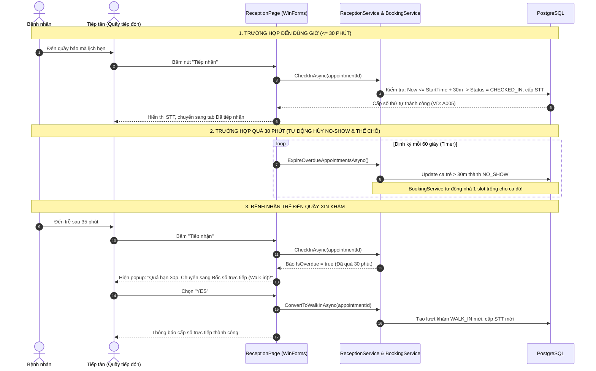

# BÁO CÁO THAY ĐỔI & TINH CHỈNH HỆ THỐNG (CHANGED.MD)

**Tính năng:** Cơ chế Check-in tại quầy, Tự động hủy quá hạn 30 phút (No-Show), Chuyển sang khám trực tiếp (Walk-in) & Tự động hồi phục Slot đặt lịch.  
**Ngày thực hiện:** 01/11/2026  
**Phạm vi:** `HIS.Domain`, `HIS.BLL`, `HIS.WinForms`

---

## 1. TỔNG QUAN YÊU CẦU NGHIỆP VỤ ĐÃ HIỆN THỰC

1. **Xác nhận có mặt (Check-in):** Nhân viên quầy tiếp nhận xác nhận bệnh nhân đã đến viện để chuyển trạng thái từ `CONFIRMED` / `PENDING` sang `CHECKED_IN` và cấp số thứ tự vào phòng khám.
2. **Tự động hủy sau 30 phút (Auto No-Show):** Nếu sau 30 phút so với giờ hẹn mà bệnh nhân chưa đến check-in, hệ thống tự động đánh dấu lượt khám là `NO_SHOW` (Không đến) và ghi lịch sử trạng thái.
3. **Chuyển sang bốc số trực tiếp (Walk-in) khi đến trễ:** Khi bệnh nhân đến trễ sau 30 phút, tiếp tân bấm tiếp nhận sẽ nhận được cảnh báo quá hạn kèm gợi ý: **"Chuyển sang bốc số khám trực tiếp"**. Nếu đồng ý, hệ thống tái sử dụng hồ sơ bệnh nhân cũ và cấp số thứ tự trực tiếp mới (`WALK_IN`).
4. **Giải phóng Slot trong cơ chế Đặt lịch (`BookingService`):** Khi một lịch hẹn bị hủy hoặc đánh dấu `NO_SHOW`, ca khám đó lập tức được nhả chỗ trống (Available) để bệnh nhân khác hoặc bệnh nhân khám trực tiếp có thể thế vào chỗ đó.
5. **Tiến trình quét ngầm định kỳ (Background Timer):** Tích hợp Timer chạy ngầm mỗi 1 phút trên màn hình tiếp nhận WinForms để tự động quét dọn các ca quá hạn và tự động làm mới giao diện.

---

## 2. CHI TIẾT CÁC FILE ĐÃ CHỈNH SỬA

### ① `HIS.Domain/Entities/Appointments/AppointmentStatus.cs`
* **Mục đích:** Bổ sung hằng số mã trạng thái `NoShow` và `Expired` vào lớp `AppointmentStatus.Codes` (khớp với seed data Id = 8, 9 trong CSDL).
* **Nội dung thay đổi:**
  ```csharp
  public static class Codes
  {
      public const string Pending = "PENDING";
      public const string Confirmed = "CONFIRMED";
      public const string CheckedIn = "CHECKED_IN";
      public const string InProgress = "IN_PROGRESS";
      public const string Completed = "COMPLETED";
      public const string Cancelled = "CANCELLED";
      public const string NoShow = "NO_SHOW";       // << MỚI THÊM
      public const string Expired = "EXPIRED";     // << MỚI THÊM
  }
  ```

---

### ② `HIS.BLL/Services/BookingService.cs`
* **Mục đích:** Hồi phục slot khám của Bác sĩ / Ca khám khi có bệnh nhân bị No-Show hoặc Expired.
* **Chi tiết:** 
  * Cập nhật 2 vị trí tính toán số lượng lịch đã đặt: hàm `GetActiveDepartmentsAsync()` (dòng 48) và `GetShiftsAsync()` (dòng 155).
  * **Trước:** Chỉ lọc `a.Status.Code != "CANCELLED"`.
  * **Sau:** Lọc loại trừ cả `CANCELLED`, `NO_SHOW` và `EXPIRED`:
  ```csharp
  && a.Status.Code != AppointmentStatus.Codes.Cancelled
  && a.Status.Code != AppointmentStatus.Codes.NoShow
  && a.Status.Code != AppointmentStatus.Codes.Expired
  ```
  *(Khi ca khám có người bị No-Show quá 30p, số chỗ trống `SlotsLeft` tự động tăng thêm 1).*

---

### ③ `HIS.BLL/Interfaces/IReceptionService.cs`
* **Mục đích:** Bổ sung chữ ký hàm và cờ nhận diện quá hạn cho tầng giao diện.
* **Chi tiết:**
  1. Mở rộng `ReceptionActionResult`:
     ```csharp
     public sealed record ReceptionActionResult(
         bool Success, 
         string Message, 
         string QueueNumber = "", 
         bool IsOverdue = false,          // << Cờ báo hiệu quá hạn 30 phút
         int? AppointmentId = null);      // << Mã lịch hẹn liên quan
     ```
  2. Bổ sung 2 phương thức nghiệp vụ mới:
     ```csharp
     Task<int> ExpireOverdueAppointmentsAsync(CancellationToken cancellationToken = default);
     Task<ReceptionActionResult> ConvertToWalkInAsync(int appointmentId, CancellationToken cancellationToken = default);
     ```

---

### ④ `HIS.BLL/Services/ReceptionService.cs`
* **Mục đích:** Xử lý toàn bộ logic nghiệp vụ quét hủy 30 phút, chặn check-in trễ và chuyển đổi sang Walk-in.
* **Chi tiết:**
  1. **Hiển thị No-Show ở Tab Đã hủy:**
     ```csharp
     private static readonly string[] CancelledCodes = { 
         AppointmentStatus.Codes.Cancelled, 
         AppointmentStatus.Codes.NoShow 
     };
     ```
  2. **Tự động quét dọn thời gian thực:**
     Gọi `await ExpireOverdueAppointmentsAsync(cancellationToken);` ngay đầu các hàm `GetCountsAsync()` và `GetReceptionListAsync()`.
  3. **Nâng cấp `CheckInAsync(appointmentId)`:**
     * Kiểm tra thời gian: nếu `DateTime.Now > appointmentTime.AddMinutes(30)`:
       * Tự động cập nhật `StatusId = NO_SHOW`.
       * Ghi log vào `AppointmentStatusHistory`.
       * Trả về kết quả: `Success = false`, `IsOverdue = true`, kèm thông báo quá giờ.
  4. **Thêm phương thức `ExpireOverdueAppointmentsAsync(...)`:**
     * Truy vấn tất cả lịch hẹn trong ngày hôm nay ở trạng thái `PENDING` hoặc `CONFIRMED`.
     * Điều kiện: `Slot.StartTime` (hoặc `CreatedAt`) + 30 phút < `DateTime.Now`.
     * Cập nhật đồng loạt sang trạng thái `NO_SHOW` và ghi lịch sử thay đổi.
  5. **Thêm phương thức `ConvertToWalkInAsync(appointmentId)`:**
     * Lấy lại thông tin bệnh nhân từ lịch hẹn trễ.
     * Tạo một lượt khám trực tiếp mới (`VisitType = "WALK_IN"`, `BookingChannel = "ON_SITE"`).
     * Cấp số thứ tự khám trong ngày (`QueueNumber`) mới.
     * Liên kết `ParentAppointmentId` để dễ dàng tra cứu nguồn gốc.

---

### ⑤ `HIS.WinForms/Pages/ReceptionPage.cs`
* **Mục đích:** Tương tác người dùng tại quầy tiếp nhận.
* **Chi tiết:**
  1. **Thêm Timer ngầm 60 giây (`_autoRefreshTimer`):**
     * Định kỳ mỗi 1 phút tự động gọi `ExpireOverdueAppointmentsAsync()`.
     * Nếu có ca bị quá hạn chuyển sang No-Show, tự động nạp lại danh sách (`ReloadAsync()`) và số đếm trên các Tab.
     * Hủy Timer khi đóng UserControl (`Disposed`).
  2. **Xử lý sự kiện bấm Tiếp nhận:**
     * Nếu đúng hạn: Tiếp nhận thành công $\rightarrow$ Hiển thị số thứ tự và chuyển sang tab "Đã tiếp nhận".
     * Nếu quá 30 phút: Hiện hộp thoại hỏi tiếp tân:
       > *"Lịch hẹn đã quá giờ hẹn hơn 30 phút. Hệ thống đã đánh dấu Vắng mặt (No-Show).*  
       > *Bạn có muốn chuyển bệnh nhân sang diện BỐC SỐ KHÁM TRỰC TIẾP (Walk-in) ngay bây giờ không?"*
     * Nếu bấm **Yes**: Gọi `ConvertToWalkInAsync` $\rightarrow$ Tự động cấp số Walk-in mới và chuyển ngay sang danh sách đã tiếp nhận.
  3. **Định dạng màu sắc trạng thái (`GridReceptions_CellFormatting`):**
     * Trạng thái `"Không đến"` (No-Show) và `"Đã hủy"` được hiển thị bằng màu đỏ cảnh báo (`Theme.Red`).
     * Trạng thái `"Đã check-in"` / `"Đã tiếp nhận"` hiển thị màu xanh lá (`Theme.Green`).

---

## 3. SƠ ĐỒ LUỒNG HOẠT ĐỘNG (WORKFLOW)



---

## 4. HƯỚNG DẪN KIỂM THỬ (TESTING GUIDE)

1. **Kiểm tra biên dịch và test:**
   * Chạy lệnh `dotnet build` $\rightarrow$ Đạt 0 Warning, 0 Error.
   * Chạy lệnh `dotnet test` $\rightarrow$ Toàn bộ Unit Test vượt qua thành công.
2. **Kiểm tra kịch bản Check-in đúng giờ:**
   * Đặt 1 lịch khám trên Web hoặc tạo sẵn lịch hẹn trong ngày hôm nay.
   * Mở WinForms $\rightarrow$ Tab **"Chờ tiếp nhận"** $\rightarrow$ Bấm nút "Tiếp nhận".
   * Kiểm tra số thứ tự được cấp và ca khám chuyển sang Tab **"Đã tiếp nhận"**.
3. **Kiểm tra kịch bản Quá hạn 30 phút:**
   * Tạo 1 lịch hẹn có `Slot.StartTime` lùi lại hơn 30 phút so với giờ hiện tại.
   * Sau 1 phút (hoặc bấm Làm mới), ca khám sẽ tự động biến mất khỏi Tab "Chờ tiếp nhận" và xuất hiện tại Tab **"Đã hủy"** với trạng thái **"Không đến"** (màu đỏ).
   * Kiểm tra trên Web đặt lịch: Ca khám đó đã được hồi phục lại thêm 1 chỗ trống.
4. **Kiểm tra bốc số trực tiếp lại (Walk-in):**
   * Tại quầy, bấm tiếp nhận ca trễ $\rightarrow$ Chọn Đồng ý chuyển sang khám trực tiếp $\rightarrow$ Kiểm tra lượt khám mới được sinh ra với thông tin cũ và STT mới.

---

## 5. ĐỢT SỬA LỖI SAU REVIEW (02/11/2026)

Phạm vi: chỉ sửa code, **không đổi cấu trúc database**.

### 5.1 Lỗi chặn — hẹn Web bị hủy oan sau 30 phút

* **Nguyên nhân:** `BookingService.CreateAppointmentAsync` chưa lưu `SlotId`, nên lượt đặt Web có `slot_id = NULL`. Mã cũ lấy `created_at` thay cho giờ hẹn (`ReceptionService.CheckInAsync` và `ExpireOverdueAppointmentsAsync`), khiến lượt vừa đặt lúc 14:00 cho ngày 04/11 bị coi là "quá hạn" từ 14:31.
* **Sửa:** bộ quét quá hạn và `CheckInAsync` **chỉ xét lượt có slot**; lượt chưa có giờ hẹn giữ nguyên trạng thái.

### 5.2 Luồng hồi phục bị khóa ở tab "Đã hủy"

* **Nguyên nhân:** nút thao tác chỉ hiện ở tab Chờ tiếp nhận, còn `ConvertToWalkInAsync` chỉ được gọi khi bấm đúng lúc. Sau khi timer kịp chuyển `NO_SHOW`, tiếp tân không còn cách nào cấp lại số.
* **Sửa:** tab "Đã hủy" nay hiển thị nút **"Bốc số lại"** cho các lượt `CANCELLED` / `NO_SHOW` / `EXPIRED` và gọi thẳng luồng cấp số trực tiếp.

### 5.3 `ConvertToWalkInAsync` siết lại nghiệp vụ

* Chống cấp trùng: nếu lượt gốc đã có lượt con `ParentAppointmentId` thì trả về số đã cấp, không sinh lượt mới.
* Chặn khi bệnh nhân **đã có ca khám hoàn thành trong ngày hôm nay** (đúng nghiệp vụ đã chốt).
* Bỏ việc chọn bừa phòng đầu tiên trong danh mục: không suy ra được phòng từ lượt gốc/slot thì báo rõ và hướng dẫn dùng "Tiếp nhận mới".
* Nếu lượt gốc vẫn còn ở trạng thái chờ (trường hợp CSDL chưa có `NO_SHOW`) thì đóng lượt gốc trong cùng transaction.

### 5.4 Chống trùng số thứ tự và giao dịch

* Thêm `LockQueueNumberAsync` dùng `pg_advisory_xact_lock` theo ngày, gọi trong cả ba đường cấp số: `CreateReceptionAsync`, `CheckInAsync`, `ConvertToWalkInAsync`.
* `CheckInAsync` và `ConvertToWalkInAsync` giờ chạy trong transaction tường minh (trước đây `SaveChangesAsync` đơn lẻ).
* Chuông `Timer` 60 giây thêm cờ chống chạy chồng (`_isSweepingOverdue`).

### 5.5 Sửa thông báo và dữ liệu tạm

* `CheckInAsync` chỉ báo "đã đánh dấu Vắng mặt" khi thực sự ghi được `NO_SHOW`; nếu CSDL thiếu trạng thái thì nói đúng thực tế.
* `ReloadAsync` khi lỗi sẽ **xóa danh sách cũ** thay vì để lại các dòng của lần tải trước; các `await` đều kiểm tra `IsDisposed/Disposing`.
* `BookingService.GetActiveDepartmentsAsync`: khôi phục cận trên `Slot.StartTime <= toDateTime` (trước đó chỉ còn cận dưới, tải toàn bộ tương lai).

### 5.6 Khôi phục các sửa giao diện bị mất khi chuyển sang bản Git

* `ReceptionPage.Designer.cs`: bảng dùng `AutoSizeColumnsMode = Fill` với trọng số cột đã tinh chỉnh, để cột THAO TÁC không bị che ở cửa sổ nhỏ.
* `NewReceptionDialog.Designer.cs` / `NewReceptionDialog.cs`: bỏ checkbox trong ô chọn ngày sinh, nút "Xóa nhập", giá trị ngày sinh mặc định dùng hằng `DefaultDateOfBirth`.

### 5.7 Repository

* `.gitignore` bổ sung `appsettings.json` (file chưa từng được track và đang chứa mật khẩu CSDL). `appsettings.Development.json` vẫn ignore; `HIS.Web`/`HIS.WebApi` appsettings đã track trước đó nên không bị ảnh hưởng.

### 5.8 Kiểm chứng đã chạy (không phải mô tả trong tưởng tượng)

* `dotnet build HIS.sln` → 0 Warning, 0 Error. `dotnet test` → 3/3 pass (chưa có unit test cho luồng mới).
* Kiểm chứng trên PostgreSQL `hospital_his` bằng dữ liệu tạm thật (đã xóa sạch sau khi đo: còn đúng 5 appointments, 18 slots, 0 history mồ côi):

| Kịch bản | Kết quả |
| --- | --- |
| Quét quá hạn: 1 lượt có slot bắt đầu 45 phút trước + 1 lượt Web không slot tạo 40 phút trước | Chỉ lượt có slot thành `NO_SHOW` (count = 1); lượt Web vẫn `CONFIRMED` |
| `CheckInAsync` lượt Web không slot | `Success = True`, cấp số `A001`, `IsOverdue = False` |
| `ConvertToWalkInAsync` lượt `NO_SHOW` | `Success = True`, cấp số `A002` |
| Gọi lần hai trên cùng lượt | `Success = False`, "đã được cấp số trực tiếp trước đó", không sinh lượt thứ hai |
| Bệnh nhân đã có ca `COMPLETED` trong ngày | `Success = False`, từ chối mở lượt thường mới |
| Lượt không suy ra được phòng khám | `Success = False`, không gán phòng bừa, 0 lượt Walk-in phát sinh sai |

* **Chưa kiểm chứng bằng giao diện thật:** các thay đổi ở tab "Đã hủy" (nút "Bốc số lại") và layout grid mới chỉ được xác nhận qua build, chưa chạy lại chụp màn hình WinForms.

### 5.9 Còn treo, cần quyết định trước khi làm tiếp

* Mốc 30 phút hiện vẫn tính từ **giờ slot tại quầy**, trong khi kế hoạch đã chốt là tính từ **lần bác sĩ gọi số đầu tiên không ai trả lời**; đồng thời đã chốt là **không có bước check-in riêng**. Phần này chỉ sửa được tận gốc khi lượt khám lưu được ngày/giờ và có bảng theo dõi gọi số.
* `appointment_slots.booked_count` **không** có code nào cập nhật (chỉ seed SQL), nên mục 4 ở phần cũ ("Slot được hồi phục") chỉ đúng với `SlotsLeft` do `BookingService` tự đếm từ bảng `appointments`; cột "Đã đặt" và bộ lọc còn trống của `SchedulingService.GetAvailableSlotsAsync` vẫn đọc `booked_count` nên chưa phản ánh đúng. Cần làm cùng đợt với việc gắn lịch Web vào slot.

---

## 6. ĐỢT CÂN CHỈNH THEO SPEC NHÓM — schema 33 bảng (03/11/2026)

Phạm vi: `HIS.Domain`, `HIS.DAL`, `HIS.BLL`, `HIS.Web`, `HIS.WebApi`, `HIS.WinForms` và **CSDL thật** `hospital_his`.
Khuôn chuẩn: `init.md` (bản 02/11) mục 5 — 33 bảng, id `appointment_statuses` theo spec, ràng buộc `ck_*`/`uq_*`/`fk_*`/`pk_*`.

### 6.1 Vì sao không dùng diff tự động của EF Core

`hospital_his` được dựng tay từ `init.md`, **không** do migration `20261015010838_InitialCreate` tạo ra, và không có bảng `__EFMigrationsHistory`. Vì vậy diff của EF so với `InitialCreate` sinh ra hàng trăm câu lệnh sai (thiếu `payments`, `insurance_cards`, `duty_shifts`; ép `timestamp with time zone`). Toàn bộ SQL align được **sinh từ `AppDbContextModelSnapshot.cs` đối chiếu trực tiếp với hiện trạng DB** bằng script `backup/align_plan.js`, rồi viết tay vào migration.

Kết quả đối chiếu máy móc: 30 PK rename, 50 FK rename, 14 unique index, 15 CHECK rename, 3 bảng mới, 12 cột thêm, 2 cột sửa kiểu, 2 cột bỏ, 8 đối tượng thừa cần xóa.

### 6.2 Cấu trúc DB sau align (`hospital_his` == `his_rehearsal`, khác nhau đúng 2 dòng dump-id ngẫu nhiên)

| Nhóm | Thay đổi |
| --- | --- |
| Bảng mới | `account_patient_profiles` (liên kết tài khoản ↔ hồ sơ, PK ghép), `queue_counters` (PK ghép 4 cột ngày/phòng/ca/kênh), `notifications` |
| `patients` | **bỏ** `account_id` (đã dồn sang `account_patient_profiles`) và `insurance_card_number` (nguồn chuẩn là `insurance_cards`) |
| `appointments` | thêm `booked_by`, `doctor_id`, `department_id`, `checked_in_at`, `called_at` |
| `doctor_schedules` | `day_of_week` 0–6 NOT NULL theo `System.DayOfWeek`, thêm `max_patients` (40), `online_slots` (28) + `ck_online_slots`; `shift` bỏ `EVENING` |
| `schedule_exceptions` | thêm `status` (PENDING/APPROVED/REJECTED), backfill `APPROVED` cho dòng đã có `approved_by` |
| Khác | `accounts.email`, `invoices.coverage_pct_applied`, `payments.receipt_email`, `access_logs.patient_id` |
| Tên ràng buộc | toàn bộ theo `init.md`: `ck_appointment_slots_capacity`, `uq_slot`, `uq_patient_slot_active`, `uq_link_self_account`, `uq_link_self_patient`, `idx_appointments_hold`… |
| FK | 61 FK đều `NO ACTION` (Restrict) — vòng lặp trong `AppDbContext.OnModelCreating` áp cho mọi quan hệ, kể cả 2 cấu hình từng khai báo `Cascade` |

### 6.3 Di trú dữ liệu (một chiều, đã chạy trên `hospital_his`)

* **Hoán vị id `appointment_statuses`**: DB cũ có 8 trạng thái với id lệch spec (3↔5 `IN_PROGRESS`, 4↔6 `COMPLETED`↔`CHECKED_IN`). Migration drop 3 FK trạng thái → cộng 1000 vào mọi id (cha và con) → xóa và chèn 10 dòng theo spec → re-point qua bảng tạm `_status_remap` → tạo lại FK → tạo index một phần. Cả 5 lượt khám và 6 dòng lịch sử vẫn giữ **đúng ý nghĩa** (bảng 6.5).
* `patients.account_id` → link `SELF` ACTIVE, `can_view_records = true`; hồ sơ `k` (bệnh nhân 4, tạo bởi tài khoản admin) thành link `OTHER` ACTIVE với `can_view_records = false`.
* 3 tài khoản tự sinh cho bệnh nhân (`bn26…`) không xóa mà chuyển thành link `SELF` + `accounts.is_active = false`, vì `appointments.booked_by` đang tham chiếu chúng.
* `booked_by` backfill từ `patients.account_id` của từng hồ sơ → không lượt nào NULL (gate số 5).

### 6.4 Kiểm chứng đã chạy (số liệu thật, không mô tả)

* `dotnet build HIS.sln` → **0 Warning, 0 Error**.
* `dotnet test` → **4/4 pass** trên `his_rehearsal` (có dòng hôm nay) và **4/4 pass** trên `hospital_his`.
* `backup/gate_align.sql` trên `hospital_his`: 10/10 `ok = true` — 33 bảng, 10 status đúng id spec, `patients` không còn 2 cột, 5 link hồ sơ, 0 lượt thiếu `booked_by`, 0 cột `timestamp with time zone`, `day_of_week` NOT NULL 0–6, 4 index một phần tồn tại, 0 FK Cascade.
* `pg_restore` bản dump `backup/hospital_his_20261103_225211.dump` vào DB tạm `his_restore_check` → 30 bảng / 5 appointments / 8 status → xác nhận đường lùi còn dùng được (DB tạm đã xóa).
* Migration rỗng `20261103173448_SanityCheck` + snapshot không đổi = bằng chứng cơ học "model == DB".
* HTTP `GET /api/appointments` trên `hospital_his` → 200, enum serialize dạng chuỗi UPPER_SNAKE, `bookedBy` đầy đủ.

### 6.5 Ý nghĩa trạng thái trước / sau khi remap

| id lượt | trước align | sau align |
| --- | --- | --- |
| 1 | `status_id=4` COMPLETED | `status_id=6` COMPLETED (Hoàn thành) |
| 2 | `status_id=2` CONFIRMED | `status_id=2` CONFIRMED |
| 4 | `status_id=2` CONFIRMED | `status_id=2` CONFIRMED |
| 5 | `status_id=6` CHECKED_IN | `status_id=3` CHECKED_IN (Đã check-in) |
| 6 | `status_id=6` CHECKED_IN | `status_id=3` CHECKED_IN |

### 6.6 Lệch có chủ đích so với spec (ghi để nhóm không hiểu nhầm)

1. Giữ `HIS.WebApi` + `HIS.WinForms` và DB `hospital_his`; BLL trả tuple/DTO thay vì `Result<T>`.
2. `roles` giữ **7** vai trò đang có (lễ tân ≠ y tá, thêm `DEPT_HEAD`) chứ không theo danh mục ít hơn trong spec.
3. Seed `HasData` cho `roles`/`service_types` khớp **DB đích**, không chép nguyên số lượng trong spec.
4. Chưa bật `TreatWarningsAsErrors`, chưa dùng `Directory.Packages.props` (Central Package Management).
5. Chưa làm: job hủy 14 ngày, màn bác sĩ gọi số + no-show 30 phút từ lần gọi, `hold_until` + worker, trang Thu ngân, `Notification` UI.
6. `capacity` của 18 slot cũ **không** backfill theo `online_slots` (giữ 1) vì các slot này đã sinh cố định; chỉ slot mới sinh theo `online_slots` ở mẻ chọn giờ.

### 6.7 Công cụ hỗ trợ trong `backup/` (đã ignore, không vào git)

* `align_plan.js` — sinh `backup/sql/{A..G}.sql` + `diff_report.txt` từ snapshot vs DB.
* `build_migration.js` — ghép `backup/sql/*` + các đoạn SQL viết tay thành `20261103165420_AlignToGroupSpec.cs`.
* `baseline_history.sql` — tạo `__EFMigrationsHistory` và ghi dòng `InitialCreate` trước khi `dotnet ef database update`.
* `seed_rehearsal_day.sql` — nạp 4 lượt khám hôm nay vào `his_rehearsal` để test chạy thật đường đọc của quầy.
* `db.sh` — gọi psql/pg_dump theo connection string trong appsettings mà không lộ mật khẩu.
* `gate_align.sql` — 10 kiểm tra gate.
* `winforms-smoke/` — app console tham chiếu `HIS.WinForms`, dựng `ReceptionPage` thật để đếm cột grid và tìm nút mới (không mở cửa sổ), dùng khi sửa `.Designer.cs`.

### 6.8 Mẻ 3 — hồ sơ N–N, quầy tiếp nhận và cấp số `queue_counters` (04/11/2026)

**BLL mới** (`src/HIS.BLL`)
* `Interfaces/IPatientProfileService.cs` + `Services/PatientProfileService.cs`: `CreateProfileAsync`, `RequestLinkAsync`, `VerifyLinkAsync`, `RevokeLinkAsync`, `GetLinksForAccountAsync`, `GetPendingLinksAsync` theo "cách A" — hồ sơ mới ⇒ link `ACTIVE` + `can_view_records = true`; xin liên kết hồ sơ đã có ⇒ `PENDING` + `false`, quầy duyệt. Một hồ sơ thuộc được nhiều tài khoản. Mọi ghi đều kèm `access_logs`.
* `Interfaces/IPatientAccessService.cs` + `Services/PatientAccessService.cs`: `CanBookAsync` (link `ACTIVE`/`PENDING`), `CanViewRecordsAsync` (`ACTIVE` ∧ `can_view_records`), `LogRecordAccessAsync` ghi `DENIED_<ACTION>` khi từ chối.
* Đăng ký DI: `HIS.WinForms/Program.cs`, `HIS.Web/Program.cs`.

**Quầy tiếp nhận** (`Services/ReceptionService.cs`)
* `CreateReceptionAsync` **không còn tự tạo tài khoản đăng nhập** cho bệnh nhân vãng lai; hồ sơ liên kết tài khoản phải đi qua `account_patient_profiles`. Ghi thêm `booked_by` = tài khoản quầy (`CreateReceptionRequest.OperatorAccountId`), `department_id`, `doctor_id`, `checked_in_at`.
* `CheckInAsync` / `ConvertToWalkInAsync` nhận `operatorAccountId`; `CheckInAsync` suy `room_id`/`department_id` từ slot, chỉ điền `booked_by` khi lượt chưa có ai đặt.
* `ExpireOverdueAppointmentsAsync` **chỉ quét lượt đã có `called_at`** — bỏ nhánh quét theo `slot.start_time` để không hủy oan lịch Web (màn gọi số là mẻ sau).
* Tab "Đã hủy" gồm `CANCELLED`, `NO_SHOW`, `EXPIRED` để dòng không biến mất khỏi mọi tab.
* Danh sách chiếu thêm `BookedByLabel` ("patient.nguyena (bệnh nhân)" / "td.tranthivan · Lễ tân" / "Chưa ghi nhận") và cờ `HasPendingLink`.

**Cấp số thứ tự** — `queue_counters` thay cho `pg_advisory_xact_lock` + đếm `COUNT(appointments)` (đã xóa `LockQueueNumberAsync`, `GenerateQueueNumberAsync`):
```sql
INSERT INTO queue_counters (queue_date, room_id, shift, channel, last_number)
VALUES (@queue_date, @room_id, @shift, @channel, 1)
ON CONFLICT (queue_date, room_id, shift, channel)
DO UPDATE SET last_number = queue_counters.last_number + 1
RETURNING last_number
```
Chạy bằng ADO.NET trên chính connection + transaction của `AppDbContext` (đảm bảo số chỉ có hiệu lực khi lượt khám commit; hai quầy cùng bấm thì PostgreSQL tự khóa dòng).

**Hai lỗi chỉ lộ ra khi chạy DB thật (đã sửa)**
1. `Database.SqlQueryRaw<QueueCounter>` báo *"The property 'QueueCounter.Room' … Navigations are not supported when using 'SqlQuery'"* ⇒ chuyển sang `DbCommand` + `ExecuteScalarAsync`, đồng thời đọc `Enum.IsDefined` qua `DbSet` để chắc chắn enum vẫn dịch đúng khi LINQ đọc bảng.
2. `LogAccess` gán `AccessLog.Patient = patient` cho hồ sơ **đã tồn tại** (tra về `AsNoTracking`) ⇒ EF coi bệnh nhân là bản ghi mới và `INSERT` vào `patients.id` là cột `GENERATED ALWAYS AS IDENTITY` ⇒ `428C9: cannot insert a non-DEFAULT value into column "id"`. Nay ghi `PatientId` cho hồ sơ cũ, chỉ dùng navigation khi hồ sơ vừa tạo trong cùng `SaveChanges`.

**WinForms**
* `ReceptionPage` thêm cột **ĐẶT BỞI** (grid Now 13 cột) và nút **Xác nhận liên kết hồ sơ** kèm badge số liên kết `PENDING`; nút ẩn khi trang chạy không có DB.
* `Dialogs/LinkApprovalDialog.cs`: danh sách chờ duyệt (tài khoản, hồ sơ, mã BN, ngày sinh, quan hệ, gửi từ, lượt hôm nay) ⇒ `VerifyLinkAsync` với `verified_by` = tài khoản đăng nhập.
* `MainForm` truyền `_session?.User?.AccountId` + `IPatientProfileService` xuống trang; `NewReceptionDialog` gửi `OperatorAccountId`.

**Kiểm chứng đã chạy (số liệu thật)**
* `dotnet build HIS.sln` ⇒ 0 Warning, 0 Error.
* `dotnet test` ⇒ **9/9 Passed trên `his_rehearsal`** và **9/9 Passed trên `hospital_his`**.
  * `QueueCounterNumberingTests`: 2 quầy bấm cùng lúc ⇒ `W01`, `W02`; 3 lượt liên tiếp ⇒ `W03, W04, W05`; counter đọc qua model = `room=1 Morning/OnSite last=5`.
  * `ReceptionCheckInPathTests`: lịch Web mồi chưa có số ⇒ check-in ra `O01` (đúng dãy của kênh WEB), `booked_by=10`, `checked_in_at` có, 1 dòng `appointment_status_history`, sweep trả 0 vì chưa gọi số.
  * `PatientProfileFlowTests`: tạo hồ sơ ⇒ `ACTIVE` + view=true; người thân xin liên kết ⇒ `PENDING` + view=false; quầy duyệt ⇒ `ACTIVE`, `verified_by=10`; xin SELF lần hai ⇒ bị chặn `uq_link_self_account`; `access_logs` = `CREATE_PROFILE, LINK_REQUEST, LINK_VERIFY`.
* `backup/gate_align.sql` chạy lại trên `hospital_his` sau Mẻ 3 ⇒ **10/10** (33 bảng, 10 status đúng id spec, 5 link, 0 `booked_by` thiếu, 4 partial index, 0 FK cascade).
* Dọn dữ liệu test: `hospital_his` vẫn `patients=5, appointments=5, links=5, history=6`, không còn dòng `HIS-TEST%`; chỉ `queue_counters` tăng (`MORNING/ON_SITE=15`) vì bộ đếm không hoàn tác.

**Chưa kiểm chứng bằng chuột thật**: toàn bộ thay đổi WinForms mới được xác minh qua build + smoke dựng control (`backup/winforms-smoke`), chưa bấm thử trên GUI.


### 6.9 Nạp dữ liệu demo vào `hospital_his` để bấm thử WinForms (04/11/2026)

`hospital_his` trước đó có 16 slot hôm nay nhưng **0 lượt hẹn** và **0 liên kết chờ duyệt**, nên mở quầy sẽ thấy trống. Đã nạp mồi (không đổi cấu trúc bảng):

| Script | Nội dung |
| --- | --- |
| `backup/seed_rehearsal_day.sql` | 4 lượt `HIS-SEED-*` (CONFIRMED / CHECKED_IN / CANCELLED hôm nay, FUTURE ngày mai) + 2 slot `2026-11-05`, rồi tính lại `booked_count`/`status` cho slot từ hôm nay |
| `backup/seed_demo_pending_link.sql` | 1 liên kết `PENDING` (tài khoản 8 `patient.tranb` → bệnh nhân 1, `OTHER`, `can_view_records=false`) + log `LINK_REQUEST` |
| `backup/seed_demo_shift_slot.sql` | Dời `HIS-SEED-CONFIRMED` sang slot còn trống **muộn hơn now()+30′** để bấm check-in ra số `O##` thay vì bị quét `NO_SHOW` |
| `backup/unseed_demo.sql` | Dọn sạch 4 lượt mồi + lịch sử trạng thái + link demo + log, xóa 2 slot seed (chỉ khi trống) và tính lại `booked_count` |

**Bẫy gặp phải khi dời slot:** sub-`SELECT` của câu `UPDATE` **không nhìn thấy** thay đổi do CTE data-modifying gây ra trong cùng một lệnh (cùng snapshot) ⇒ lần chạy đầu cho `07:30 booked_count=1` (stale) và `09:45 booked_count=0`. Đã tách thành 2 câu lệnh riêng; chạy lại cho kết quả đúng.

**Kiểm chứng bằng query thật trên `hospital_his`**
* 4 lượt mồi: `HIS-SEED-CONFIRMED` BN1 *Nguyễn Văn An* — Đã xác nhận — `O01` — WEB — slot `11-04 09:45` — `booked_by=7`; `HIS-SEED-CHECKEDIN` BN2 — Đã check-in — `O02` — ON_SITE — `07:45` — `booked_by=8` — `checked_in_at` có; `HIS-SEED-FUTURE` BN4 — `11-05 07:30`; `HIS-SEED-CANCELLED` BN6 — Đã hủy — không slot.
* Slot hôm nay: chỉ `07:45` và `09:45` là `FULL booked_count=1`, 14 slot còn lại `AVAILABLE booked_count=0` — khớp số lượt đang giữ chỗ.
* Link demo: `account 8 → patient 1, OTHER, PENDING, can_view_records=f, created_by=8`; `access_logs` có đúng 1 dòng `LINK_REQUEST`.
* `backup/gate_align.sql` chạy lại sau khi nạp ⇒ **10/10** (33 bảng, 10 status đúng id, 6 link, 0 `booked_by` thiếu, 4 partial index, 0 FK cascade) — seed không làm lệch schema.
* Số dư sau seed: `patients=5, appointments=9, links=6, history=6, slots=20`; `queue_counters` = `MORNING/ON_SITE=25`, `MORNING/WEB=2` ⇒ số kế tiếp là `W26`/`O03`, không đụng `O01`/`O02` đã mồi.

**Chưa kiểm chứng:** lần này chỉ xác minh ở tầng dữ liệu. Phần harness gọi thẳng `ReceptionService` để in ra đúng những gì lưới hiển thị đã bị dừng giữa chừng (build chưa chạy xong), nên **chưa có bằng chứng GUI** — cần bấm thật trên WinForms.

---

### 6.10 Mẻ 3b — bỏ `queue_counters`, đánh số theo vị trí khung giờ A/T (04–05/11/2026)

**Lý do đổi:** cách cũ cấp số từ bộ đếm tăng dần theo kênh (`O01`, `W26`) nên số không nói gì về giờ khám, hai kênh chạy song song thành hai dãy vô nghĩa, và `CancelCutoffMinutes = 120` cứng khiến mọi lượt hủy trong 2 giờ cuối bị chặn hẳn thay vì tính là hủy trễ. Cơ chế mới binding theo đúng nghiệp vụ đã chốt: khung 60 phút, chỉ tiêu suất của khung chia theo tỷ lệ online, số là **vị trí** chứ không phải bộ đếm.

**Cơ chế số (nguồn sự thật: `init.md` mục 7 + `DomainExtensions.cs`)**

| Đại lượng | Công thức |
| --- | --- |
| `capacity` của khung | `max(1, slot_duration_minutes / doctors.avg_consultation_minutes)` — khung 60′, khám 12′ ⇒ 5 suất; khám 15′ ⇒ 4 suất |
| `online_quota` | `round(capacity × online_ratio_pct / 100)` (AwayFromZero) — 5 suất @60% ⇒ 3A + 2T; 4 suất ⇒ 2A + 2T |
| `slot_position` | `1..online_quota` = suất A (web), `online_quota+1..capacity` = suất T (tại quầy) |
| `queue_number` | `tiền tố + (tổng capacity các khung **cùng phòng, cùng ngày, cùng ca** bắt đầu sớm hơn + slot_position)`, pad 2 chữ số ⇒ `A06`, `T09`. Một dãy liên tục trong ca nên không bao giờ trùng số |
| Mốc cắt | `start_time − ReleaseCutoffMinutes (10′)`; qua mốc mà lượt WEB chưa check-in thì suất A bị giải phóng thành suất T |

**Schema / DAL**
* Bỏ entity `QueueCounter` + bảng `queue_counters` ⇒ **32 entity / 32 bảng** (`33 → 32`).
* Migration `20261104144910_QueuePositionNumbering` (tập dượt trên `his_rehearsal` trước, sau đó mới chạy lên `hospital_his`):
  * `doctor_schedules`: thêm `online_ratio_pct INT NOT NULL DEFAULT 60` + `ck_doctor_schedules_online_ratio (0..100)`, `slot_duration_minutes` mặc định `15 → 60`, **xóa** `max_patients` và `online_slots`.
  * `appointment_slots`: thêm `online_quota INT NOT NULL DEFAULT 3` + `ck_online_quota (online_quota <= capacity)`, `online_booked INT NOT NULL DEFAULT 0` + `ck_online_booked (online_booked <= online_quota AND online_booked <= booked_count)`.
  * `appointments`: thêm `slot_position INT NULL CHECK (>= 1)`, `overtaken_count INT NOT NULL DEFAULT 0 CHECK (0..3)`; `priority_level` siết `0..3 → 0..2`; partial index `uq_slot_position ON (slot_id, slot_position) WHERE slot_position IS NOT NULL AND status_id = ANY(ARRAY[1,2,3,4,5])`.
  * `appointment_status_history`: thêm `is_late_cancel BOOLEAN NOT NULL DEFAULT false` + partial index `idx_history_cancel (performed_by, changed_at) WHERE is_late_cancel`.
  * `accounts`: thêm `booking_blocked_until TIMESTAMP NULL`, `no_show_reset_at TIMESTAMP NULL`.

**BLL**
* `Options/BookingOptions.cs` thay toàn bộ thông số: `OnlineRatioPct=60, ReleaseCutoffMinutes=10, MaxOvertakeAhead=3, MaxTimesOvertaken=3, FreeCancelHours=24, MaxLateCancelsPerMonth=1, BookingBlockDays=45, PriorityChildUnderAge=6, PrioritySeniorFromAge=70, MaxNoShowsBeforeBlock=3, NoShowWindowDays=90`, `ValidateOnStart` từng giá trị. **Không còn** `CancelCutoffMinutes`, `DefaultMaxPatients`, `DefaultOnlineSlots`.
* `Services/QueuePositionAllocator.cs` (mới): `AssignOnlineAsync` / `AssignOnSiteAsync` / `ReleaseExpiredOnlinePositionsAsync` / `ReleaseSeat` — cấp vị trí, tăng `booked_count` + `online_booked` trong một lần `SaveChanges`, quét giải phóng suất A đã quá mốc của cả phòng trong ngày.
* `Services/QueueCallOrder.cs` (mới, hàm thuần): dựng thứ tự gọi số — theo giờ khung, trong cùng khung thì mức 1 được gọi trước,
  rồi đến `slot_position`; mức 2 không đảo thứ tự trong khung mà chen lên trước tối đa `MaxOvertakeAhead` người đang chờ
  và dừng khi gặp một lượt ưu tiên khác hoặc người đã bị chen đủ `MaxTimesOvertaken` lần.
* `SchedulingService`: sinh slot theo công thức capacity/quota ở trên, `OnlineRatioPct` của ca được ưu tiên, suy ra từ `avg_consultation_minutes` của **cả bác sĩ chính và bác sĩ thay thế**; vòng sinh khung dừng khi `TimeOnly` quấn qua nửa đêm.
* `BookingService`: `CancelAppointmentAsync` trả chỗ (kể cả `online_booked`) theo đúng kênh, ghi `is_late_cancel` khi hủy trong `FreeCancelHours`, chặn lần hủy trễ thứ 2 trong cùng tháng dương lịch; `CreateAppointmentAsync` từ chối khi `booking_blocked_until > now`.
* `ReceptionService`: `AssignStaffPriorityAsync` (mức 2) chỉ chen tối đa `MaxOvertakeAhead` người đang chờ và bỏ qua người đã bị chen `MaxTimesOvertaken` lần, cộng `overtaken_count` cho người bị vượt; check-in trễ mốc cắt thì xếp lại thành suất T trống cuối ca; cấp cứu (`IsEmergency`) không bốc số, không giữ suất.

**Hai lỗi chỉ lộ ra khi chạy DB thật (đã sửa)**
1. `AssignOnlineAsync` truyền **`slot.StartTime`** làm giờ để quét giải phóng thay vì giờ hiện tại ⇒ mọi lượt web vừa đặt bị coi là quá hạn và bị thu hồi ngay lần đặt kế tiếp trong phòng (triệu chứng thật: khung báo "giữ 1 suất trước khi hủy" thay vì 2). Sửa bằng cách bơm `TimeProvider` vào constructor `QueuePositionAllocator` và dùng `Now`.
2. `AssignStaffPriorityAsync` gọi `InDay(..., now)` thay vì `InDay(..., Today)` ⇒ hàng đợi bị cắt từ giờ hiện tại, các khung đã chạy trong buổi sáng (vẫn còn người chờ) bị loại, báo sai "Lượt HIS-TEST-… không nằm trong hàng đợi của phòng này".

**Tests — `dotnet test tests/HIS.Tests` trên `his_rehearsal`: 46/46 Passed (trước mẻ này 20/20)**
* `QueuePositionsTests` (unit, không DB): bảng chia suất `(5,60)→3`, `(4,60)→2`, `(3,60)→2`, `(8,50)→4`, `(1,60)→1`, `(5,0)→0`, `(5,100)→5`, `(4,150)→4`, `(0,60)→0`; vòng kiểm `quota ≤ capacity` cho 12×101 cặp; `ShiftNumber` 0+1=1, 0+5=5, 5+1=6, 5+5=10 ⇒ dãy liên tục; định dạng `A01/A06/T04/T08`; `ExamShifts` cắt ở 12:00.
* `SchedulingServiceTests`: ca 22:00→23:59 sinh đúng 1 khung (capacity 3, quota 2); ca 20:00→01:00 sinh 0 khung (không quấn nửa đêm, không spin vô hạn).
* `SlotConstraintTests` (integration, 4 ca, mỗi ca tự tạo `clinic_rooms` riêng tên `TEST-…` để không ăn chỗ dữ liệu demo, tự xóa khi xong):
  * `ck_online_booked`: `online_booked=3` với quota 2 ⇒ **23514**; `booked_count=0, online_booked=1` ⇒ **23514**.
  * `uq_slot_position`: hai lượt **còn hiệu lực** cùng `(slot_id, vị trí 3)` ⇒ **23505**; cùng vị trí đó nhưng một lượt `CANCELLED` ⇒ **chấp nhận** (đúng bộ lọc partial).
  * `priority_level=2` chấp nhận, `=3` ⇒ **23514**.
  * Hai quầy bốc suất cuối: log thật in ra `Quầy A: T04 | lỗi không lỗi` / `Quầy B: không có chỗ | lỗi 23505` / `Khung #118 giữ 4/4 suất, booked_count = 4, vị trí: 1, 2, 3, 4` ⇒ đúng một lượt thắng, bất biến cuối kỳ giữ đúng.
* `BookingPolicyPathTests` (integration, chạy với đồng hồ `FixedTimeProvider` ngày 05/11 10:15):
  * Hủy muộn: `is_late_cancel = true`, `slot_position` trả `NULL`, `booked_count` giảm 2→1; lần thứ hai trong tháng bị từ chối — "Tháng này bạn đã dùng hết 1 lần hủy muộn (trong vòng 24 giờ trước giờ khám)…".
  * Đủ 3 vắng mặt: `booking_blocked_until = 20/12/2026 10:15`, `no_show_reset_at = 05/11/2026 10:15`, `CreateAppointmentAsync` ném "Tài khoản đang bị chặn đặt lịch mới đến hết ngày 20/12/2026 do đã đủ 3 lần vắng mặt. Đăng nhập và xem lịch sử vẫn bình thường."
  * Ưu tiên mức 2: "Đã gán ưu tiên cho 6 (số T16), vượt lên trước 3 người: T15, T14, T13", `overtaken_count` của 3 người = 1, thứ tự gọi `T16, T13, T14, T15`.
* Các lớp integration dùng chung CSDL đánh dấu `[Collection("RehearsalPostgres")]` để chạy tuần tự (trước đó bị `23505 uq_slot` vì hai lớp cùng tạo khung 10:07 cho một bác sĩ).

**Seed / gate / demo data**
* `backup/gate_align.sql` nâng lên **16 check** (32 bảng, 8 cột mới, 5 CHECK mới, `uq_slot_position`, `idx_history_cancel`, `slot_duration=60`/`online_ratio=60`, dữ liệu slot không vi phạm quota) ⇒ **16/16 đạt trên cả `his_rehearsal` và `hospital_his`**.
* `backup/seed_rehearsal_day.sql` viết lại theo A/T (trước đây ghi cứng `O01`/`O02`), dùng `current_date` nên chạy được cho cả hai DB và chạy lại nhiều lần.
* `backup/unseed_demo.sql` viết lại: dọn theo `HIS-SEED-%` + `notifications`, xóa đúng 4 khung do seed tạo (phòng 1/bác sĩ 1, 07:30–10:30 hôm nay và ngày mai, chỉ khi không còn lượt giữ), tính lại **cả `booked_count` lẫn `online_booked`** theo đúng vị từ của `ck_online_booked`.
* `backup/seed_demo_shift_slot.sql` viết lại cho demo buổi chiều: chỉ dời khi khung hiện tại đã qua mốc cắt 10′, chọn khung còn mở web có vị trí A trống, ghi lại `slot_position` + `queue_number` theo dãy liên tục.
* `BookingPolicyPathTests` và `SlotConstraintTests` tự tạo `clinic_rooms` riêng (mã `TEST-…`, xóa khi xong) vì thuật toán cấp số quét giải
  phóng suất A của **cả phòng trong ngày** — đặt khung test vào phòng 1 thì ăn mất chỗ `A01` của dữ liệu demo.
  `ReceptionCheckInPathTests` vẫn mượn phòng 1 nên **mỗi lần chạy xong phải `seed_rehearsal_day.sql` lại**; sau lần chạy 46/46 gần nhất,
  `HIS-SEED-CONFIRMED` mất `slot_position` đúng như mô tả và seed đã khôi phục (`A01`/vị trí 1), residue = 0 (`HIS-TEST%`, `HIS-TSTC%`,
  phòng `TEST-%`, khung 10:07/10:37/10:47, tài khoản bị chặn đều còn 0).
* Tập dượt vòng tròn trên `his_rehearsal`: unseed (`con_lai=0`, 28 slot được tính lại) → seed → `A01/vị trí 1`, `T03/vị trí 3`, `HIS-SEED-FUTURE A01` ngày mai, khung 07:30 `booked_count=2 / online_booked=1` → shift lần 1 **không dời** (khung 07:30 còn mở web, đúng mong đợi) → lùi khung 07:30 về trước mốc cắt rồi chạy shift lần 2 ⇒ lượt demo nhảy sang khung 08:30, `slot_position=1`, số **`A05`** (tổng capacity khung trước = 4 + 1).
* Nạp lại demo vào `hospital_his` lúc 00:28 ngày 05/11 (đã `pg_dump` trước: `backup/hospital_his_20261105_002822.dump`): 4 lượt `HIS-SEED-*` hôm nay/ngày mai đúng A/T. `HIS-SEED-CANCELLED` **không bị xóa** vì còn là `parent_appointment_id` của `HIS-20261104-Y0549X` — đúng kịch bản bảo vệ dữ liệu thật trong script.

**WinForms**
* `Pages/ReceptionPage.Designer.cs`: thêm cột **ƯU TIÊN** giữa SỐ TT và ĐẶT BỞI ⇒ lưới 14 cột; giá trị lấy từ `ReceptionItemDto.PriorityLabel` ("Bình thường" / "Trẻ em / người cao tuổi" / "Nhân viên chỉ định ưu tiên"); cột "ĐÃ BỊ VƯỢT" không thêm vì `overtaken_count` là nội bộ, nghiệp vụ chen đã có trong `ReceptionService`.
* `ReceptionPage.cs`: cột mới vào `Rows.Add` và vào tiêu đề + dòng CSV ("… ,Số thứ tự,Ưu tiên,Đặt bởi,…").
* `Dialogs/NewReceptionDialog.Designer.cs`: ghi chú hộp thoại đổi thành "Số A = suất đã đặt web, số T = bốc tại quầy, cấp sau khi lưu. / Cấp cứu không bốc số, đưa thẳng vào buồng bệnh. / …".
* `dotnet build src/HIS.WinForms` ⇒ 0 Warning, 0 Error. Harness `backup/winforms-smoke` dựng control thật của trang Tiếp đón in ra:
  `grid = gridReceptions, cột = 14`, header `… | THỜI GIAN | SỐ TT | ƯU TIÊN | ĐẶT BỞI | TRẠNG THÁI | THAO TÁC`,
  thêm một dòng đúng 14 giá trị OK, `btnVerifyLinks` vẫn tìm thấy (Visible=False vì harness chạy không có DB).

**`init.md`** — mục 4 (33 → 32 entity, bỏ `QueueCounter`), mục 5 (DDL `accounts`/`doctor_schedules`/`appointment_slots`/`appointments`/`appointment_status_history` + xóa bảng `queue_counters` + 2 index một phần mới) và mục 7 (thông số `BookingOptions` mới, thuật toán bốc số/giải phóng/ưu tiên/hủy/chặn) đã ghi theo thông số chốt; mục 9 bổ sung 4 ca test (i)–(l).

**Chưa kiểm chứng / còn treo**
* **Nhãn số sau khi giải phóng suất A:** `ReleaseSeat` trả `slot_position` về `NULL` nhưng **không xóa `queue_number`**, nên lượt WEB bị thu
  chỗ vẫn hiện `A01` trên lưới tới khi check-in (lúc đó mới nhận số `T##`). Cần quyết định: xóa số ngay khi trả suất (lưới hiện `—`),
  hay giữ cho bệnh nhân nhìn thấy số cũ trên web. Chưa đổi vì đụng hiển thị phía người bệnh (Mẻ 4).
* Toàn bộ thay đổi WinForms mới xác minh bằng build, **chưa bấm chuột thật** trên lưới 14 cột.
* `TreatWarningsAsErrors` vẫn tắt theo yêu cầu; các knob `HoldMinutes`, `MaxLinkRequestsPerDay`, `PendingLinkExpiryDays`, `SlotGenerationDaysAhead`, `CheckInEarlyMinutes` trong spec **chưa có trong code** (đánh dấu rõ trong `init.md` mục 7, chờ Mẻ 4–5).
* `backup/` (gate, seed, slotgen, dump) đang gitignore ⇒ không vào git; `ix_appointment_status_history_performed_by` bị EF xóa ở một lần chạy trước, đã được gate kiểm tra lại.
* **Mẻ 1 → 3b đã commit** `5c2ff9f`, Mẻ 4–5 commit `e930ada` — cả hai **chưa push** lên `origin/main`.

## 7. MẺ 4–5 — WEB CHỌN GIỜ + ĐĂNG NHẬP DEMO + NHIỀU HỒ SƠ, TEST/CI/TÀI LIỆU (05/11/2026)

Phạm vi: `HIS.BLL`, `HIS.Web`, `HIS.WebApi`, `tests/`, `.github/workflows/ci.yml`, `docs/` và CSDL thật `hospital_his`.
File tracked thay đổi: **27 file, +932/−395 dòng** (`git diff --stat`), cộng 12 path mới (controllers, views, docs, tests).

### 7.1 `HIS.Web` — wizard 5 bước, đăng nhập demo, trang lịch khám

| File | Nội dung |
| --- | --- |
| `Helpers/DemoSession.cs` *(mới)* | lưu tài khoản đăng nhập vào `HttpContext.Session` key `DemoAccount`. **Chủ đích không dùng Cookie Authentication** — module đăng nhập thuộc thành viên khác (xem `docs/DECISIONS.md` #8) |
| `Controllers/AccountController.cs` *(mới)* | `Login` GET/POST (`[ValidateAntiForgeryToken]`, gọi `AuthService.LoginAsync` thật: BCrypt + khóa sau 5 lần sai), `Logout`. Redirect chỉ nhận `Url.IsLocalUrl(returnUrl)` |
| `Controllers/PatientPageController.cs` *(mới)* | base class: `AccountId` đọc từ session, `RequireAccount()` đưa về trang login kèm `returnUrl`. Mọi controller bệnh nhân chỉ xin `AccountId` từ đây |
| `Controllers/BookingController.cs` | bỏ hẳn `CurrentAccountId = 1` và 2 key session tạm (`ExtraProfilesKey`, `BookedKeysKey`); chuyển sang wizard 5 bước `ChonKhoa → ChonNgayCa → ChonGio → ChonNguoiKham → XacNhan`; `Guard(state, throughStep)` chặn nhảy bước; hồ sơ lấy từ `IPatientProfileService.GetLinksForAccountAsync(AccountId)` (lọc `REVOKED`), `IsBookable` = link `ACTIVE`/`PENDING`; nhãn quan hệ lấy từ enum thay vì hardcode |
| `Views/Booking/ChonGio.cshtml` *(mới)* | bước chọn **giờ cụ thể** (7:00, 7:30, 8:00 …) thay vì chỉ chọn ca; mỗi khung hiện số ghế web còn lại |
| `Controllers/LichKhamController.cs` *(mới)* | danh sách lịch theo `booked_by` + nút hủy; `ThanhCong.cshtml:65` hết `href="#"` chết, trỏ về `/LichKham` |
| `Program.cs` | `AddSession`, `AddSingleton(TimeProvider.System)`, đăng ký `IAuthService` + `QueuePositionAllocator` |

### 7.2 `HIS.BLL` — một nguồn chỗ trống duy nhất

* `CreateAppointmentAsync(accountId, patientId, slotId)`: **xóa** thuật toán tự tính sức chứa bằng `COUNT(appointments)`; nguồn chỗ trống duy nhất là `ISchedulingService.GetAvailableSlotsAsync`. Trừ ghế nguyên tử `UPDATE appointment_slots … WHERE booked_count < capacity AND version = @version`, kiểm tra số dòng bị ảnh hưởng rồi mới ghi lượt khám trong cùng transaction.
* `CancelAppointmentAsync(appointmentId, accountId)`: nhả `booked_count`/`online_booked`, trả `slot_position` về `NULL`, ghi `appointment_status_history`.
* `GetAppointmentsByAccountAsync(accountId)`: lịch theo tài khoản đặt (kèm hồ sơ link `ACTIVE`/`PENDING`).
* `AppointmentStateMachine.cs` *(mới)* + test: hàm thuần định nghĩa các bước chuyển trạng thái hợp lệ theo `init.md:584-590`.

### 7.3 Kiểm chứng bằng chuột thật trên CSDL thật (`hospital_his`, không mock)

| Bước | Kết quả quan sát được |
| --- | --- |
| Mở `/LichKham` khi chưa đăng nhập | tự redirect về trang Đăng nhập (guard `RequireAccount`) — hết cảnh trang bệnh nhân mở tự do |
| Đăng nhập `patient.nguyena` | vào được wizard; `accounts.id = 7` |
| Đặt cho hồ sơ **mới tạo** (vợ, `patients.id = 40`) | link `SPOUSE / ACTIVE / can_view_records=true` — đúng "cách A": hồ sơ mới tạo thì dùng ngay, không phải chờ quầy |
| Đặt khung 08:30 ngày 06/11 | `HIS-20261106-SG1RN3`, `slot_position=1`, số **`A05`** = tổng `capacity` khung đi trước (07:30 = 4) + 1 ✓ |
| Đặt cùng hồ sơ, cùng khung đã đặt | bị chặn (`uq_patient_slot_active`), web báo không đặt trùng được |
| Ghế web tụt theo | khung 08:30: `capacity=4, online_quota=2, booked_count=1, online_booked=1` ✓ |
| Hủy `HIS-20261106-JRSB7S` (khung 09:30) trên `/LichKham` | `status_id 2→7`, `is_late_cancel=false`, `performed_by=7`; khung 09:30 về `booked_count=0, online_booked=0`, `slot_position` bị nhả ✓ |
| Trang Lịch khám | hiện đúng 4 lượt của tài khoản 7 (bao gồm cả `HIS-SEED-*`), đủ giờ/phòng/bác sĩ/trạng thái |
| Đăng xuất rồi mở lại `/Booking` | bị chặn về login ✓ |

Ràng buộc kiểm bằng psql: `account_patient_profiles` có 8 link, trong đó tài khoản 7 = `SELF(patient 1)` + `SPOUSE(patient 40)` — một tài khoản hai hồ sơ, đúng thứ mà `patients.account_id UNIQUE` trước đây chặn.

### 7.4 Mẻ 5 — test, CI, tài liệu

* `dotnet build HIS.sln` → **0 Warning, 0 Error**.
* `dotnet test --filter "Category!=Integration"` → **56/56 pass** (unit, không cần DB).
* `dotnet test --filter "Category=Integration"` → **11/11 pass** trên DB Postgres thật (`his_ci`) qua `HIS_REHEARSAL_CONNECTION`.
* `bash backup/ci_local.sh` (mô phỏng đúng job `integration`): dựng `docs/database/ci/schema.sql` → seed `demo_master.sql` + `demo_day.sql` → gate `schema_checks.sql` → **16/16 đạt**.
* `dotnet ef migrations has-pending-model-changes` → **không drift** (model == migration snapshot).
* `.github/workflows/ci.yml`: tách 2 job — `build` (windows-latest, unit) và `integration` (ubuntu-latest + service `postgres:16`: schema → seed → gate 16 check → integration → `has-pending-model-changes`).
* Tài liệu mới: `docs/ARCHITECTURE.md` (sơ đồ project thật, quy tắc BẤT BIẾN, từng tầng, DB/migration, test, CI), `docs/DECISIONS.md` (16 quyết định, ⚠️ đánh dấu 7 chỗ lệch `init.md` có chủ đích), `docs/database/erd.md` (Mermaid 32 entity / 60 quan hệ / 34 CHECK, sinh từ dump của `his_ci`), `docs/database/schema-reference.sql` (DDL tham chiếu chép từ `init.md` mục 5 + 3 delta), `global.json` (SDK 10, `rollForward: latestFeature`).

### 7.5 Còn treo sau Mẻ 4–5

* Nhãn số sau khi giải phóng suất A vẫn giữ `A##` cũ tới lúc check-in (xem mục "Chưa kiểm chứng" của đợt 3b) — cần nhóm quyết hiển thị.
* WinForms mới xác minh bằng build + harness, **chưa bấm chuột thật** trên lưới 14 cột.
* Trang `LichKham` chỉ hiện lịch sử khám + trạng thái theo quyết định #11; `CanViewRecordsAsync` và `access_logs.patient_id` đã có nhưng chưa màn nào dùng.
* `hold_until` + 3 `BackgroundService`, `Notification` UI, màn bác sĩ gọi số, trang Thu ngân: mẻ sau (`docs/DECISIONS.md` #15).
* `src/HIS.Web/appsettings.json` và `src/HIS.WebApi/appsettings.json` đang tracked và chứa mật khẩu Postgres dev — chưa sửa vì làm gãy máy đồng nghiệp, cần cả nhóm chốt (`docs/DECISIONS.md` #16).

### 7.6 Dọn `backup/` (24 file thừa đã xóa)

`backup/` là đồ nghề local (đang gitignore, không vào git). Đã xóa hết thứ **chỉ dùng một lần** hoặc **đã bị bản đã commit thay thế**:

| Đã xóa | Lý do |
| --- | --- |
| `db_*.txt`, `inv_*.txt`, `pre_align_*.txt` (11 file) | output kiểm kê schema/trạng thái trước align; `information_schema` + 3 file `.dump` cùng thời điểm đã chứa đúng dữ liệu đó |
| `fresh_schema.sql`, `ci_static.raw.sql`, `ci_static.err` | bản nháp của DDL, nay đã là `docs/database/ci/schema.sql` (bản thật) |
| `snapshot_before_sanity.cs` | copy `AppDbContextModelSnapshot.cs` để so diff một lần |
| `plan_rename.js`, `rename_constraints.sql`, `rename_report.txt` | kết quả rename ràng buộc đã nằm trong migration `AlignToGroupSpec` và `backup/sql/` |
| `check_mile4.sql`, `.gate_summary.sql`, `.schema_inventory.sql` | câu truy vấn/chẩn đoán tạm khi kiểm Mẻ 4 |
| `demologin/*/bin`, `slotgen/*/bin`, `winforms-smoke/*/bin` (+ `obj`) | build artifact, dựng lại bằng `dotnet run` |

**Còn giữ** (và là thứ đồng nghiệp có thể dùng luôn): `db.sh` (psql không lộ mật khẩu), `dump.sh` (dump/restore), `ci_local.sh` (mô phỏng job `integration`), `gate_align.sql` (16 check trên DB thật), `baseline_history.sql` + `sql/A…G*.sql` (các bước align, được `AlignToGroupSpec.cs` dẫn lại), `seed_demo_*` / `seed_rehearsal_day` / `unseed_demo` (nạp & dọn dữ liệu demo), `demologin.sh` (đặt lại mật khẩu tài khoản demo), `slotgen.sh` + `winforms-smoke/` (2 harness đã được Changed.md dẫn làm bằng chứng), 3 file `hospital_his_*.dump` (đường lùi). `align_plan.js` / `build_migration.js` giữ vì là nguồn sinh ra SQL của migration viết tay.
