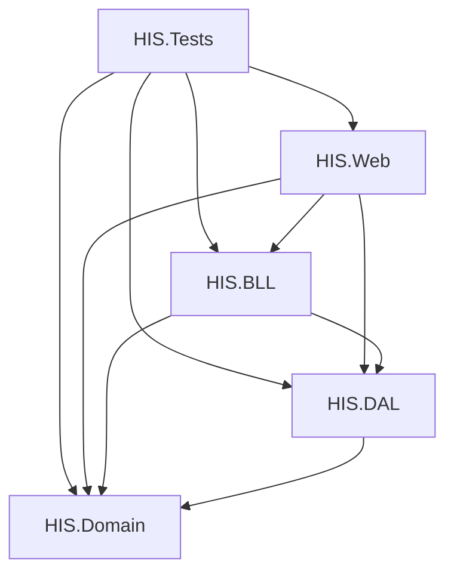

# Kiến trúc hệ thống HIS

## 1. Sơ đồ phụ thuộc giữa các dự án

## 2. Quy tắc bất biến
1. **Phụ thuộc một chiều**:
   - `HIS.Domain` không tham chiếu bất kỳ dự án nào.
   - `HIS.DAL` chỉ tham chiếu `HIS.Domain`.
   - `HIS.BLL` tham chiếu `HIS.DAL` và `HIS.Domain`. Không được dùng các thư viện `Microsoft.AspNetCore.*` hoặc `HttpContext` (giữ tính độc lập để có thể gắn WinForms/WPF sau này).
   - `HIS.Web` tham chiếu `HIS.BLL`, `HIS.DAL`, `HIS.Domain`. `HIS.Web` tham chiếu `HIS.DAL` chỉ để đăng ký Dependency Injection (Composition Root).
2. **Nguồn sự thật dữ liệu**:
   - EF Core Migration là nguồn sự thật duy nhất của cơ sở dữ liệu trên PostgreSQL.

