# Sơ đồ quan hệ (ERD) của CSDL HIS

Sinh từ `docs/database/ci/schema.sql` — ảnh chụp "model => schema" của `AppDbContext` + `Configurations/`,
tức là đúng schema mà job `integration` trong `.github/workflows/ci.yml` đang dựng (32 bảng,
không tính `__EFMigrationsHistory`, 244 cột, 60 FK, 32 PK — PK ghép thấy ở cuối file).
DDL nguyên văn theo spec nhóm nằm cùng thư mục: `schema-reference.sql`. Khi hai bên lệch nhau,
migration trong `src/HIS.DAL/Migrations` là nguồn sự thật — lý do xem `docs/DECISIONS.md`.

Quy ước cạnh:

- `||--o{` một–nhiều, FK bắt buộc; `|o--o{` một–nhiều, FK nullable (cha được phép để trống).
- `||--||` / `|o--o|` một–một: cột FK có index UNIQUE không điều kiện, ví dụ `doctors.account_id`,
  `invoices.appointment_id` (ràng buộc UNIQUE của spec đã đổi thành index nên không hiện là UNIQUE).
- Index một phần (`uq_link_self_account`, `uq_patient_slot_active`, `uq_slot_position`, `idx_appointments_hold`,
  `idx_history_cancel`) **không** phải ràng buộc UNIQUE nên không hiện ở đây; kiểm tra số 8 của
  `docs/database/ci/schema_checks.sql` đếm chúng.

```mermaid
erDiagram
    accounts ||--o{ access_logs : "account_id"
    medical_records |o--o{ access_logs : "medical_record_id"
    patients |o--o{ access_logs : "patient_id"
    accounts ||--o{ account_patient_profiles : "account_id"
    accounts |o--o{ account_patient_profiles : "created_by"
    patients ||--o{ account_patient_profiles : "patient_id"
    accounts |o--o{ account_patient_profiles : "verified_by"
    roles ||--o{ accounts : "role_id"
    doctors ||--o{ appointment_slots : "doctor_id"
    clinic_rooms ||--o{ appointment_slots : "room_id"
    appointments ||--o{ appointment_status_history : "appointment_id"
    appointment_statuses ||--o{ appointment_status_history : "new_status_id"
    appointment_statuses |o--o{ appointment_status_history : "old_status_id"
    accounts |o--o{ appointment_status_history : "performed_by"
    accounts |o--o{ appointments : "booked_by"
    departments |o--o{ appointments : "department_id"
    doctors |o--o{ appointments : "doctor_id"
    appointments |o--o{ appointments : "parent_appointment_id"
    patients ||--o{ appointments : "patient_id"
    clinic_rooms |o--o{ appointments : "room_id"
    appointment_slots |o--o{ appointments : "slot_id"
    appointment_statuses ||--o{ appointments : "status_id"
    departments ||--o{ clinic_rooms : "department_id"
    accounts ||--|| department_heads : "account_id"
    departments ||--|| department_heads : "department_id"
    doctors ||--o{ doctor_schedules : "doctor_id"
    clinic_rooms ||--o{ doctor_schedules : "room_id"
    accounts ||--|| doctors : "account_id"
    departments ||--o{ doctors : "department_id"
    accounts ||--o{ duty_shifts : "account_id"
    accounts |o--o{ duty_shifts : "assigned_by"
    departments ||--o{ duty_shifts : "department_id"
    insurance_plans ||--o{ insurance_cards : "insurance_plan_id"
    patients ||--o{ insurance_cards : "patient_id"
    invoices ||--o{ invoice_items : "invoice_id"
    appointments ||--|| invoices : "appointment_id"
    insurance_cards |o--o{ invoices : "insurance_card_id"
    insurance_plans |o--o{ invoices : "insurance_plan_id"
    patients ||--o{ invoices : "patient_id"
    medical_records ||--o{ lab_orders : "medical_record_id"
    services ||--o{ lab_orders : "service_id"
    lab_orders ||--|| lab_results : "order_id"
    accounts |o--o{ lab_results : "performed_by"
    appointments ||--|| medical_records : "appointment_id"
    doctors ||--o{ medical_records : "doctor_id"
    accounts ||--o{ notifications : "account_id"
    appointments |o--o{ notifications : "appointment_id"
    accounts ||--|| nurses : "account_id"
    departments |o--o{ nurses : "department_id"
    accounts |o--o{ payments : "cashier_id"
    invoices ||--o{ payments : "invoice_id"
    medications ||--o{ prescription_items : "medication_id"
    prescriptions ||--o{ prescription_items : "prescription_id"
    medical_records ||--o{ prescriptions : "medical_record_id"
    accounts |o--o{ schedule_exceptions : "approved_by"
    doctors ||--o{ schedule_exceptions : "doctor_id"
    doctors |o--o{ schedule_exceptions : "replacement_doctor_id"
    service_types ||--o{ services : "service_type_id"
    appointments ||--|| vital_signs : "appointment_id"
    nurses ||--o{ vital_signs : "recorded_by"

    access_logs {
        int id PK
        int account_id FK
        int patient_id FK
        int medical_record_id FK
        varchar action
        timestamp occurred_at
        varchar ip_address
    }

    account_patient_profiles {
        int account_id PK,FK
        int patient_id PK,FK
        varchar relationship
        varchar status
        boolean can_view_records
        int created_by FK
        int verified_by FK
        timestamp verified_at
        timestamp created_at
    }

    accounts {
        int id PK
        varchar username
        varchar email
        varchar password_hash
        int role_id FK
        boolean is_active
        int failed_login_count
        timestamp locked_until
        timestamp booking_blocked_until
        timestamp no_show_reset_at
        timestamp created_at
        timestamp updated_at
    }

    appointment_slots {
        int id PK
        int doctor_id FK
        int room_id FK
        timestamp start_time
        timestamp end_time
        int capacity
        int booked_count
        int online_quota
        int online_booked
        varchar status
        int version
    }

    appointment_status_history {
        int id PK
        int appointment_id FK
        int old_status_id FK
        int new_status_id FK
        int performed_by FK
        timestamp changed_at
        boolean is_late_cancel
    }

    appointment_statuses {
        int id PK
        varchar code
        varchar name
        int sort_order
        boolean is_terminal
    }

    appointments {
        int id PK
        varchar appointment_code
        int patient_id FK
        int booked_by FK
        int slot_id FK
        int doctor_id FK
        int department_id FK
        int room_id FK
        int status_id FK
        varchar booking_channel
        varchar visit_type
        int priority_level
        int slot_position
        int overtaken_count
        boolean has_health_insurance
        boolean has_private_insurance
        varchar queue_number
        varchar reason
        timestamp hold_until
        timestamp checked_in_at
        timestamp called_at
        int parent_appointment_id FK
        timestamp created_at
        timestamp updated_at
    }

    clinic_rooms {
        int id PK
        int department_id FK
        varchar room_name
        varchar room_number
    }

    department_heads {
        int id PK
        int account_id FK
        int department_id FK
        varchar full_name
    }

    departments {
        int id PK
        varchar name
        varchar description
    }

    doctor_schedules {
        int id PK
        int doctor_id FK
        int room_id FK
        int day_of_week
        varchar shift
        time without time zone start_time
        time without time zone end_time
        int slot_duration_minutes
        int online_ratio_pct
        date effective_from
        date effective_to
        boolean is_active
    }

    doctors {
        int id PK
        int account_id FK
        int department_id FK
        varchar full_name
        varchar specialty
        varchar license_number
        int avg_consultation_minutes
    }

    duty_shifts {
        int id PK
        int account_id FK
        int department_id FK
        timestamp start_time
        timestamp end_time
        varchar note
        int assigned_by FK
        timestamp created_at
    }

    insurance_cards {
        int id PK
        int patient_id FK
        varchar card_number
        int insurance_plan_id FK
        varchar registered_facility
        boolean is_registered_here
        date valid_from
        date valid_to
        boolean is_active
        timestamp created_at
    }

    insurance_plans {
        int id PK
        varchar name
        numeric coverage_pct
        varchar referral_type
    }

    invoice_items {
        int id PK
        int invoice_id FK
        varchar category
        varchar description
        numeric amount
    }

    invoices {
        int id PK
        int appointment_id FK
        int patient_id FK
        int insurance_plan_id FK
        int insurance_card_id FK
        numeric coverage_pct_applied
        numeric total_amount
        numeric insurance_covered_amount
        numeric patient_amount
        varchar status
        timestamp created_at
    }

    lab_orders {
        int id PK
        int medical_record_id FK
        int service_id FK
        varchar note
        varchar status
        timestamp created_at
    }

    lab_results {
        int id PK
        int order_id FK
        text result
        int performed_by FK
        timestamp recorded_at
    }

    medical_records {
        int id PK
        int appointment_id FK
        int doctor_id FK
        text symptoms
        text clinical_examination
        varchar primary_diagnosis_code
        varchar primary_diagnosis_desc
        text secondary_diagnosis
        text conclusion
        timestamp created_at
        timestamp updated_at
    }

    medications {
        int id PK
        varchar name
        varchar active_ingredient
        varchar strength
        varchar unit
        numeric price
        boolean is_active
    }

    notifications {
        int id PK
        int account_id FK
        int appointment_id FK
        varchar title
        text content
        boolean is_read
        timestamp created_at
    }

    nurses {
        int id PK
        int account_id FK
        int department_id FK
        varchar full_name
    }

    patients {
        int id PK
        varchar full_name
        date date_of_birth
        varchar gender
        varchar national_id
        varchar phone_number
        varchar address
        varchar email
        timestamp created_at
    }

    payments {
        int id PK
        int invoice_id FK
        numeric amount
        varchar payment_type
        varchar payment_method
        int cashier_id FK
        varchar receipt_email
        varchar note
        timestamp paid_at
    }

    prescription_items {
        int id PK
        int prescription_id FK
        int medication_id FK
        varchar dosage
        int quantity
        int duration_days
        varchar usage_instructions
    }

    prescriptions {
        int id PK
        int medical_record_id FK
        date prescribed_date
        varchar note
    }

    roles {
        int id PK
        varchar code
        varchar name
        varchar description
    }

    schedule_exceptions {
        int id PK
        int doctor_id FK
        date date
        varchar shift
        varchar type
        varchar status
        int replacement_doctor_id FK
        varchar reason
        int approved_by FK
        timestamp approved_at
        timestamp created_at
    }

    service_types {
        int id PK
        varchar code
        varchar name
    }

    services {
        int id PK
        varchar name
        int service_type_id FK
        numeric price
        boolean is_active
    }

    vital_signs {
        int id PK
        int appointment_id FK
        int pulse
        int systolic_bp
        int diastolic_bp
        numeric temperature
        int respiratory_rate
        int spo2
        numeric weight
        numeric height
        int recorded_by FK
        timestamp recorded_at
    }
```

## Ràng buộc CHECK (34 ràng buộc trên 14 bảng)

Tên theo mẫu `ck_<bảng>_<cột>`; erDiagram không diễn đạt được CHECK nên liệt kê ở đây.

| Bảng | CHECK |
|---|---|
| `account_patient_profiles` | `ck_account_patient_profiles_relationship: CHECK ((relationship IN ('SELF', 'SPOUSE', 'CHILD', 'PARENT', 'SIBLING', 'OTHER')))` `ck_account_patient_profiles_status: CHECK ((status IN ('ACTIVE', 'PENDING', 'REVOKED')))` `ck_link_adult_records_consent: CHECK (((can_view_records = false) OR (relationship IN ('SELF', 'CHILD')) OR (verified_by IS NOT NULL)))` `ck_link_pending_no_records: CHECK (((status = 'ACTIVE') OR (can_view_records = false)))` `ck_link_self_not_pending: CHECK ((NOT ((relationship = 'SELF') AND (status = 'PENDING'))))` |
| `accounts` | `ck_accounts_email_lower: CHECK (((email IS NULL) OR (email = lower(email))))` |
| `appointment_slots` | `ck_appointment_slots_capacity: CHECK ((booked_count <= capacity))` `ck_appointment_slots_status: CHECK ((status IN ('AVAILABLE', 'FULL', 'BLOCKED')))` `ck_online_booked: CHECK (((online_booked <= online_quota) AND (online_booked <= booked_count)))` `ck_online_quota: CHECK ((online_quota <= capacity))` |
| `appointments` | `ck_appointments_booking_channel: CHECK ((booking_channel IN ('WEB', 'ON_SITE')))` `ck_appointments_overtaken_count: CHECK (((overtaken_count >= 0) AND (overtaken_count <= 3)))` `ck_appointments_priority_level: CHECK (((priority_level >= 0) AND (priority_level <= 2)))` `ck_appointments_slot_position: CHECK ((slot_position >= 1))` `ck_appointments_visit_type: CHECK ((visit_type IN ('SCHEDULED', 'WALK_IN')))` |
| `doctor_schedules` | `ck_doctor_schedules_day_of_week: CHECK (((day_of_week >= 0) AND (day_of_week <= 6)))` `ck_doctor_schedules_online_ratio: CHECK (((online_ratio_pct >= 0) AND (online_ratio_pct <= 100)))` `ck_doctor_schedules_shift: CHECK ((shift IN ('MORNING', 'AFTERNOON')))` |
| `duty_shifts` | `ck_duty_time: CHECK ((end_time > start_time))` |
| `insurance_cards` | `ck_insurance_dates: CHECK ((valid_to >= valid_from))` |
| `insurance_plans` | `ck_insurance_plans_referral_type: CHECK (((referral_type IS NULL) OR (referral_type IN ('IN_NETWORK', 'OUT_OF_NETWORK'))))` |
| `invoice_items` | `ck_invoice_items_category: CHECK ((category IN ('EXAMINATION', 'MEDICATION', 'SERVICE')))` |
| `invoices` | `ck_invoices_coverage_pct_applied: CHECK (((coverage_pct_applied IS NULL) OR ((coverage_pct_applied >= (0)) AND (coverage_pct_applied <= (100)))))` `ck_invoices_status: CHECK ((status IN ('UNPAID', 'PARTIALLY_PAID', 'PAID')))` |
| `lab_orders` | `ck_lab_orders_status: CHECK ((status IN ('PENDING', 'COMPLETED')))` |
| `patients` | `ck_patients_gender: CHECK (((gender IS NULL) OR (gender IN ('MALE', 'FEMALE', 'OTHER'))))` |
| `payments` | `ck_payments_amount: CHECK ((amount > (0)))` `ck_payments_payment_method: CHECK ((payment_method IN ('CASH', 'BANK_TRANSFER')))` `ck_payments_payment_type: CHECK ((payment_type IN ('DEPOSIT', 'PAYMENT', 'REFUND')))` |
| `schedule_exceptions` | `ck_exception_approved: CHECK (((status <> 'APPROVED') OR ((approved_by IS NOT NULL) AND (approved_at IS NOT NULL))))` `ck_exception_replacement: CHECK (((replacement_doctor_id IS NULL) OR (replacement_doctor_id <> doctor_id)))` `ck_schedule_exceptions_shift: CHECK (((shift IS NULL) OR (shift IN ('MORNING', 'AFTERNOON'))))` `ck_schedule_exceptions_status: CHECK ((status IN ('PENDING', 'APPROVED', 'REJECTED')))` `ck_schedule_exceptions_type: CHECK ((type IN ('LEAVE', 'TRAINING', 'SURGERY', 'SHIFT_SWAP')))` |

## Khóa chính

32 bảng; 1 bảng dùng khóa ghép (còn lại là `id int` `GENERATED ALWAYS AS IDENTITY`):

- `account_patient_profiles` : (`account_id`, `patient_id`)

